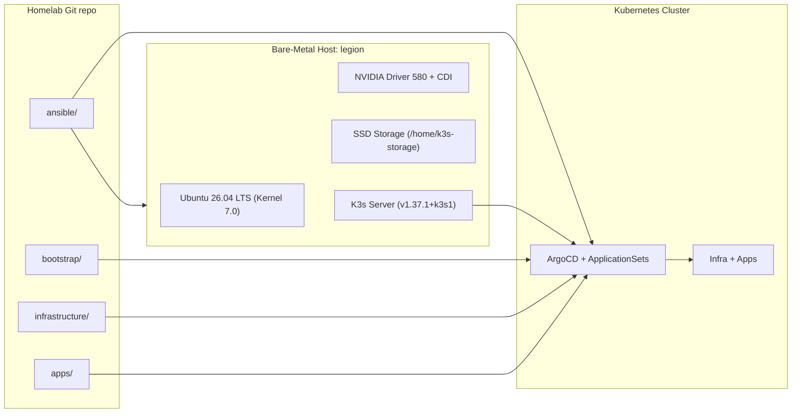
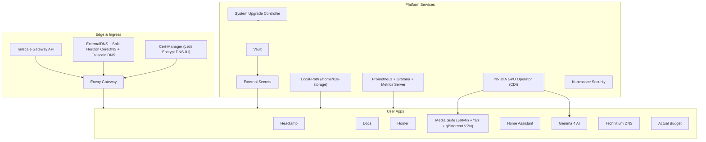
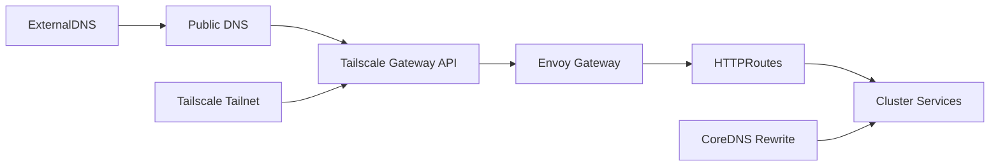

# Homelab

A self-hosted bare-metal Kubernetes cluster on Ubuntu 26.04 LTS (node `legion`). It runs K3s `v1.37.1+k3s1`. Ansible bootstraps the node and ArgoCD, and ArgoCD manages everything else through GitOps.

- Ansible playbooks configure the bare-metal host after you install Ubuntu, the NVIDIA driver, and Tailscale
- Tailscale gives secure ingress and Envoy Gateway routes the traffic. Vault and External Secrets keep the credentials
- Local SSD storage uses the K3s Local-Path Provisioner on `/home/k3s-storage`
- The NVIDIA GPU Operator `v26.7.2` gives the NVIDIA GTX 1050 Ti to workloads through the Container Device Interface (CDI)
- The Rancher System Upgrade Controller upgrades K3s from a `Plan` in Git, without cordoning or draining the node
- ArgoCD applies all infrastructure and user applications from this repository through GitOps

## Table of contents

- [Features](#features)
- [Architecture](#architecture)
  - [Core systems map](#core-systems-map)
  - [Platform services map](#platform-services-map)
  - [Network topology](#network-topology)
- [Quick start](#quick-start)
  - [Automated bare metal bring-up](#automated-bare-metal-bring-up)
- [Documentation](#documentation)
- [Repository layout](#repository-layout)
- [Applications](#applications)
- [GitOps model](#gitops-model)
- [Operations](#operations)
- [Maintainers](#maintainers)

## Features

- Single-node bare-metal K3s Kubernetes `v1.37.1+k3s1` on node `legion` with Flannel CNI (worker joins are not automated yet)
- Ansible playbooks for host preparation, runtime configuration, and cluster bootstrap
- NVIDIA GPU Operator `v26.7.2` with Container Device Interface (CDI) for GTX 1050 Ti transcoding
- Rancher System Upgrade Controller `v0.20.2` for declarative K3s upgrades
- ArgoCD ApplicationSets that manage the infrastructure and apps through GitOps
- Tailscale Gateway API ingress with split-horizon DNS
- Vault and External Secrets Operator for central secret management
- Local SSD storage on `/home/k3s-storage` through the Local-Path Provisioner
- Prometheus monitoring stack with Alertmanager and Grafana
- Telegram alerts through @ManassuHomelabBot from Alertmanager, Grafana, and AI assistants
- Media automation stack (Prowlarr, Sonarr, Radarr, Bazarr, Seerr) sharing `jellyfin-media` storage for instant atomic hardlinks
- qBittorrent isolated inside a Gluetun WireGuard VPN sidecar with an iptables firewall killswitch and zero-seeding limits
- Personal finance tracking with Actual Budget and AI transaction classification
- Local AI inference with Google Gemma 4 (E2B) on the NVIDIA GTX 1050 Ti through llama.cpp
- A Gmail classifier that sorts mail each day and sends Telegram summaries
- A symmetrical Google Drive organizer that classifies documents and copies joint documents to the partner's folder
- AI jobs call Claude Haiku 5.5 (`anthropic:claude-haiku-5-5`) first, then OpenRouter `google/gemma-4-31b-it`, then the local Gemma 4 E2B model (`packages/homelab-ai/kustomize/kustomization.yaml`). Email, document, and transaction text goes to Anthropic first
- Automatic container image updates with ArgoCD Image Updater
- Envoy Gateway data plane for the Kubernetes Gateway API
- Kubescape operator for automatic cluster security scans

## Architecture

### Core systems map



### Platform services map



### Network topology



## Quick start

### Automated bare metal bring-up

Make sure that the target machine `legion` runs Ubuntu and has SSH and sudo access. Then run this command from your workstation:

```bash
./scripts/provision.sh
```

To use the new cluster, run these commands:

```bash
export KUBECONFIG=$PWD/k3s.kubeconfig
kubectl get nodes -o wide
kubectl get pods -A
kubectl get apps -n argocd
```

## Documentation

The full documentation website is at [homelab.sudhanva.me](https://homelab.sudhanva.me). The documentation source files are in `docs/` and use Astro Starlight.

To build the documentation locally, run these commands:

```bash
cd docs
bun install
bun run dev
```

Main guides:

- From scratch installation: [Build K3s Cluster from Scratch](https://homelab.sudhanva.me/how-to/from-scratch/)
- Media automation & VPN: [Media Automation and WireGuard VPN Stack](https://homelab.sudhanva.me/how-to/media-automation/)
- Media VPN architecture: [Media VPN and Storage Architecture](https://homelab.sudhanva.me/explanation/media-vpn-architecture/)
- Secrets management: [HashiCorp Vault Secrets Management](https://homelab.sudhanva.me/how-to/vault/)
- Persistent storage: [Local-Path Storage Architecture](https://homelab.sudhanva.me/explanation/storage-architecture/)
- Version matrix: [Component Version Matrix](https://homelab.sudhanva.me/reference/versions/)
- Applications catalog: [Applications Catalog Reference](https://homelab.sudhanva.me/reference/applications/)
- Tailnet as code: [Manage Tailscale with Terraform](https://homelab.sudhanva.me/how-to/tailscale-terraform/)

## Repository layout

```bash
ansible/          Ansible playbooks, roles, and inventory for bare-metal setup
bootstrap/        ArgoCD bootstrap and ApplicationSet definitions
infrastructure/   Platform components managed by ArgoCD
apps/             User workloads managed by ArgoCD
packages/         Shared monorepo libraries (e.g. homelab-ai)
terraform/        Terraform for the Tailscale tailnet (policy, DNS, settings, device tags)
scripts/          Automation and verification scripts
docs/             Astro Starlight documentation
```

## Applications

| App | Purpose | Hostname |
| --- | --- | --- |
| Docs | Documentation site for cluster guides | `homelab.sudhanva.me`, `docs.sudhanva.me` |
| Headlamp | Kubernetes UI that signs in with a ServiceAccount token, with metrics | `headlamp.sudhanva.me` |
| Homer | Home dashboard with service shortcuts | `home.sudhanva.me` |
| Jellyfin | Media streaming with NVIDIA GPU acceleration | `jellyfin.sudhanva.me` |
| Filebrowser | File manager for persistent media volumes | `filebrowser.sudhanva.me` |
| qBittorrent | BitTorrent client isolated behind Gluetun WireGuard VPN | `qbittorrent.sudhanva.me` |
| Prowlarr | Torrent indexer manager and proxy | `prowlarr.sudhanva.me` |
| Sonarr | Television series collection automation | `sonarr.sudhanva.me` |
| Radarr | Movie collection automation | `radarr.sudhanva.me` |
| Bazarr | Automated subtitle download manager | `bazarr.sudhanva.me` |
| Seerr | Media discovery and request interface | `seerr.sudhanva.me` |
| Actual Budget | Privacy-focused personal finance tracking | `actual.sudhanva.me` |
| Technitium DNS | Recursive DNS server with ad blocking, the global tailnet nameserver | `dns.sudhanva.me` |
| Home Assistant | Smart home automation platform | `homeassistant.sudhanva.me` |
| Gemma 4 AI | Local LLM inference on NVIDIA GPU | `ai.sudhanva.me` |
| Gmail Classifier | Daily email sorting and Telegram summary for each account, plus a weekly mark-read job | CronJobs (01:00 and 01:15 America/Los_Angeles) |
| Drive Organizer | Symmetrical family document organizer | CronJobs (02:00 and 02:15 America/Los_Angeles) |
| Actual Classifier | Daily bank transaction categorization in Actual Budget | CronJob (03:00 America/Los_Angeles) |
| Alert Summarizer | Alertmanager webhook that summarizes alerts with the AI model chain and posts them to Telegram | Deployment (no HTTPRoute) |
| ArgoCD | GitOps control plane UI | `argocd.sudhanva.me` |
| Vault | Central secrets management | `vault.sudhanva.me` |
| Grafana | Metrics dashboards | `grafana.sudhanva.me` |
| Prometheus | Metrics collector and query engine | `prometheus.sudhanva.me` |
| Alertmanager | Alert routing and notifications | `alertmanager.sudhanva.me` |

## GitOps model

ArgoCD uses ApplicationSets to apply all items in `infrastructure/` and `apps/`. After the initial bootstrap, avoid manual `kubectl apply`.

To add an app, do these steps:

- Step 1: Create `apps/<app>/app.yaml`. This file sets the ArgoCD app name, path, and namespace
- Step 2: Add the Kubernetes manifests in the same folder
- Step 3: If you want Image Updater to write overrides, add `kustomization.yaml`

## Operations

To do a routine check of the cluster health, run these commands:

```bash
export KUBECONFIG=$PWD/k3s.kubeconfig
kubectl get nodes -o wide
kubectl get pods -A
kubectl get apps -n argocd
```

Before you push code changes, run this command:

```bash
pre-commit run --all-files
```

## Maintainers

- [Sudhanva Narayana](https://sudhanva.me)
- [Maanasa Narayan](https://maanasanarayan.github.io)
