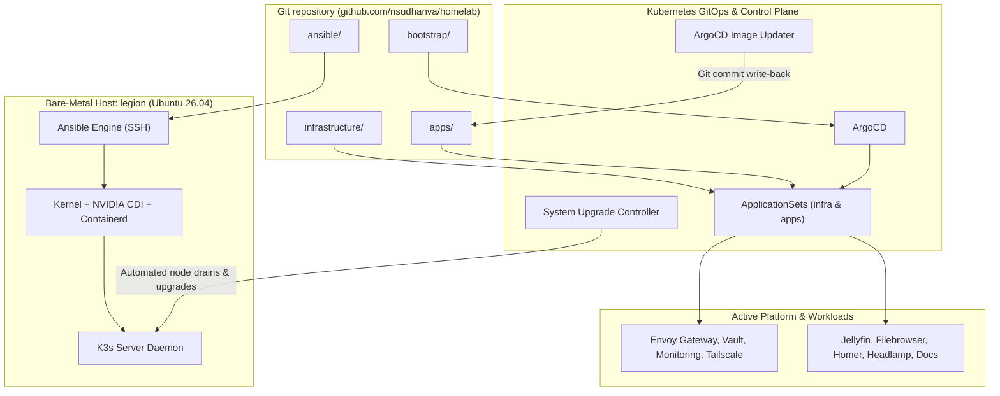

# Automation Model

This repository uses 100% infrastructure-as-code and GitOps automation. Each layer of the homelab is declarative. A control loop automates each layer:

- **Ansible Automation (`ansible/`)**: Installs the bare-metal Ubuntu hosts, the kernel parameters, the container runtime with NVIDIA CDI, and the initial K3s bootstrap.
- **ArgoCD GitOps Engine (`bootstrap/`, `infrastructure/`, `apps/`)**: Continuously reconciles all cluster infrastructure and user applications against git HEAD.
- **Rancher System Upgrade Controller (`infrastructure/system-upgrade-controller/`)**: Does rolling K3s upgrades declaratively through Kubernetes Custom Resources (`Plan`).
- **ArgoCD Image Updater (`infrastructure/argocd-image-updater/`)**: Scans container registries and commits updated image tags back to git automatically.



## Layer 1: Host and Control Plane Automation (Ansible)

The Ansible roles can make the same host configuration again at any time:

- `ansible/roles/common/`: Installs OS packages, loads kernel modules (`overlay`, `br_netfilter`), sets the sysctl network values, and prepares `/home/k3s-storage`.
- `ansible/roles/nvidia/`: Configures the NVIDIA Container Toolkit and makes the CDI specifications (`/etc/cdi/nvidia.yaml`).
- `ansible/roles/k3s_server/`: Deploys the K3s server with these flags (`default-runtime: "nvidia"`, `default-local-storage-path: "/home/k3s-storage"`).
- `ansible/roles/argocd/`: Installs the ArgoCD control plane and applies `bootstrap/root.yaml`.

## Layer 2: In-Cluster Declarative GitOps (ArgoCD)

ArgoCD is the main reconcile loop. The root application `bootstrap/root.yaml` creates two ApplicationSets:

- `infra-appset.yaml`: Watches each directory in `infrastructure/*` and makes one `infra-<component>` application for each.
- `apps-appset.yaml`: Finds the application definitions in `apps/*/app.yaml` and deploys the workloads into their target namespaces.

Both ApplicationSets use automatic pruning and self-healing:

```yaml
syncPolicy:
  automated:
    prune: true
    selfHeal: true
```

## Layer 3: Automated Lifecycle & Image Updates

- **System Upgrade Controller**: Removes the need for manual node patches. When you set a new K3s version tag in `k3s-upgrade-plan.yaml`, the controller does these steps: node cordon, drain, in-place binary upgrade, and uncordon.
- **Image Updater**: Monitors upstream semantic tags or digests. It examines the container registries on a schedule and pushes Git commits back to `master`.
