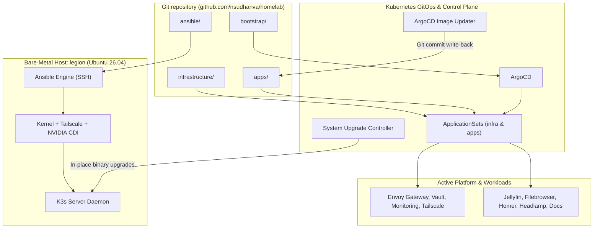

# Automation Model

This repository uses 100% infrastructure-as-code and GitOps automation. Each layer of the homelab is declarative. A control loop automates each layer:

- **Ansible Automation (`ansible/`)**: Configures the bare-metal Ubuntu host, the kernel parameters, the Tailscale node settings, the NVIDIA Container Toolkit and CDI, and the initial K3s install and ArgoCD bootstrap.
- **ArgoCD GitOps Engine (`bootstrap/`, `infrastructure/`, `apps/`)**: Continuously reconciles all cluster infrastructure and user applications against git HEAD.
- **Rancher System Upgrade Controller (`infrastructure/system-upgrade-controller/`)**: Upgrades K3s declaratively through a `Plan` custom resource.
- **ArgoCD Image Updater (`infrastructure/argocd-image-updater/`)**: Scans container registries and commits updated image tags or digests back to Git.
- **Terraform (`terraform/tailscale/`)**: Manages the Tailscale tailnet: the policy file, DNS, tailnet settings, and device tags. CI plans every change and checks for drift each week. A manual workflow run applies the plan.



## Layer 1: Host and Control Plane Automation (Ansible)

The Ansible roles can make the same host configuration again at any time:

- `ansible/roles/common/`: Installs OS packages, loads kernel modules (`overlay`, `br_netfilter`), sets the sysctl network and inotify values, and prepares `/home/k3s-storage`.
- `ansible/roles/tailscale/`: Requires Tailscale on the node, turns off Tailscale DNS (`--accept-dns=false`), and waits for the Tailscale node IP.
- `ansible/roles/nvidia/`: Configures the NVIDIA Container Toolkit and makes the CDI specifications (`/etc/cdi/nvidia.yaml`).
- `ansible/roles/k3s_server/`: Writes the K3s server config (`default-runtime: "nvidia"`, `default-local-storage-path: "/home/k3s-storage"`, the Tailscale `node-ip`, node labels, and kubelet reservations), adds a systemd drop-in that starts K3s after `tailscaled`, installs K3s if the binary is missing, and fetches the kubeconfig.
- `ansible/roles/argocd/`: Installs the ArgoCD control plane and applies `bootstrap/root.yaml`.

## Layer 2: In-Cluster Declarative GitOps (ArgoCD)

ArgoCD is the main reconcile loop. The root application `bootstrap/root.yaml` creates two ApplicationSets:

- `infra-appset.yaml` (ApplicationSet `infrastructure`): Watches each directory in `infrastructure/*` and makes one `infra-<component>` application for each.
- `apps-appset.yaml` (ApplicationSet `apps`): Finds the application definitions in `apps/*/app.yaml` and makes one `app-<name>` application for each, in the namespace from `app.yaml`.

Both ApplicationSets use automatic pruning and self-healing:

```yaml
syncPolicy:
  automated:
    prune: true
    selfHeal: true
```

## Layer 3: Automated Lifecycle & Image Updates

- **System Upgrade Controller**: Removes the need for manual K3s upgrades. When you set a new K3s version in `k3s-upgrade-plan.yaml`, the controller runs a `rancher/k3s-upgrade` Job on the control-plane node. The Plan sets `cordon: false` and has no `drain` block, so the Job replaces the binary and restarts the `k3s` service without cordoning or draining the node.
- **Image Updater**: Monitors semver tags or `latest` digests. It reads GHCR with the credentials in the `argocd-image-updater-registries` Secret and Docker Hub anonymously, and pushes Git commits back to `master`.

## Layer 4: Tailnet Configuration (Terraform)

The tailnet is outside the cluster, so ArgoCD cannot manage it. Terraform manages it instead:

- **Code**: `terraform/tailscale/` holds the policy file (`policy.hujson`), DNS, tailnet settings, and device tags.
- **State**: The state is in the private R2 bucket `homelab-terraform-state`, with a lock file, so the public repository holds no state.
- **Control loop**: The `Tailscale` workflow plans on every change and every Monday. A drift plan fails the scheduled run. Apply is a manual workflow run, because a bad policy can lock you out of the tailnet.
- **Boundaries**: The Tailscale Kubernetes operator manages its own devices, and OAuth clients and auth keys stay out of Terraform so that their secrets never reach state.

Refer to [Manage Tailscale with Terraform](/how-to/tailscale-terraform/).
