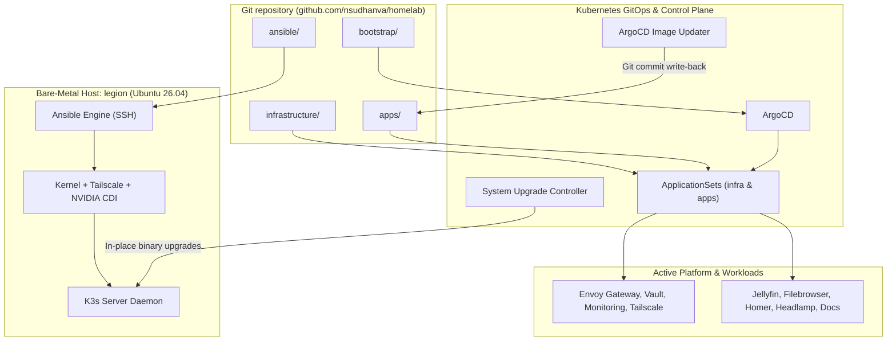

# Automation Model

The repository defines each layer of the homelab as code. A control loop applies each layer:

| Tool | Location | Scope |
| --- | --- | --- |
| Ansible | `ansible/` | The Ubuntu host, kernel parameters, Tailscale node settings, the NVIDIA Container Toolkit and CDI, the K3s installation, and the ArgoCD bootstrap |
| ArgoCD | `bootstrap/`, `infrastructure/`, `apps/` | All cluster infrastructure and user applications. ArgoCD compares the cluster with the Git `HEAD` and applies the differences |
| Rancher System Upgrade Controller | `infrastructure/system-upgrade-controller/` | K3s upgrades from a `Plan` custom resource |
| ArgoCD Image Updater | `infrastructure/argocd-image-updater/` | New image tags or digests. It finds them in the container registries and commits them to Git |
| Terraform | `terraform/tailscale/` | The tailnet policy file, DNS, tailnet settings, and device tags |



## Layer 1: Host and Control Plane (Ansible)

You can run the Ansible roles again at any time. Each run gives the same host configuration.

- `ansible/roles/common/`: Installs the OS packages and loads the kernel modules `overlay` and `br_netfilter`. It sets the sysctl network and inotify values, prepares `/home/k3s-storage`, and sets the CPU power profile (`power_profile` in `ansible/group_vars/all.yaml`).
- `ansible/roles/tailscale/`: Makes sure that Tailscale is on the node, disables Tailscale DNS (`--accept-dns=false`), and waits for the Tailscale node IP.
- `ansible/roles/nvidia/`: Configures the NVIDIA Container Toolkit and writes the CDI specification (`/etc/cdi/nvidia.yaml`).
- `ansible/roles/k3s_server/`: Writes the K3s server configuration (`default-runtime: "nvidia"`, `default-local-storage-path: "/home/k3s-storage"`, the Tailscale `node-ip`, node labels, and kubelet reservations). It adds a systemd drop-in that starts K3s after `tailscaled`. It installs K3s if the binary is missing, and it fetches the kubeconfig.
- `ansible/roles/argocd/`: Installs the ArgoCD control plane and applies `bootstrap/root.yaml`.

## Layer 2: In-Cluster GitOps (ArgoCD)

ArgoCD is the main reconciliation loop. The root application `bootstrap/root.yaml` creates two ApplicationSets:

- `infra-appset.yaml` (ApplicationSet `infrastructure`): Makes one `infra-<component>` application for each directory in `infrastructure/*`.
- `apps-appset.yaml` (ApplicationSet `apps`): Makes one `app-<name>` application for each `apps/*/app.yaml` file. Each application uses the namespace from its `app.yaml`.

Both ApplicationSets use automatic pruning and self-healing:

```yaml
syncPolicy:
  automated:
    prune: true
    selfHeal: true
```

## Layer 3: K3s Upgrades and Image Updates

- System Upgrade Controller: Upgrades K3s from the version in `k3s-upgrade-plan.yaml`. When you change the version, the controller runs a `rancher/k3s-upgrade` Job on the control-plane node. The Plan sets `cordon: false` and has no `drain` block. The Job replaces the binary and restarts the `k3s` service, and the node stays schedulable.
- ArgoCD Image Updater: Monitors semver tags or `latest` digests. It reads GHCR with the credentials in the `argocd-image-updater-registries` Secret, and it reads Docker Hub anonymously. It pushes Git commits to `master`.

## Layer 4: Tailnet Configuration (Terraform)

The tailnet is outside the cluster, so ArgoCD cannot manage it. Terraform manages the tailnet.

- Code: `terraform/tailscale/` holds the policy file (`policy.hujson`), DNS, tailnet settings, and device tags.
- State: The state and its lock file are in the private R2 bucket `homelab-terraform-state`. The public repository holds no state.
- Control loop: The `Tailscale` workflow makes a plan for each change and each Monday. A plan that finds drift causes the scheduled run to fail. A manual workflow run applies the plan, because an incorrect policy can lock you out of the tailnet.
- Boundaries: The Tailscale Kubernetes operator manages its own devices. OAuth clients and auth keys stay out of Terraform, so their secrets do not go into the state.

Refer to [Manage Tailscale with Terraform](/how-to/tailscale-terraform/).
