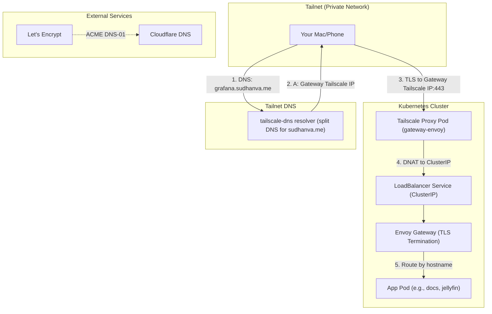
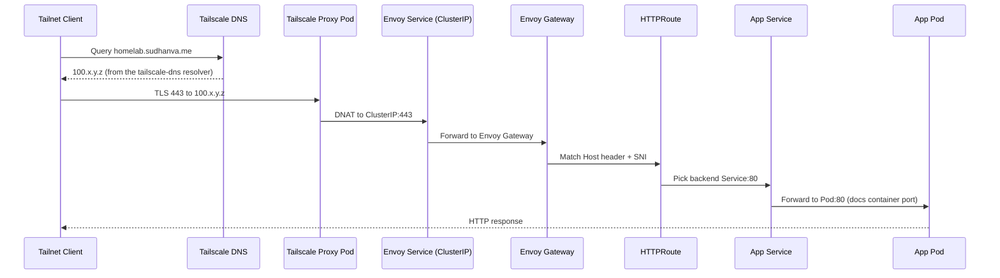
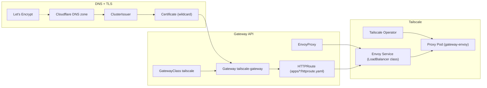
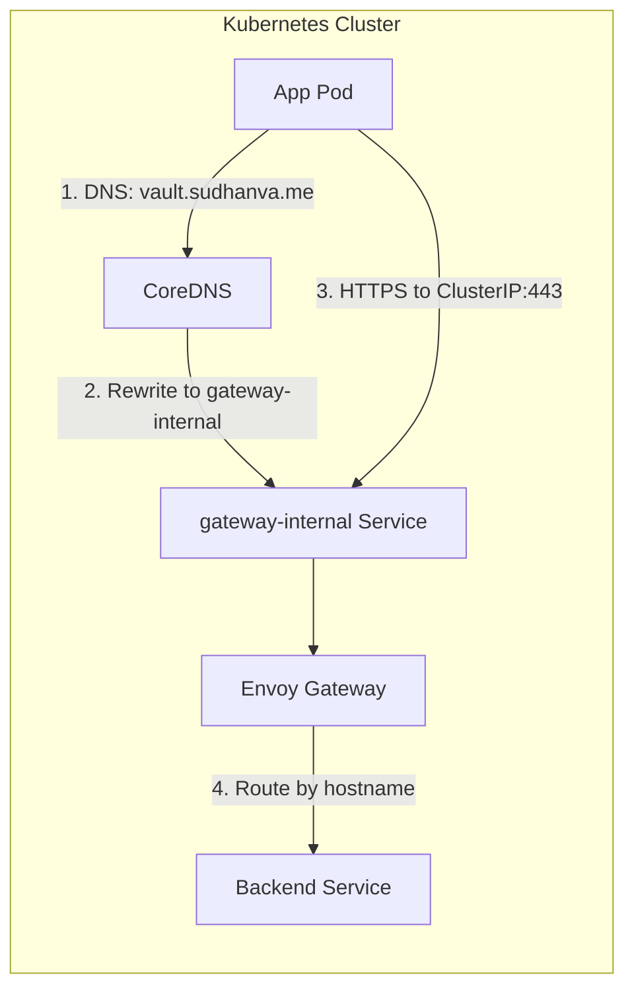

# Gateway API and Networking

This page tells how traffic goes from tailnet clients to the applications in the cluster.

## Overview

The homelab exposes HTTPS services through these layers:



ExternalDNS also writes a public A record in Cloudflare for each exposed hostname, for example `grafana.sudhanva.me`. The A record points to the Tailscale IP of the Gateway. Only tailnet devices can reach that IP.

## Detailed Request Path



## Control Plane Objects and Ownership



## Components

### Tailscale Operator

The Tailscale Kubernetes Operator creates a proxy pod for each `LoadBalancer` Service that sets `spec.loadBalancerClass: tailscale`. Each proxy pod does these tasks:

- It joins the tailnet as a device. The Envoy proxy device is `gateway-envoy`, and its MagicDNS name is `gateway-envoy.ainu-herring.ts.net`.
- It gets a Tailscale IP. The Gateway shows this IP in `status.addresses`.
- It uses iptables DNAT to send traffic to the Kubernetes ClusterIP.

### Envoy Gateway

Envoy Gateway implements the Gateway API and does these tasks:

- It terminates TLS with the certificates from cert-manager.
- It uses SNI to select the correct filter chain.
- It matches HTTPRoutes and sends requests to the backend Services.

The `EnvoyProxy` resource `tailscale-proxy` makes the Envoy Service a `LoadBalancer` with `loadBalancerClass: tailscale`. The Tailscale Operator finds this Service and creates the proxy.

### ExternalDNS

ExternalDNS (source `gateway-httproute`) watches the HTTPRoutes that have the annotation `external-dns.alpha.kubernetes.io/expose: "true"`. For each hostname, it creates an A record in Cloudflare, for example `grafana.sudhanva.me`. Each A record points to the Tailscale IP of the Gateway, which the `tailscale-gateway` status shows. ExternalDNS also writes a TXT ownership record (`owner=homelab`) for each hostname.

The Gateway in `infrastructure/gateway/gateway.yaml` also has the `external-dns.alpha.kubernetes.io/target` annotation. ExternalDNS discards the CNAME record from this annotation, because it conflicts with the A record. The ExternalDNS log shows `discarding CNAME record`.

The docs HTTPRoute (`homelab.sudhanva.me`, `docs.sudhanva.me`) does not have the annotation, so ExternalDNS does not manage those records.

### cert-manager

cert-manager gets a wildcard TLS certificate from Let's Encrypt with DNS-01 challenges:

- The `ClusterIssuer` `letsencrypt-dns` uses a Cloudflare API token.
- One `Certificate` resource, `wildcard-sudhanva-me`, covers `*.sudhanva.me`.
- The Secret `wildcard-sudhanva-me-tls` holds the certificate, and the Gateway refers to that Secret.

## Necessary configuration for tailnet ingress

All of these resources must agree. If one is incorrect, HTTPS routing through Tailscale stops.

- Flannel CNI keeps the iptables DNAT path from the Tailscale proxy pods to the target ClusterIP.
- EnvoyProxy exposes a `LoadBalancer` service with `loadBalancerClass: tailscale` and a stable Tailscale hostname.
- The Gateway uses `gatewayClassName: tailscale` and points to the wildcard certificate.
- ExternalDNS publishes A records that point to the Tailscale IP of the Gateway.
- cert-manager creates the wildcard certificate in the `tailscale` namespace.
- The HTTPRoutes are in the app namespaces. All HTTPRoutes except the docs route have the ExternalDNS expose annotation.
- External Secrets Operator syncs the Cloudflare API tokens and the Tailscale OAuth credentials from Vault.

## Split-horizon DNS for public hostnames

Some hostnames have a public DNS record that ExternalDNS does not manage. `homelab.sudhanva.me` and `docs.sudhanva.me` have manual public A records that point to the Tailscale Gateway IP, so they work only on the tailnet. The public copy of the docs is the Cloudflare Pages site `homelab-68o.pages.dev`. Cloudflare builds it from `docs/` on each push to `master`.

These rules give this result:

- Keep the public Cloudflare DNS record for the hostname. ExternalDNS does not manage it.
- Send tailnet DNS through the `tailscale-dns` resolver. This resolver answers HTTPRoute hostnames with the Tailscale Gateway IP. It sends all other `sudhanva.me` names to public DNS.
- Do not add the `external-dns.alpha.kubernetes.io/expose: "true"` annotation to the HTTPRoute. Without the annotation, ExternalDNS does not overwrite the public record.
- Let the `tailscale-dns-updater` CronJob write the Gateway IP and the list of HTTPRoute hostnames into the resolver configuration.

## In-cluster access to Gateway services

Pods in the cluster cannot route to Tailscale IPs (`100.x.x.x`). Some pods must connect to a service that the Tailscale Gateway exposes, for example `https://vault.sudhanva.me`. For these pods, DNS must resolve the hostname to an internal IP.



CoreDNS rewrites `*.sudhanva.me` to the `gateway-internal` Service:

```text
sudhanva.me:53 {
    rewrite name regex (.*)\.sudhanva\.me gateway-internal.envoy-gateway.svc.cluster.local answer auto
    kubernetes cluster.local ...
}
```

The `gateway-internal` Service selects the Envoy pods by label. Thus, it continues to find the Envoy pods when Kubernetes replaces them:

```yaml
selector:
  gateway.envoyproxy.io/owning-gateway-name: tailscale-gateway
  gateway.envoyproxy.io/owning-gateway-namespace: tailscale
```

Pods use the same hostnames as tailnet clients, and the traffic stays in the cluster.

## Quick validation commands

Run these commands from a kubectl context that can connect to the cluster:

```bash
kubectl get gatewayclass
kubectl get gateways -n tailscale
kubectl get envoyproxy -n tailscale
kubectl get svc -n tailscale
kubectl get certificates -n tailscale
kubectl get pods -n tailscale
kubectl get pods -n envoy-gateway
kubectl get httproute -A
```

## Traffic Flow

When you open `https://homelab.sudhanva.me` from a Mac on the tailnet, these events occur:

- DNS resolution: The Tailscale client sends a query to Tailscale DNS (`100.100.100.100`). Split DNS sends `sudhanva.me` queries to the `tailscale-dns` resolver (`infrastructure/tailscale-dns/`). The resolver answers each HTTPRoute hostname, for example `homelab.sudhanva.me`, with the Tailscale IP of the Gateway.
- TLS connection: The browser connects to the Gateway Tailscale IP on port 443 through the WireGuard tunnel. The Tailscale proxy pod receives the connection.
- DNAT: iptables rules in the proxy pod change the destination from the Gateway Tailscale IP to the ClusterIP `10.x.x.x:443`.
- Packet routing: Flannel CNI sends the packet across the cluster network to the Envoy Gateway pod.
- TLS termination: Envoy reads the SNI (`homelab.sudhanva.me`) and selects the filter chain with the wildcard certificate.
- HTTPRoute matching: Envoy matches the `Host` header to an HTTPRoute. Then it sends the request to the backend Service, for example `docs.docs.svc.cluster.local:80`. The docs container listens on port 80.

## Key Configuration Files

| Component | Path | Purpose |
|-----------|------|---------|
| Gateway | `infrastructure/gateway/gateway.yaml` | Defines listeners and TLS |
| GatewayClass | `infrastructure/gateway/gatewayclass.yaml` | Links to EnvoyProxy |
| EnvoyProxy | `infrastructure/gateway/envoyproxy.yaml` | LoadBalancer + Tailscale |
| Certificate | `infrastructure/gateway/certificate.yaml` | Wildcard cert request |
| Internal Service | `infrastructure/gateway/internal-service.yaml` | In-cluster access to gateway |
| CoreDNS | `infrastructure/coredns/configmap.yaml` | Split-horizon DNS for pods |
| HTTPRoutes | `apps/*/httproute.yaml`, `infrastructure/gateway/*-httproute.yaml`, `infrastructure/prometheus/httproute-*.yaml` | Per-app routing rules |
| Tailnet resolver | `infrastructure/tailscale-dns/` | Split DNS for tailnet clients |

## Common Issues

### Missing SNI

Envoy needs Server Name Indication (SNI) to select the correct TLS certificate. If a client connects to an IP address without a hostname, Envoy logs `filter_chain_not_found`.

To fix this problem, connect with the FQDN. Do not connect to the Tailscale IP.

### Gateway shows not programmed

If `kubectl get gateways -n tailscale` shows `PROGRAMMED=False`, make sure that these conditions are true:

- The `parametersRef` of the GatewayClass points to the EnvoyProxy `tailscale-proxy`.
- The EnvoyProxy service is a `LoadBalancer` with `loadBalancerClass: tailscale`.
- The Tailscale Operator pod runs and can tag devices.

To find the cause, examine the logs of the Envoy Gateway controller:

```bash
kubectl logs -n envoy-gateway -l app.kubernetes.io/name=envoy-gateway --tail=200
```
