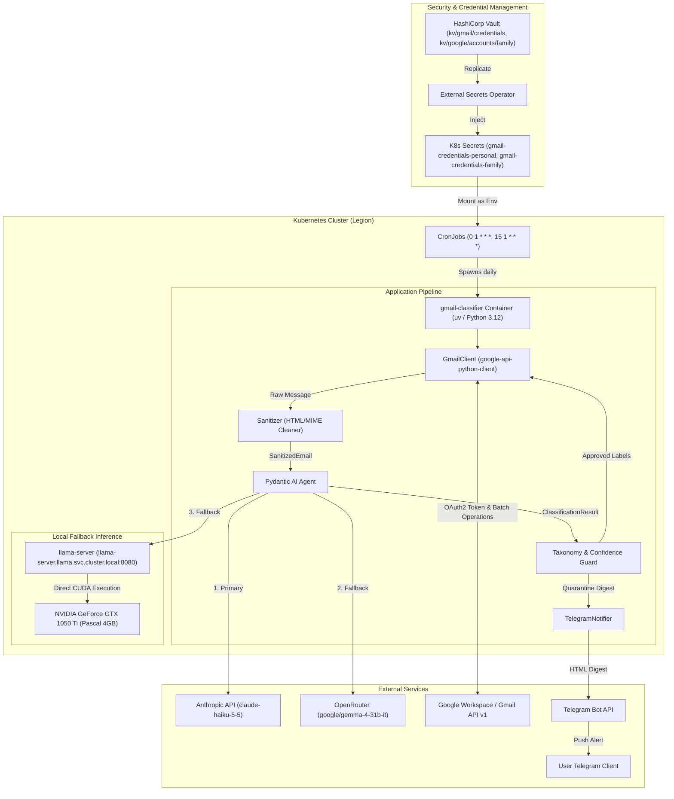
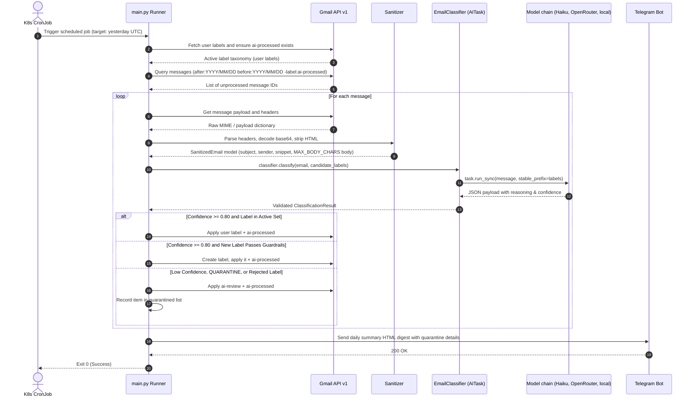
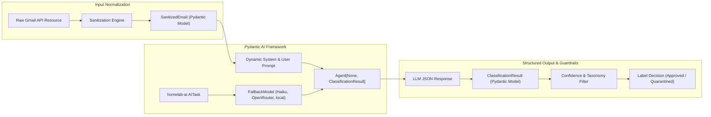
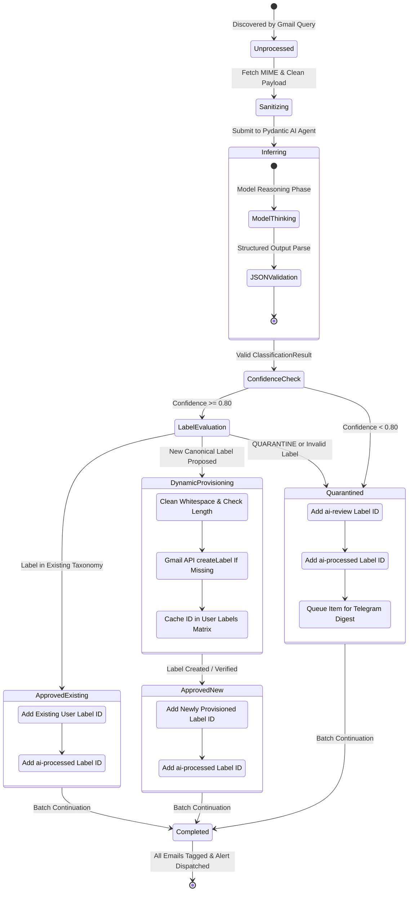

## Overview

The Gmail Classifier is an email triage job that runs as one Kubernetes CronJob per Google account. GitOps manages its deployment. The `gmail-classifier-personal` CronJob runs every day at 01:00 and `gmail-classifier-family` runs at 01:15, in the `America/Los_Angeles` time zone (schedules from `apps/accounts.yaml`, time zone from the CronJob `timeZone`). Each run examines the messages from the previous day (UTC). It cleans the email bodies and sends them through Pydantic AI to the shared `homelab-ai` model chain. The primary model is Claude Haiku 5.5 (`anthropic:claude-haiku-5-5`). OpenRouter (`openrouter:google/gemma-4-31b-it`) and the local Gemma 4 model in the cluster (`local:gemma-4-e2b-it`) are the fallbacks. The label guide is the same for every email in a run, so the classifier sends it as a cached prompt prefix.

The classifier puts incoming mail into the existing labels that the user curates. With `ALLOW_LABEL_CREATION=true` (set in both CronJobs), it can also create a new broad label. If the result is uncertain or ambiguous, the classifier applies the `ai-review` label and does not change the root labels. When the run is complete, the classifier sends a summary report to Telegram.



---

## Daily Execution Sequence

The classifier runs without an operator in a fixed sequence. If one message causes a Gmail API error or another processing error, the classifier catches and logs the failure. It lists the failed item in the Telegram digest and continues with the remaining emails. The failed message gets no labels, so it is not marked as processed.

A model infrastructure failure is different. If every model in the chain is unreachable, times out, or rate limits the request, `homelab-ai` raises `LLMConnectionError`. The run then stops, sends a "Gmail Classifier Halted" message to Telegram, and exits with an error. The CronJob uses `restartPolicy: OnFailure`, so Kubernetes restarts the container. The messages that were not processed still lack `ai-processed`, so the next attempt picks them up.



---

## Pydantic & Pydantic AI Integration

The application uses Pydantic for data validation. It uses Pydantic AI for structured output and for calls to the model.



### Type-Safe Data Contracts

The data structures are strongly typed Pydantic models:

- `SanitizedEmail`: Holds the email metadata, the sender, the clean subject, the decoded body, and the snippet.
- `ClassificationResult`: Defines the output schema that the model must return. The schema has the label name, a confidence score from 0.0 to 1.0, and the reason for the decision.

```python
from pydantic import BaseModel, Field


class ClassificationResult(BaseModel):
    label: str = Field(description="Selected Gmail label or quarantine fallback")
    confidence: float = Field(
        ge=0.0, le=1.0, description="Confidence score between 0.0 and 1.0"
    )
    reason: str = Field(description="Brief explanation of classification decision")
```

### Agent Configuration

The `EmailClassifier` in `apps/gmail-classifier/src/gmail_classifier/classifier.py` does not build a model itself. It creates an `AITask` from the shared `homelab-ai` package. The task reads the model chain from the `homelab-ai` ConfigMap (`AI_MODEL`, `AI_FALLBACK_MODELS`) and the API keys from the `homelab-ai-credentials` Secret:

```python
from homelab_ai import AISettings, AITask, LLMOutputError

self.task = task or AITask(
    name="gmail-classifier",
    output_type=ClassificationResult,
    instructions=INSTRUCTIONS,
    settings=settings,
)
```

`EmailClassifier.classify` builds two strings: the label guide, which is the same for every email in the run, and the email itself. It then calls `self.task.run_sync(message, stable_prefix=labels)`. `AITask` puts the label guide before a cache point, so Anthropic can reuse it as a cached prompt prefix. If no model returns valid output, `AITask` raises `LLMOutputError`, and the classifier quarantines that email.

---

## Label Safety & Autonomous Taxonomy Discovery

The classifier protects user labels from corruption. For accounts with few labels, it can also add new labels in a controlled way.

### Autonomous Label Discovery

An account can have few or no user labels, or an incoming email can match no candidate label. In these cases, the classifier uses autonomous label discovery (`ALLOW_LABEL_CREATION=true`):

- **Canonical labels**: The prompt tells the model to propose short, high-level category labels, such as `Newsletters`, `Travel`, `Entertainment`, `Shopping`, `Finance`, and `Social`. The model selects the label from the main intent of the sender. Legitimate mail thus stays out of quarantine.
- **Prompt rules**: The instructions tell the model to propose one broad Title Case category of one or two words, and never to name a label after a single sender. The code does not enforce these rules.
- **Code guardrails**: The code checks only three things. It strips whitespace and leading or trailing `/`, rejects labels longer than 40 characters, and rejects labels that start with `CATEGORY_`. A rejected label goes to quarantine.
- **Label creation**: If the label is not in the account yet, the run calls `ensure_label_exists` on the Gmail API, which creates it. The run then caches the label ID and adds the label to the candidate list for the rest of the run.
- **Quarantine**: Spam, phishing, and ambiguous emails continue to get the `QUARANTINE` label, which maps to `ai-review`.



---

## Automated 90-Day Archiving Sweep

Immediately after the daily classification, the classifier archives old messages. This keeps the inbox clean without manual work:

- **Query**: The sweep selects inbox messages that the classifier processed and that are older than 90 days:

  ```text
  in:inbox label:ai-processed -label:ai-review older_than:90d
  ```

- **Quarantine exclusion**: The query excludes messages with the `ai-review` label (`-label:ai-review`). Items that need human review stay in the inbox.
- **Batch processing**: The sweep uses the Gmail API `batchModify` endpoint to remove the `INBOX` label from up to 1,000 messages per request. It uses no LLM inference tokens.
- **Reporting**: The Telegram summary report shows the number of archived emails (`📦 Archived from Inbox: <count>`).

### Weekly Mark-as-Read

Each account has a separate CronJob (`gmail-mark-read-<nickname>`). It runs the same image with `--mark-all-read` every Sunday. The schedule is 04:00 for `personal` and 04:15 for `family`, from `gmail_mark_read` in `apps/accounts.yaml`. The job does these tasks:

- Lists all unread messages outside Spam and Trash with the query `is:unread`.
- Removes the `UNREAD` label through `batchModify`, up to 1,000 messages per request. It does not change labels, inbox placement, or classification.
- Uses no LLM inference and sends no Telegram message.

Run the job on demand for one account:

```bash
kubectl -n gmail-classifier create job --from=cronjob/gmail-mark-read-personal gmail-mark-read-personal-manual
```

---

## Security & Secrets Management

- **Secrets**: Version control contains no refresh tokens or OAuth secrets. HashiCorp Vault keeps the OAuth credentials (`client_id`, `client_secret`, `refresh_token`) for each account. The `gmail-credentials-personal` ExternalSecret reads `kv/gmail/credentials`, and `gmail-credentials-family` reads `kv/google/accounts/family`. Each one creates a Kubernetes Secret of the same name with `GMAIL_CLIENT_ID`, `GMAIL_CLIENT_SECRET`, and `GMAIL_REFRESH_TOKEN`, plus `TELEGRAM_BOT_TOKEN` from `kv/telegram/bot` (property `token`). The app reads only these uppercase variable names. The model API keys come from the `homelab-ai-credentials` Secret (`kv/anthropic`, `kv/openrouter`).
- **Container restrictions**: The container runs as the non-root UID/GID `10001:10001` with a read-only root filesystem. It drops all POSIX capabilities and uses the `RuntimeDefault` seccomp profile.
- **Privacy**: Email text goes to Anthropic first. For each email, the classifier sends the sender, subject, date, snippet, and up to `MAX_BODY_CHARS` (default 12,000) characters of the cleaned body to Claude Haiku 5.5. If Anthropic fails, the same text goes to OpenRouter. Only if both fail does it stay inside the cluster, at `http://llama-server.llama.svc.cluster.local:8080/v1`.
- **Failure handling**: If the Gmail API fails on one email, the classifier logs the error, lists the email in the digest, and continues with the queue. If the whole model chain is unreachable, the run stops and sends a "Halted" alert instead of the summary.

---

## Observability & Grafana Dashboard

The file `infrastructure/prometheus/dashboard-gmail-classifier.yaml` adds a Grafana dashboard for the classifier to the `monitoring` namespace. The label `grafana_dashboard: "1"` lets the Grafana sidecar find the dashboard automatically. The dashboard shows no PII.

- **Status panels**: The CronJob schedule status (`0 1 * * *`), the total of successful jobs, the failure count, the active batch workers, and the duration of the last run.
- **Run history**: The run duration over time and the timeline of Pod phases (`Running`, `Succeeded`, `Failed`).
- **Resources**: Container CPU usage and memory working set, compared with the container requests (100m / 128Mi) and limits (500m / 384Mi).
- **GPU**: NVIDIA GTX 1050 Ti compute utilization (%), VRAM framebuffer allocation (MB), core temperature, and compute clock speeds of the `llama-server` container. These panels show only the local fallback model.
- **Privacy**: Prometheus does not store email bodies, subjects, sender addresses, or personal identifiers. The dashboards do not show them.
