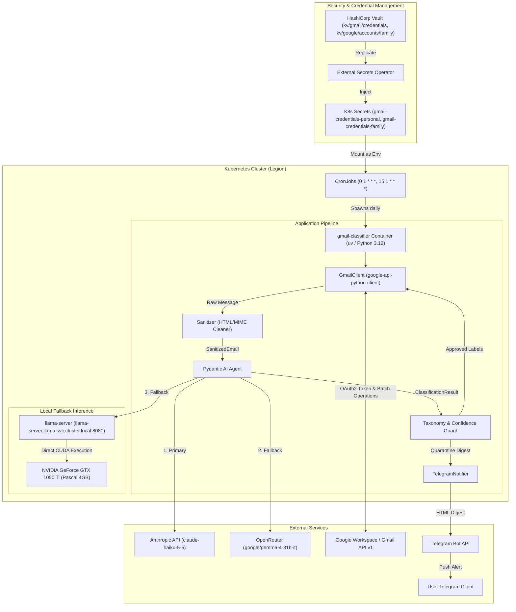
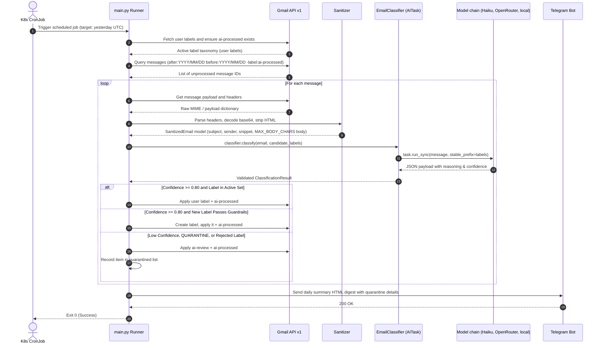
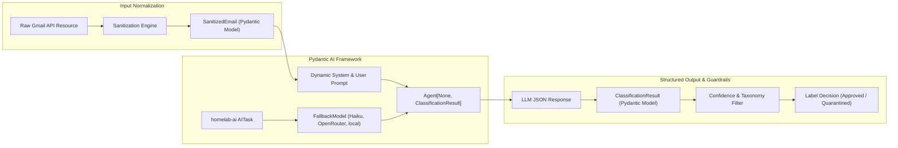
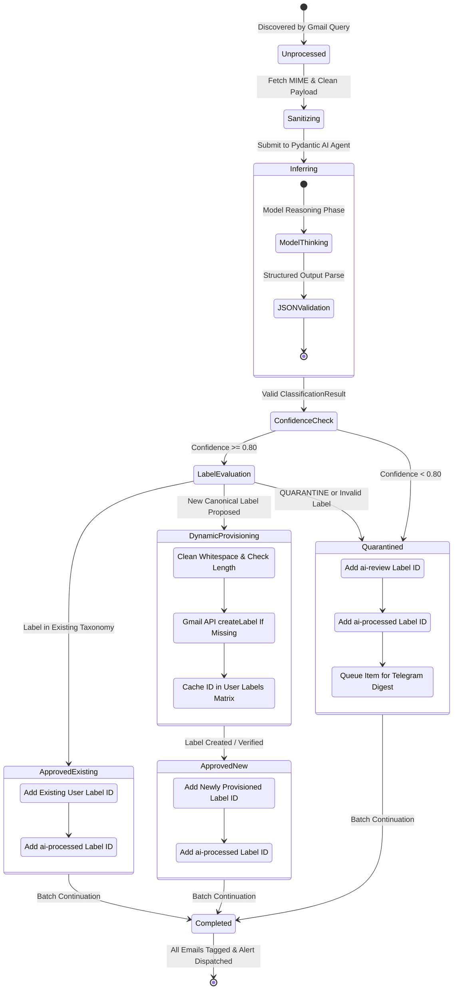

## Overview

The Gmail classifier is an email triage job. It runs as one Kubernetes CronJob for each Google account, and ArgoCD deploys it. Both CronJobs use the `America/Los_Angeles` time zone (the CronJob `timeZone` field):

| CronJob | Schedule |
| --- | --- |
| `gmail-classifier-personal` | Each day at 01:00 |
| `gmail-classifier-family` | Each day at 01:15 |

The schedules come from `apps/accounts.yaml`. Each run examines the messages from the previous day (UTC). The classifier cleans the email bodies and sends them through Pydantic AI to the shared `homelab-ai` model chain. The primary model is Claude Haiku 5.5 (`anthropic:claude-haiku-5-5`). The fallback models are OpenRouter (`openrouter:google/gemma-4-31b-it`) and the local Gemma 4 model in the cluster (`local:gemma-4-e2b-it`). The label guide is the same for each email in a run, so the classifier sends it as a cached prompt prefix.

The classifier puts each incoming email into one of the labels that the user curates. Both CronJobs set `ALLOW_LABEL_CREATION=true`, so the classifier can also create a new broad label. If the result is uncertain or ambiguous, the classifier applies the `ai-review` label and does not change the root labels. At the end of the run, the classifier sends a summary report to Telegram.



## Daily Run Sequence

The classifier runs a fixed sequence without an operator. If one message causes a Gmail API error or another processing error, the classifier catches and logs the error. It lists the failed message in the Telegram digest and continues with the remaining messages. The failed message gets no labels, so it does not get the `ai-processed` label.

A model infrastructure failure stops the run. If each model in the chain is unreachable, times out, or rate-limits the request, `homelab-ai` raises `LLMConnectionError`. The run then sends a "Gmail Classifier Halted" message to Telegram and exits with an error. The CronJob uses `restartPolicy: OnFailure`, so Kubernetes restarts the container. The messages that the run did not process do not have `ai-processed`, so the next attempt finds them.



## Pydantic and Pydantic AI

The application uses Pydantic for data validation. It uses Pydantic AI for the model calls and for structured output.



### Data Models

The data structures are typed Pydantic models:

- `SanitizedEmail`: Holds the email metadata, the sender, the clean subject, the decoded body, and the snippet.
- `ClassificationResult`: Defines the output schema for the model. The schema has the label name, a confidence score from 0.0 to 1.0, and the reason for the decision.

```python
from pydantic import BaseModel, Field


class ClassificationResult(BaseModel):
    label: str = Field(description="Selected Gmail label or quarantine fallback")
    confidence: float = Field(
        ge=0.0, le=1.0, description="Confidence score between 0.0 and 1.0"
    )
    reason: str = Field(description="Brief explanation of classification decision")
```

### Agent Configuration

The `EmailClassifier` in `apps/gmail-classifier/src/gmail_classifier/classifier.py` does not build a model. It creates an `AITask` from the shared `homelab-ai` package. The task reads the model chain from the `homelab-ai` ConfigMap (`AI_MODEL`, `AI_FALLBACK_MODELS`). It reads the API keys from the `homelab-ai-credentials` Secret.

```python
from homelab_ai import AISettings, AITask, LLMOutputError

self.task = task or AITask(
    name="gmail-classifier",
    output_type=ClassificationResult,
    instructions=INSTRUCTIONS,
    settings=settings,
)
```

`EmailClassifier.classify` builds two strings. The first string is the label guide, which is the same for each email in the run. The second string is the email. The method then calls `self.task.run_sync(message, stable_prefix=labels)`. `AITask` puts the label guide before a cache point, so Anthropic can reuse it as a cached prompt prefix. If no model returns valid output, `AITask` raises `LLMOutputError`, and the classifier quarantines the email.

## Label Safety and Label Creation

The classifier protects the user labels. For accounts with few labels, it can also create new labels within set limits.

### Label Creation

An account can have few or no user labels, or an email can match no candidate label. In these cases, the classifier can create a label (`ALLOW_LABEL_CREATION=true`):

- Canonical labels: The prompt tells the model to propose short, high-level category labels, for example `Newsletters`, `Travel`, `Entertainment`, `Shopping`, `Finance`, and `Social`. The model selects the label from the main intent of the sender. Thus, legitimate mail does not go to quarantine.
- Prompt rules: The instructions tell the model to propose one broad Title Case category of one or two words. They also tell the model not to name a label after one sender. The code does not enforce these rules.
- Code guardrails: The code does three checks. It removes whitespace and leading or trailing `/` characters. It rejects labels longer than 40 characters and labels that start with `CATEGORY_`. A rejected label goes to quarantine.
- Label creation: If the label is not in the account, the run calls `ensure_label_exists`, which creates the label through the Gmail API. The run then caches the label ID and adds the label to the candidate list for the remaining messages.
- Quarantine: Spam, phishing, and ambiguous emails get the `QUARANTINE` label, which maps to `ai-review`.



## 90-Day Archive Sweep

After the daily classification, the classifier archives old messages:

- Query: The sweep selects inbox messages that the classifier processed and that are older than 90 days:

  ```text
  in:inbox label:ai-processed -label:ai-review older_than:90d
  ```

- Quarantine exclusion: The query excludes messages with the `ai-review` label (`-label:ai-review`). Messages that need human review stay in the inbox.
- Batch processing: The sweep uses the Gmail API `batchModify` endpoint to remove the `INBOX` label from a maximum of 1,000 messages for each request. It uses no LLM tokens.
- Reporting: The Telegram summary report shows the number of archived emails.

### Weekly Mark-as-Read

Each account has a separate CronJob, `gmail-mark-read-<nickname>`. It runs the same image with `--mark-all-read` each Sunday. The schedule is 04:00 for `personal` and 04:15 for `family`, from `gmail_mark_read` in `apps/accounts.yaml`. The job does these tasks:

- It lists all unread messages outside Spam and Trash with the query `is:unread`.
- It removes the `UNREAD` label through `batchModify`, a maximum of 1,000 messages for each request. It does not change labels, inbox placement, or classification.
- It uses no LLM and sends no Telegram message.

To start the job for one account, run this command:

```bash
kubectl -n gmail-classifier create job --from=cronjob/gmail-mark-read-personal gmail-mark-read-personal-manual
```

## Security and Secrets

- Secrets: Git contains no refresh tokens or OAuth secrets. HashiCorp Vault keeps the OAuth credentials (`client_id`, `client_secret`, `refresh_token`) for each account. The `gmail-credentials-personal` ExternalSecret reads `kv/gmail/credentials`, and `gmail-credentials-family` reads `kv/google/accounts/family`. Each ExternalSecret creates a Kubernetes Secret of the same name with `GMAIL_CLIENT_ID`, `GMAIL_CLIENT_SECRET`, and `GMAIL_REFRESH_TOKEN`. It also adds `TELEGRAM_BOT_TOKEN` from `kv/telegram/bot` (property `token`). The app reads only these uppercase variable names. The model API keys come from the `homelab-ai-credentials` Secret (`kv/anthropic`, `kv/openrouter`).
- Container restrictions: The container runs as the non-root UID/GID `10001:10001` with a read-only root filesystem. It drops all POSIX capabilities and uses the `RuntimeDefault` seccomp profile.
- Privacy: The email text goes to Anthropic first. For each email, the classifier sends the sender, subject, date, and snippet to Claude Haiku 5.5. It also sends a maximum of `MAX_BODY_CHARS` (default 12,000) characters of the cleaned body. If Anthropic fails, the same text goes to OpenRouter. The text stays in the cluster only if both fail. The local model is at `http://llama-server.llama.svc.cluster.local:8080/v1`.
- Failure handling: If the Gmail API fails on one email, the classifier logs the error and lists the email in the digest. Then it continues with the queue. If the full model chain is unreachable, the run stops and sends a "Halted" alert in place of the summary.

## Observability and Grafana Dashboard

The file `infrastructure/prometheus/dashboard-gmail-classifier.yaml` adds a Grafana dashboard for the classifier to the `monitoring` namespace. The Grafana sidecar finds the dashboard through the label `grafana_dashboard: "1"`. The dashboard shows no personal data.

- Status panels: The CronJob schedule (01:00 Pacific), the successful and failed job counts, the active workers, the last run duration, and the primary model.
- Run history: The run duration over time and the timeline of Pod phases (`Running`, `Succeeded`, `Failed`).
- Resources: The CPU usage and memory working set of the container, compared with the container requests (100m / 128Mi) and limits (500m / 384Mi).
- GPU: The NVIDIA GTX 1050 Ti compute utilization (%), VRAM framebuffer allocation (MB), core temperature, and compute clock speeds of the `llama-server` container. These panels show only the local fallback model.
- Privacy: Prometheus does not store email bodies, subjects, sender addresses, or personal identifiers. The dashboards do not show them.
