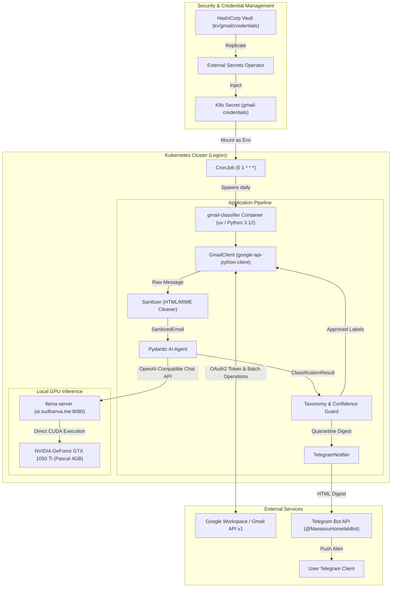
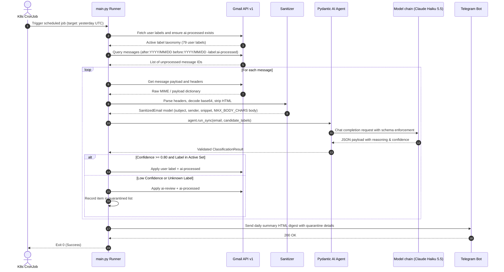
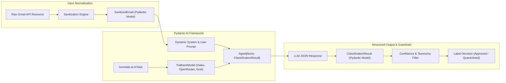
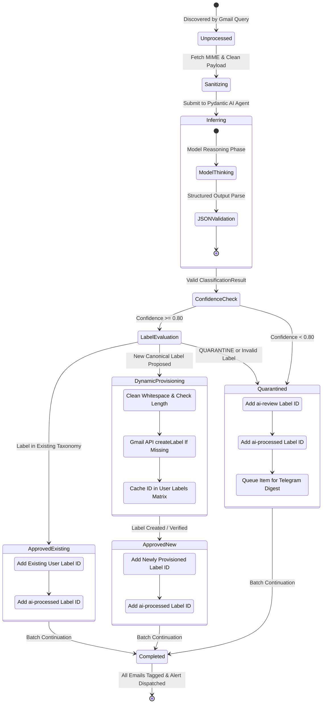

## Overview

The Gmail Classifier is an email triage job that runs as a Kubernetes CronJob. GitOps manages its deployment. The job runs every day at 01:00 UTC and examines the messages from the previous day. It cleans the email bodies and sends them through Pydantic AI to the shared `homelab-ai` model chain. The primary model is Claude Haiku 5.5. OpenRouter and the local Gemma 4 model in the cluster are the fallbacks. The label guide is the same for every email in a run, so the classifier sends it as a cached prompt prefix.

The classifier puts incoming mail only into the existing labels that the user curates. If the result is uncertain or ambiguous, the classifier applies the `ai-review` label and does not change the root labels. When the run is complete, the classifier sends a summary report to Telegram.



---

## Daily Execution Sequence

The classifier runs without an operator in a fixed sequence. If one message causes an API error or a network timeout, the classifier catches and logs the failure. It records the failed item for manual review and continues with the remaining emails. The Telegram digest still goes out at the end of the run.



---

## Pydantic & Pydantic AI Integration

The application uses Pydantic for data validation. It uses Pydantic AI for structured output and for calls to the model.



### Type-Safe Data Contracts

The data structures are strongly typed Pydantic models:

- `SanitizedEmail`: Holds the email metadata, the sender, the clean subject, the decoded body, and the snippet.
- `ClassificationResult`: Defines the output schema that the model must return. The schema has the label name, a confidence score from 0.0 to 1.0, and the reason for the decision.

```python
from pydantic import BaseModel, Field


class ClassificationResult(BaseModel):
    label: str = Field(description="Selected Gmail label or quarantine fallback")
    confidence: float = Field(
        ge=0.0, le=1.0, description="Confidence score between 0.0 and 1.0"
    )
    reason: str = Field(description="Brief explanation of classification decision")
```

### Agent Configuration

The `EmailClassifier` creates an `Agent` that connects to the local inference server through `OpenAIChatModel`:

```python
from openai import AsyncOpenAI
from pydantic_ai import Agent
from pydantic_ai.models.openai import OpenAIChatModel
from pydantic_ai.providers.openai import OpenAIProvider

client = AsyncOpenAI(base_url=self.base_url, api_key="not-needed", timeout=self.timeout)
provider = OpenAIProvider(openai_client=client)
model = OpenAIChatModel(self.model_name, provider=provider)

self.agent = Agent(
    model=model,
    output_type=ClassificationResult,
    system_prompt=(
        "You are an automated email triage system.\n"
        "Categorize the provided email into EXACTLY ONE of the active user labels.\n"
        "If none of the candidate labels match with high confidence, choose 'QUARANTINE'.\n"
        "Keep your reasoning brief (1-2 sentences)."
    ),
)
```

---

## Label Safety & Autonomous Taxonomy Discovery

The classifier protects user labels from corruption. For accounts with few labels, it can also add new labels in a controlled way.

### Autonomous Label Discovery

An account can have few or no user labels, or an incoming email can match no candidate label. In these cases, the classifier uses autonomous label discovery (`ALLOW_LABEL_CREATION=true`):

- **Canonical labels**: The prompt tells the model to propose short, high-level category labels, such as `Newsletters`, `Travel`, `Entertainment`, `Shopping`, `Finance`, and `Social`. The model selects the label from the main intent of the sender. Legitimate mail thus stays out of quarantine.
- **Guardrails**: A new label must use Title Case and be broad (one or two words). Labels with sender company names (such as `Netflix` or `Uber`) are not permitted, because they fragment the taxonomy. The classifier trims each label, limits it to $\le 40$ characters, and rejects reserved prefixes such as `CATEGORY_`.
- **Label creation**: After the classifier cleans the label, it calls `ensure_label_exists` on the Gmail API. If the label does not exist, this call creates it. The classifier then caches the label ID for the next batch operations.
- **Quarantine**: Spam, phishing, and ambiguous emails continue to get the `QUARANTINE` label, which maps to `ai-review`.



---

## Automated 90-Day Archiving Sweep

Immediately after the daily classification, the classifier archives old messages. This keeps the inbox clean without manual work:

- **Query**: The sweep selects inbox messages that the classifier processed and that are older than 90 days:

  ```text
  in:inbox label:ai-processed -label:ai-review older_than:90d
  ```

- **Quarantine exclusion**: The query excludes messages with the `ai-review` label (`-label:ai-review`). Items that need human review stay in the inbox.
- **Batch processing**: The sweep uses the Gmail API `batchModify` endpoint to remove the `INBOX` label from up to 1,000 messages per request. It uses no LLM inference tokens.
- **Reporting**: The Telegram summary report shows the number of archived emails (`📦 Archived from Inbox: <count>`).

### Weekly Mark-as-Read

Each account has a separate CronJob (`gmail-mark-read-<nickname>`). It runs the same image with `--mark-all-read` every Sunday. The schedule is 04:00 for `personal` and 04:15 for `family`, from `gmail_mark_read` in `apps/accounts.yaml`. The job does these tasks:

- Lists all unread messages outside Spam and Trash with the query `is:unread`.
- Removes the `UNREAD` label through `batchModify`, up to 1,000 messages per request. It does not change labels, inbox placement, or classification.
- Uses no LLM inference and sends no Telegram message.

Run the job on demand for one account:

```bash
kubectl -n gmail-classifier create job --from=cronjob/gmail-mark-read-personal gmail-mark-read-personal-manual
```

---

## Security & Secrets Management

- **Secrets**: Version control contains no refresh tokens or OAuth secrets. HashiCorp Vault keeps all the secrets at `kv/gmail/credentials`. An `ExternalSecret` copies them into the Kubernetes Secret `gmail-credentials`.
- **Container restrictions**: The container runs as the non-root UID/GID `10001:10001` with a read-only root filesystem. It drops all POSIX capabilities and uses the `RuntimeDefault` seccomp profile.
- **Privacy**: The classifier processes email contents only inside the local cluster network (`http://llama-server.llama.svc.cluster.local:8080/v1`). No personal email or headers go out of the local network to third-party inference APIs.
- **Failure handling**: If the Google API has a temporary failure on one email, the classifier catches the error. It logs the failure, marks the message for human review, and continues with the queue. Thus, the summary alert always goes out.

---

## Observability & Grafana Dashboard

The file `infrastructure/prometheus/dashboard-gmail-classifier.yaml` adds a Grafana dashboard for the classifier to the `monitoring` namespace. The label `grafana_dashboard: "1"` lets the Grafana sidecar find the dashboard automatically. The dashboard shows no PII.

- **Status panels**: The CronJob schedule status (`0 1 * * *`), the total of successful jobs, the failure count, the active batch workers, and the duration of the last run.
- **Run history**: The run duration over time and the timeline of Pod phases (`Running`, `Succeeded`, `Failed`).
- **Resources**: Container CPU usage and memory working set, compared with the container requests (100m / 128Mi) and limits (500m / 384Mi).
- **GPU**: NVIDIA GTX 1050 Ti compute utilization (%), VRAM framebuffer allocation (MB), core temperature, and compute clock speeds during inference.
- **Privacy**: Prometheus does not store email bodies, subjects, sender addresses, or personal identifiers. The dashboards do not show them.
