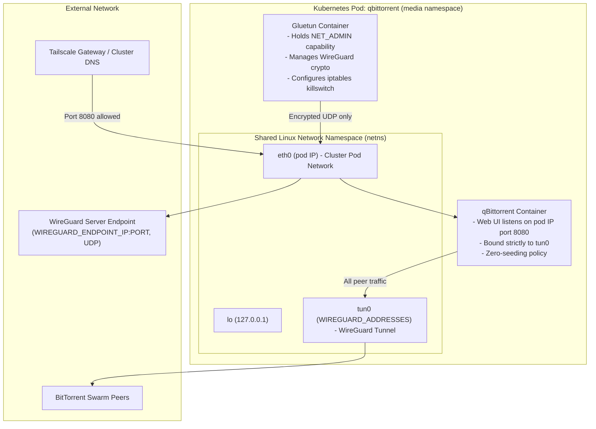
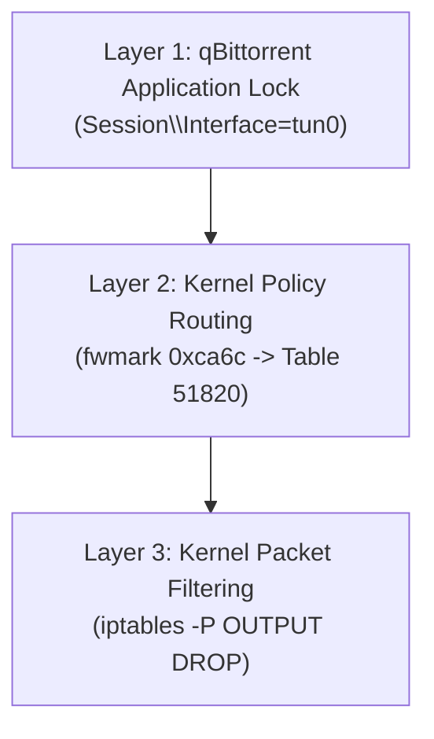
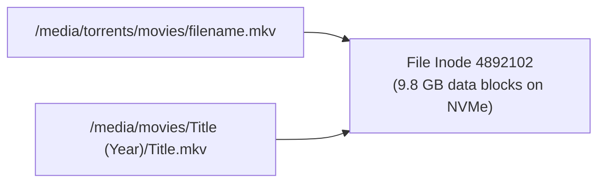

# Media VPN and Storage Architecture

This page tells how the media stack keeps BitTorrent traffic in the VPN, and how the media apps share one storage volume.



## Pod Network Namespace Sharing

All containers in one Kubernetes Pod share one Linux network namespace (`netns`). They have the same IP addresses, network interfaces, and kernel routing tables. They can communicate with each other over `127.0.0.1` (`localhost`).

In `apps/qbittorrent/deployment.yaml`, the `gluetun` and `qbittorrent` containers run in the same Pod:

- `gluetun` creates and manages the network interface `tun0`.
- `qbittorrent` sees the interface `tun0` in its network stack.
- `qbittorrent` binds its peer sockets to the `tun0` address. This address comes from the `addresses` property of `kv/qbittorrent/vpn`, through `WIREGUARD_ADDRESSES`.
- The qBittorrent Web UI listens on port 8080 on the pod IP. Gluetun opens this port in its firewall with `FIREWALL_INPUT_PORTS=8080`, so the `qbittorrent` Service (port 80 to 8080) can reach it.

## VPN Killswitch Layers

The stack uses three layers to prevent traffic outside the VPN.



### Layer 1: Application Socket Binding

qBittorrent sets `Session\Interface=tun0` in `/config/qBittorrent/qBittorrent.conf`. This file is on the `qbittorrent-config` PVC and is not in Git. The [media automation guide](/how-to/media-automation/#step-4-configure-the-vpn-interface-lock) shows how to set it.

The BitTorrent engine binds its sockets only to the `tun0` address. It does not open peer sockets on the interface `eth0`.

### Layer 2: Linux Kernel Policy Routing

Gluetun creates policy routing rules in the kernel. Gluetun sets these values at runtime. They are not in the manifests.

- The mark `0xca6c` identifies encrypted WireGuard traffic.
- Table `51820` sends all outbound traffic without the mark `0xca6c` to the device `tun0`.
- Table `199` sends the internal cluster subnets (`10.42.0.0/16` and `10.43.0.0/16`) to `eth0`.

```text
0:     from all lookup local
99:    from all to 10.42.0.0/16 lookup 199
101:   not from all fwmark 0xca6c lookup 51820
32766: from all lookup main
```

### Layer 3: Kernel Firewall Killswitch (`iptables`)

The pod firewall sets the default policy `DROP` on all chains:

- `-P INPUT DROP`
- `-P FORWARD DROP`
- `-P OUTPUT DROP`

The firewall allows outbound traffic on `eth0` to only two destinations:

- The WireGuard UDP endpoint (`WIREGUARD_ENDPOINT_IP` and `WIREGUARD_ENDPOINT_PORT`, from the `qbittorrent-vpn` Secret).
- The internal Kubernetes cluster subnets (`10.42.0.0/16` and `10.43.0.0/16`, from `FIREWALL_OUTBOUND_SUBNETS`).

The firewall allows inbound traffic on `eth0` only on port 8080 (`FIREWALL_INPUT_PORTS`), for the Web UI. The kernel drops all other outbound packets to the internet that are not encrypted.

## DNS Leak Prevention

A DNS query outside the VPN can show the activity of the client. Gluetun runs a DNS resolver on `127.0.0.1:53`, and the container sets `/etc/resolv.conf` to `nameserver 127.0.0.1`. All tracker and peer domain lookups go through the encrypted `tun0` tunnel.

## Shared Storage and Hardlinks

The media apps share one PersistentVolumeClaim, `jellyfin-media`. A hardlink in this volume moves a completed download into the library without a second copy of the file. A second copy of a 50 GB video file uses disk space and causes more writes to the SSD.

qBittorrent, Sonarr, Radarr, Bazarr, and Jellyfin mount `jellyfin-media` at `/media`. Filebrowser mounts it at `/srv`. Prowlarr and Seerr do not mount it.

```text
/media/
├── torrents/
│   ├── incomplete/
│   ├── movies/       <- qBittorrent writes completed file
│   └── tv/
├── movies/           <- Radarr creates hardlink
└── tv/               <- Sonarr creates hardlink
```

### How Hardlinks Work

A hardlink is a second directory entry for an existing file inode on the same filesystem. For example, `/media/torrents/movies/video.mkv` and `/media/movies/Title/video.mkv` refer to the same data blocks. A hardlink uses no additional data blocks. When qBittorrent removes the torrent file, the video file stays in `/media/movies`.



## Library Scan Notifications

File system events (`inotify`) can be lost across container mount boundaries. Thus, Radarr and Sonarr send a webhook notification to Jellyfin after each import.

When an import completes, Radarr sends a notification to `http://jellyfin.media.svc:80`. The `jellyfin` Service forwards port 80 to container port 8096. You set up this connection in the Radarr and Sonarr UI. The [media automation guide](/how-to/media-automation/#step-8-configure-jellyfin-library-scan-notifications) shows the procedure. Jellyfin then starts a library scan on the directory of the new item.
