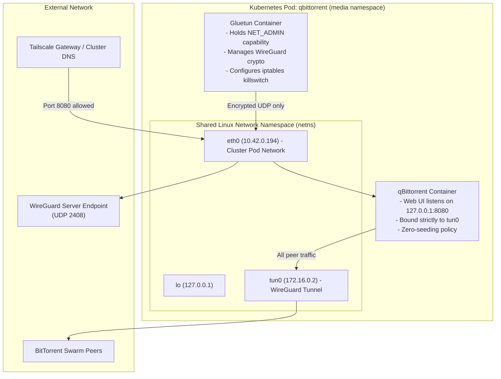
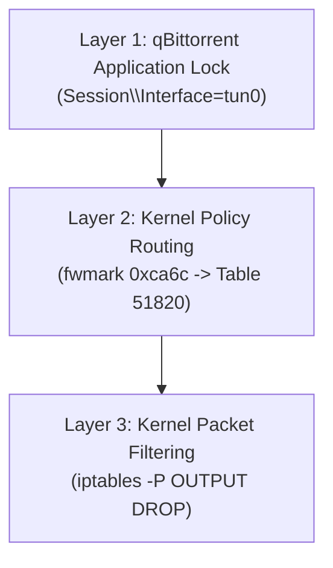
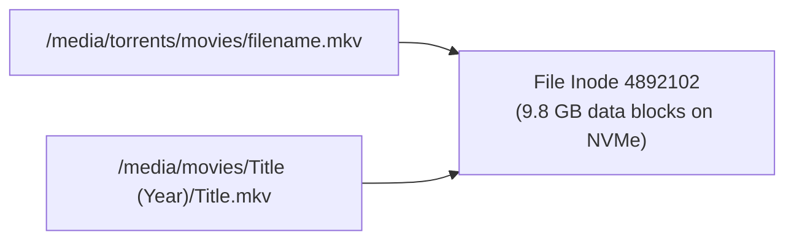

# Media VPN and Storage Architecture

This document explains the security and storage architecture of the media automation stack.



---

## 1. Pod Network Namespace Sharing

In Kubernetes, all containers in a single Pod share one Linux network namespace (`netns`).

They share identical IP addresses, network interfaces, and kernel routing tables.

Containers communicate with each other over `127.0.0.1` (`localhost`) without network overhead.

In `apps/qbittorrent/deployment.yaml`, `gluetun` and `qbittorrent` run in the same Pod:
- `gluetun` creates and manages network interface `tun0`.
- `qbittorrent` sees interface `tun0` immediately in its local network stack.
- `qbittorrent` binds its listening sockets directly to `172.16.0.2` on `tun0`.

---

## 2. Multi-Layer VPN Killswitch Protection

The stack uses three distinct layers to prevent network leaks.



### Layer 1: Application-Level Socket Binding

qBittorrent sets `Session\Interface=tun0` in `/config/qBittorrent/qBittorrent.conf`.

The BitTorrent engine binds its raw sockets strictly to `172.16.0.2`.

The application refuses to open peer sockets on interface `eth0`.

### Layer 2: Linux Kernel Policy Routing

Gluetun creates advanced policy routing rules in the kernel:
- Mark `0xca6c` identifies encrypted WireGuard traffic.
- Table `51820` directs all standard outbound traffic to device `tun0`.
- Table `199` directs internal cluster subnets (`10.42.0.0/16` and `10.43.0.0/16`) to `eth0`.

```text
0:     from all lookup local
99:    from all to 10.42.0.0/16 lookup 199
101:   not from all fwmark 0xca6c lookup 51820
32766: from all lookup main
```

### Layer 3: Kernel Firewall Killswitch (`iptables`)

The pod firewall sets default `DROP` policies on all chains:
- `-P INPUT DROP`
- `-P FORWARD DROP`
- `-P OUTPUT DROP`

The kernel allows outbound traffic on `eth0` for only two destinations:
- The WireGuard UDP endpoint address (`162.159.192.9:2408`).
- Internal Kubernetes cluster subnets (`10.42.0.0/16` and `10.43.0.0/16`).

The kernel drops all unencrypted outbound internet packets instantly.

---

## 3. DNS Leak Prevention

DNS queries can expose activity if resolved outside the VPN.

Gluetun runs an embedded DNS resolver on `127.0.0.1:53`.

The container sets `/etc/resolv.conf` to `nameserver 127.0.0.1`.

All tracker and peer domain lookups route inside the encrypted `tun0` tunnel.

---

## 4. Shared Storage and Hardlink Mechanics

Downloading and storing media requires efficient storage management.

Duplicating 50 GB video files wastes disk space and stresses solid-state drives.

The homelab uses one shared PersistentVolumeClaim named `jellyfin-media` mounted at `/media`:

```text
/media/
├── torrents/
│   ├── incomplete/
│   ├── movies/       <- qBittorrent writes completed file
│   └── tv/
├── movies/           <- Radarr creates hardlink
└── tv/               <- Sonarr creates hardlink
```

### How Hardlinks Operate

A hardlink points to the existing file inode on the same filesystem.

Both `/media/torrents/movies/video.mkv` and `/media/movies/Title/video.mkv` reference the same data blocks.

Creating a hardlink takes less than one millisecond and uses zero extra bytes.

When qBittorrent removes the torrent file, the video file remains intact in `/media/movies`.



---

## 5. Automated Notification Lifecycle

Real-time file monitoring (`inotify`) can miss events across container mount boundaries.

Radarr and Sonarr solve this problem through explicit REST API webhooks.

When an import completes, Radarr sends a notification to `http://jellyfin.media.svc:80`.

Jellyfin immediately starts an internal library scan on the specific movie directory.

This notification delivers new media to the user interface within five seconds.
