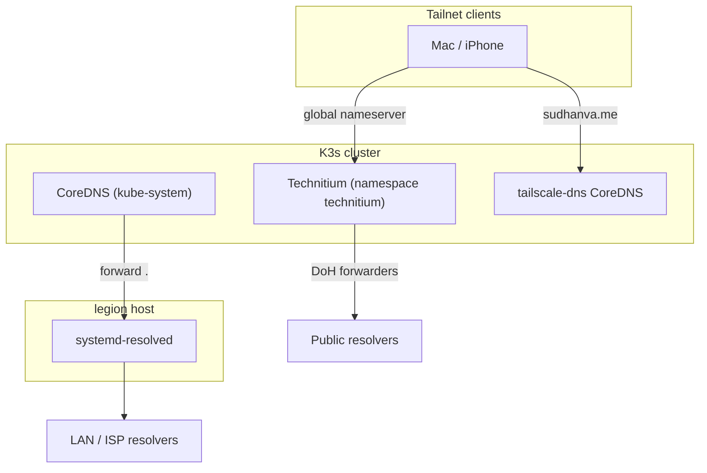

This page tells how the cluster node gets its address and how DNS works at each layer. It also tells how the node divides its resources between workloads and the control plane.

## Node addressing

The node joins the tailnet before the K3s installation. K3s uses the Tailscale IP of the node for `node-ip` and for `node-external-ip`:

| Setting | Value on `legion` | Source |
| --- | --- | --- |
| `node-ip` | `100.66.139.118` | `k3s_node_ip` in `ansible/inventory/hosts.yaml` |
| `node-external-ip` | `100.66.139.118` | `k3s_external_ip` in `ansible/inventory/hosts.yaml` |
| API server endpoint | `https://100.66.139.118:6443` | `ansible_host` |

The Tailscale IP is stable. It does not change when the node changes between Ethernet and Wi-Fi, or when the LAN DHCP lease changes. All components that connect to the InternalIP of the node use this address, for example:

- metrics-server, which scrapes the kubelet
- probes for host-network pods, for example node-exporter
- Prometheus node targets

The LAN address is only the uplink of the node, so DHCP can supply it.

### Startup ordering

The `k3s_server` role installs a systemd drop-in at `/etc/systemd/system/k3s.service.d/10-tailscale.conf`. The drop-in does two things:

- It starts `k3s.service` after `tailscaled.service`.
- It makes K3s wait until `tailscale0` has the Tailscale IP of the node.

Thus, K3s cannot start with a node IP that the host does not have.

## DNS layers

DNS resolution occurs at three independent layers:



### Node layer

The cluster node runs with Tailscale DNS disabled (`tailscale set --accept-dns=false`). The `tailscale` Ansible role applies this setting. The host uses `systemd-resolved` to resolve names through the resolvers on its network uplink.

Thus, node DNS does not depend on the workloads on the node. The kubelet and containerd use DNS to pull images and to connect to the API server. They continue to operate when the cluster DNS services restart.

### Cluster layer

The CoreDNS configuration for `kube-system` is in `infrastructure/coredns/configmap.yaml`:

- The Kubernetes plugin resolves `cluster.local` names.
- CoreDNS rewrites `*.sudhanva.me` to `gateway-internal.envoy-gateway.svc.cluster.local`. Thus, in-cluster clients connect directly to the Envoy Gateway.
- CoreDNS forwards all other queries to the resolvers in `/etc/resolv.conf` of the node. These resolvers are the node layer.

### Tailnet layer

Tailnet clients get their DNS configuration from Tailscale. Terraform sets this configuration in `terraform/tailscale/dns.tf`:

| Setting | Value |
| --- | --- |
| Global nameserver | Tailscale IP of the `technitium-tailscale` Service in namespace `technitium` (Tailscale hostname `technitium-dns`). Technitium provides ad blocking and DNSSEC validation (`apps/technitium/`) |
| Split DNS for `sudhanva.me` | `tailscale-dns` Tailscale IP (`infrastructure/tailscale-dns/`) |
| MagicDNS | Enabled |
| Override local DNS | Enabled |

The tailnet has no fallback nameserver. Technitium and the `sudhanva.me` resolver both run in the cluster. When the cluster is down, tailnet clients cannot resolve names. The cluster node continues to resolve names, because it runs with `--accept-dns=false`. To add a fallback, refer to [Add a fallback nameserver](/how-to/tailscale-terraform/#add-a-fallback-nameserver).

## Resource reservations

K3s runs the API server, controller manager, scheduler, datastore, and kubelet in one `k3s-server` process on the node. The kubelet keeps capacity for this process and for the OS. The `k3s_kubelet_args` value in `ansible/group_vars/all.yaml` sets these reservations:

| Flag | Value |
| --- | --- |
| `kube-reserved` | `cpu=250m,memory=512Mi` |
| `system-reserved` | `cpu=250m,memory=512Mi` |
| `eviction-hard` | `memory.available<500Mi,nodefs.available<10%,imagefs.available<10%` |

Node allocatable is the capacity minus these reservations. The `kubepods` cgroup keeps pods in the allocatable limit. Thus, memory pressure from workloads causes pod eviction or OOM kills in that cgroup, and `k3s-server` keeps its resources.

To see the allocatable values, run:

```bash
kubectl get node legion -o jsonpath='{.status.allocatable}'
```

## Applying changes

Use only Ansible to change node-level settings. To run one role, use its tag:

```bash
cd ansible
ansible-playbook site.yaml --tags tailscale,k3s --check --diff
ansible-playbook site.yaml --tags tailscale,k3s
```

If you change `config.yaml` or the systemd drop-in, the handlers restart K3s. The containers continue to run during the K3s restart.
