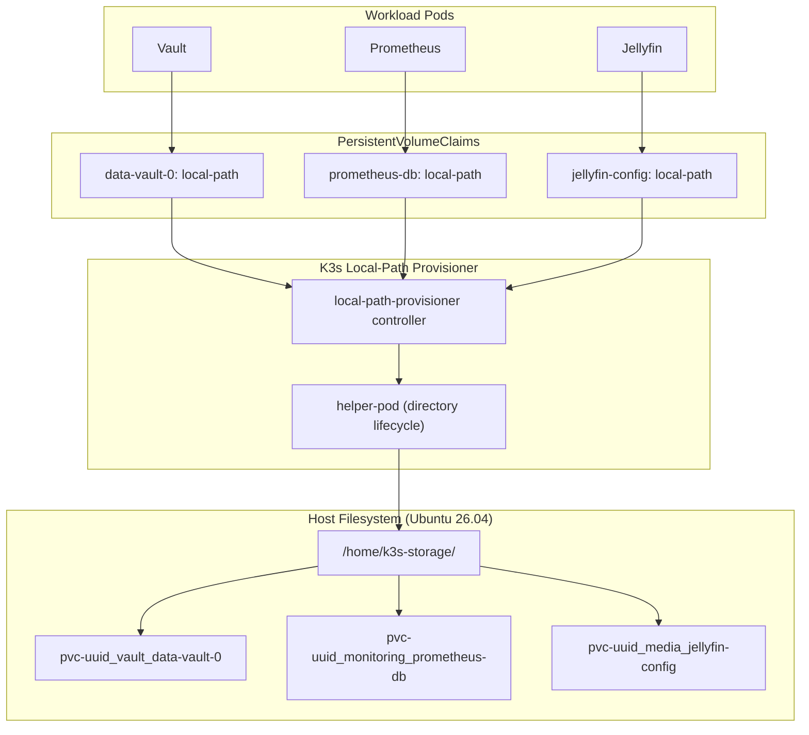

# Local-Path Storage Architecture

The homelab uses the Local-Path Provisioner that K3s includes. This page tells how the provisioner creates volumes and where the data is on the host.

## Architecture Overview

All persistent workloads use host NVMe or SSD storage at `/home/k3s-storage`:



## Design Reasons

The cluster has one node, so a volume does not need replicas on other nodes. Local-path storage has no network layer. The provisioner creates hostPath volumes directly on the dedicated SSD partition.

This design gives these properties:

- Low overhead: The provisioner runs no replication engine, health heartbeats, or storage daemons.
- Low latency: Each write goes directly to the local NVMe disk, with no network replication.
- Simple operation: A node reboot has no replica state or quorum to recover.

## Volume Lifecycle and WaitForFirstConsumer

The default `local-path` StorageClass sets `volumeBindingMode: WaitForFirstConsumer`:

- A new PersistentVolumeClaim (PVC) stays in the `Pending` state until the scheduler puts a consumer Pod on a node.
- When the scheduler puts a Pod that refers to the PVC on a node, the scheduler assigns that node to the PVC.
- The `local-path-provisioner` controller starts a temporary helper Pod on that node. The helper Pod creates the directory `/home/k3s-storage/pvc-<uuid>_<namespace>_<pvc-name>/`.
- Kubernetes binds the PersistentVolume to the PVC and mounts it into the container filesystem.

## Host Directory Structure

Each volume directory name has the PVC UUID, the namespace, and the PVC name. The Vault chart (`dataStorage` in `infrastructure/vault/vault.yaml`) creates the PVC `data-vault-0`. The Prometheus Operator names the Prometheus PVC after the StatefulSet. To see the real names, run `kubectl get pvc -A`.

```text
/home/k3s-storage/
├── pvc-<uuid>_media_jellyfin-config/
├── pvc-<uuid>_monitoring_prometheus-<release>-db-prometheus-<release>-0/
└── pvc-<uuid>_vault_data-vault-0/
```

## Backups

The volume data is in standard Linux directories on the host filesystem. This has these effects:

- Snapshots: Host-level tools, for example Restic or Borg, can make snapshots of `/home/k3s-storage/` without cluster-level storage locks.
- Portability: You can restore a backup to replacement hardware without a procedure to attach CSI volumes.

The repository has no automated backup job. For a manual backup command, refer to [Cluster Maintenance](/how-to/maintenance/).
