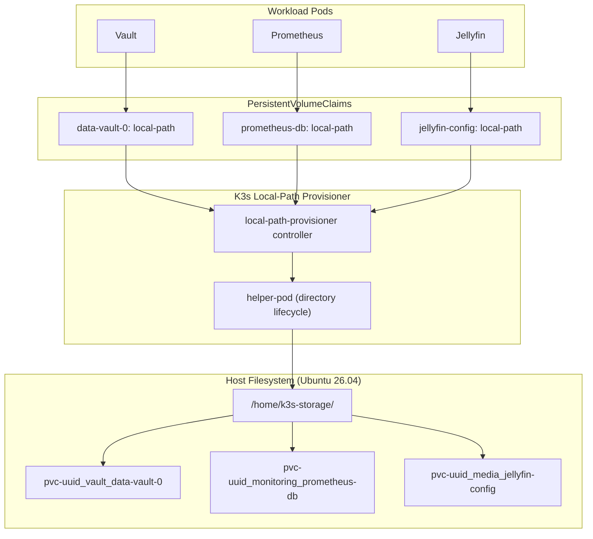

# Local-Path Storage Architecture

This document tells why and how the homelab uses the K3s built-in Local-Path Provisioner. The homelab does not use distributed block storage.

## Architecture Overview

All persistent workloads in the homelab cluster use host NVMe/SSD partitions mounted at `/home/k3s-storage`:



## Why Local-Path Over Distributed Storage

In a small bare-metal homelab, distributed block storage (such as Longhorn or Ceph) has these disadvantages:

- **CPU and memory overhead**: Distributed storage engines use much CPU and RAM. They use it for replica synchronization, health heartbeats, and storage engine daemons.
- **I/O latency**: Synchronous network replication causes more write latency than direct NVMe access.
- **Complexity**: Corrupted replica state engines and quorum loss during single-node reboots can stop the cluster boot.

Local-path storage does not use a network layer. It creates hostPath volumes directly on the dedicated SSD partition. This gives the maximum raw I/O throughput and keeps operations simple.

## Volume Lifecycle and WaitForFirstConsumer

The default `local-path` StorageClass sets volume binding to `volumeBindingMode: WaitForFirstConsumer`:

- When you apply a PersistentVolumeClaim, it stays in the `Pending` state until the scheduler puts a consumer pod on a node.
- When the scheduler puts a workload Pod that refers to the PVC on a node, the scheduler assigns that node to the PVC.
- The `local-path-provisioner` controller starts a temporary helper pod on that node. The helper pod creates the dedicated directory under `/home/k3s-storage/pvc-<uuid>_<namespace>_<pvc-name>/`.
- Kubernetes binds the PersistentVolume to the PVC and mounts it directly into the container filesystem.

## Host Directory Structure

All persistent volume data has a fixed, predictable structure on the node. The Vault chart (`dataStorage` in `infrastructure/vault/vault.yaml`) creates the PVC `data-vault-0`. The Prometheus Operator names the Prometheus PVC after the StatefulSet. To see the real names, run `kubectl get pvc -A`:

```text
/home/k3s-storage/
├── pvc-<uuid>_media_jellyfin-config/
├── pvc-<uuid>_monitoring_prometheus-<release>-db-prometheus-<release>-0/
└── pvc-<uuid>_vault_data-vault-0/
```

## Backup and Disaster Recovery Strategy

The data is in standard Linux directories on the host filesystem. This gives these advantages:

- **Deduplicated snapshots**: Host-level tools (such as Restic or Borg) can make snapshots of `/home/k3s-storage/` without cluster-level storage locks.
- **Node-level portability**: You can restore backups to any replacement hardware. You do not need complex procedures to attach CSI volumes again.
