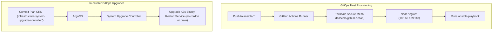

# GitOps-Driven Infrastructure Automation

This repository uses Git to automate cluster upgrades and host provisioning. You do not run manual bash scripts.



## Host Provisioning with GitHub Actions

When changes to `ansible/**` or `.github/workflows/provision.yaml` are pushed to `master`, the `Ansible Provision` workflow runs `ansible-playbook -i ansible/inventory/hosts.yaml ansible/site.yaml`. The playbook applies the roles `common`, `tailscale`, `nvidia`, `k3s_server`, and `argocd`. Preview node changes locally with `--check --diff` before you push.

### Step 1: Secure Tailscale Connection

The workflow (`.github/workflows/provision.yaml`) uses `tailscale/github-action` with a Tailscale OAuth client. The runner joins the tailnet as an ephemeral `tag:ci` node and connects to `legion` (`100.66.139.118`) through SSH.

`legion` runs Tailscale SSH, and Tailscale SSH lets a tagged device connect only to tagged devices. The policy in `terraform/tailscale/policy.hujson` therefore defines `tag:ci` and `tag:server`, tags `legion` with `tag:server`, and has an SSH rule that accepts `tag:ci` to `tag:server` as `sudhanva`. An `sshTests` entry checks this rule on every policy change. Refer to [Manage Tailscale with Terraform](/how-to/tailscale-terraform/).

The OAuth client in the `TS_OAUTH_CLIENT_ID` and `TS_OAUTH_SECRET` secrets must be able to create auth keys with `tag:ci` (the `auth_keys` scope).

### Step 2: Repository Secrets

Add these secrets to your GitHub repository (`Settings > Secrets and variables > Actions`):

- `TS_OAUTH_CLIENT_ID`: The Tailscale OAuth client ID.
- `TS_OAUTH_SECRET`: The Tailscale OAuth client secret.
- `SSH_PRIVATE_KEY`: An SSH private key whose public key is in `~/.ssh/authorized_keys` for `sudhanva` on `legion`.

### Step 3: Trigger Provisioning

Provisioning starts automatically when a push to `master` changes `ansible/**` or the workflow file. You can also start it manually with the GitHub Actions **Run workflow** button (`workflow_dispatch`).

## Automated K3s Upgrades with System Upgrade Controller

The cluster runs the Rancher System Upgrade Controller `v0.20.2`. `infrastructure/system-upgrade-controller/kustomization.yaml` pulls the upstream release manifests (`crd.yaml` and `system-upgrade-controller.yaml`), adds `k3s-upgrade-plan.yaml`, sets the kubectl Job image to `rancher/kubectl:v1.36.2`, and adds resource requests and limits to the controller.

### Step 1: Define Target K3s Version

To upgrade K3s, edit `infrastructure/system-upgrade-controller/k3s-upgrade-plan.yaml` in Git:

```yaml
apiVersion: upgrade.cattle.io/v1
kind: Plan
metadata:
  name: k3s-server
  namespace: system-upgrade
spec:
  concurrency: 1
  version: v1.37.1+k3s1
  nodeSelector:
    matchExpressions:
      - key: node-role.kubernetes.io/control-plane
        operator: Exists
  serviceAccountName: system-upgrade
  tolerations:
    - key: CriticalAddonsOnly
      operator: Exists
    - key: node-role.kubernetes.io/control-plane
      operator: Exists
      effect: NoSchedule
  cordon: false
  upgrade:
    image: rancher/k3s-upgrade
```

### Step 2: Push to Git

Commit and push your change. ArgoCD syncs the `Plan` resource to the cluster.

### Step 3: Automated Execution

The System Upgrade Controller finds the new version and starts an upgrade Job on the control-plane node. The Plan sets `cordon: false` and has no `drain` block, so the node is not cordoned or drained. The Job runs the `rancher/k3s-upgrade` container, which replaces the K3s binary and restarts the `k3s` service. Pods keep running during the restart.
