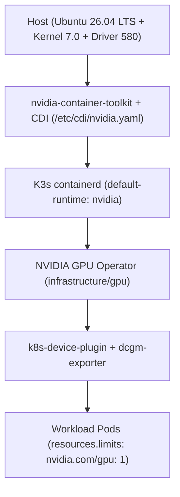

# NVIDIA GPU Acceleration

The homelab node `legion` has an NVIDIA GeForce GTX 1050 Ti Mobile GPU (Pascal architecture, 4GB VRAM). Three components expose the GPU to Kubernetes pods: the NVIDIA Container Toolkit, the Container Device Interface (CDI), and the NVIDIA GPU Operator.



## Host Configuration

The Ansible playbook (`ansible/roles/nvidia/`) installs and configures the host dependencies:

- NVIDIA driver: Version 580+ is already installed on the host.
- NVIDIA Container Toolkit: The playbook installs it from the official apt repository.
- CDI generation: `nvidia-ctk cdi generate --output=/etc/cdi/nvidia.yaml`.
- Low-level runtime: The playbook installs `runc` and makes a symlink at `/usr/bin/runc`.
- K3s server: The playbook sets `default-runtime: "nvidia"` in `/etc/rancher/k3s/config.yaml`.

## Step 1: Deploy the GPU Operator with GitOps

The file `infrastructure/gpu/gpu-operator.yaml` declares the NVIDIA GPU Operator (Helm chart `v26.7.2`) as an ArgoCD Application in the `gpu-operator` namespace. Its values use the driver and toolkit that are already on the host:

- `driver.enabled: false` (uses the 580 series kernel module that is already on the host).
- `toolkit.enabled: false` (uses the NVIDIA Container Toolkit that the `nvidia` Ansible role installs).
- `cdi.enabled: true` and `cdi.default: true` (the operator uses the Container Device Interface to inject devices, and makes CDI the default injection method).
- `validator.plugin.env`: `DISABLE_CUDA_VALIDATION=true` and `validator.cuda.env`: `WITH_WORKLOAD=false` (the validator skips the CUDA workload test pods on this Pascal GPU).

## Step 2: Examine the GPU Allocation

Make sure that Kubelet registers the GPU on the node:

```bash
kubectl get node legion -o jsonpath='{.status.allocatable.nvidia\.com/gpu}'
```

Expected output:

```text
1
```

Make sure that the node labels show the GPU model and capabilities:

```bash
kubectl get node legion -o jsonpath='{.metadata.labels.nvidia\.com/gpu\.product}'
```

Expected output:

```text
NVIDIA-GeForce-GTX-1050-Ti
```

## Step 3: Check GPU access from a running pod

The llama.cpp server holds the only `nvidia.com/gpu` resource, so a new test pod that requests the GPU stays `Pending`. Check GPU access from the running pods instead:

```bash
kubectl -n llama exec deploy/llama-server -c llama-server -- nvidia-smi
kubectl -n media exec deploy/jellyfin -- nvidia-smi
```

The output shows the GPU model, the driver version, and the processes that use the GPU.

## Step 4: Request GPUs in Workloads

The node has one GPU, and the device plugin advertises it as `nvidia.com/gpu: 1`. Only one pod can request it. In this repo, only the llama.cpp server (`apps/llama/deployment.yaml`) requests it:

```yaml
resources:
  limits:
    nvidia.com/gpu: "1"
```

Jellyfin (`apps/jellyfin/deployment.yaml`) does not request `nvidia.com/gpu`. It sets `NVIDIA_VISIBLE_DEVICES=all` and `NVIDIA_DRIVER_CAPABILITIES=all`, and the K3s default runtime (`nvidia`) gives the container access to the GPU. Thus Jellyfin can transcode while llama.cpp holds the GPU resource.
