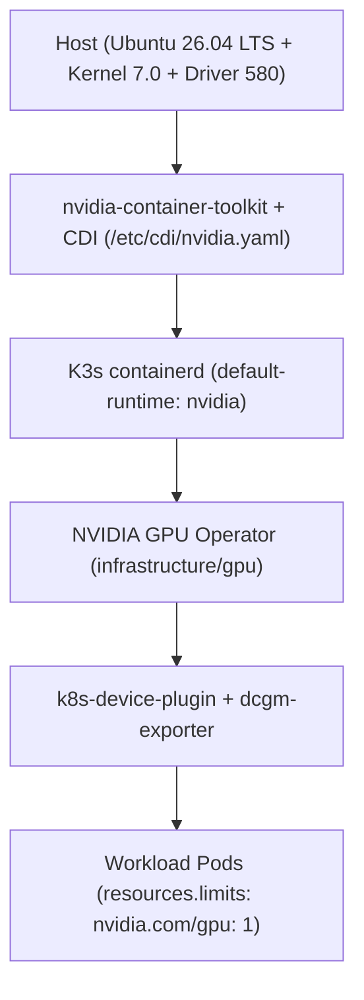

# NVIDIA GPU Acceleration

The node `legion` has an NVIDIA GeForce GTX 1050 Ti Mobile GPU (Pascal architecture, 4GB VRAM). Three components give the GPU to Kubernetes pods. They are the NVIDIA Container Toolkit, the Container Device Interface (CDI), and the NVIDIA GPU Operator.



## Host Configuration

The Ansible playbook installs and configures the host dependencies:

- NVIDIA driver: The host has driver version 580 or later. The `nvidia` role (`ansible/roles/nvidia/`) does not install the driver. It fails if the driver is not present.
- NVIDIA Container Toolkit: The `nvidia` role installs the toolkit from the NVIDIA apt repository.
- CDI generation: The `nvidia` role runs `nvidia-ctk cdi generate --output=/etc/cdi/nvidia.yaml`.
- Low-level runtime: The `nvidia` role installs `runc` and makes a symlink at `/usr/bin/runc`.
- K3s server: The `k3s_server` role sets `default-runtime: "nvidia"` in `/etc/rancher/k3s/config.yaml`.

## Step 1: Deploy the GPU Operator with GitOps

The file `infrastructure/gpu/gpu-operator.yaml` declares the NVIDIA GPU Operator (Helm chart `v26.7.2`) as an ArgoCD Application. The operator runs in the `gpu-operator` namespace. Its values use the driver and the toolkit on the host:

- `driver.enabled: false`: The operator uses the 580 series kernel module on the host.
- `toolkit.enabled: false`: The operator uses the NVIDIA Container Toolkit that the `nvidia` Ansible role installs.
- `cdi.enabled: true` and `cdi.default: true`: The operator injects devices through CDI, and CDI is the default injection method.
- `validator.plugin.env` sets `DISABLE_CUDA_VALIDATION=true`, and `validator.cuda.env` sets `WITH_WORKLOAD=false`: The validator skips the CUDA workload test pods on this Pascal GPU.

## Step 2: Examine the GPU Allocation

Make sure that the kubelet registers the GPU on the node:

```bash
kubectl get node legion -o jsonpath='{.status.allocatable.nvidia\.com/gpu}'
```

Expected output:

```text
1
```

Make sure that the node labels show the GPU model:

```bash
kubectl get node legion -o jsonpath='{.metadata.labels.nvidia\.com/gpu\.product}'
```

Expected output:

```text
NVIDIA-GeForce-GTX-1050-Ti
```

## Step 3: Check GPU Access from a Running Pod

The llama.cpp server holds the only `nvidia.com/gpu` resource. A new test pod that requests the GPU stays `Pending`. Check GPU access from the running pods:

```bash
kubectl -n llama exec deploy/llama-server -c llama-server -- nvidia-smi
kubectl -n media exec deploy/jellyfin -- nvidia-smi
```

The output shows the GPU model, the driver version, and the processes that use the GPU.

## Step 4: Request GPUs in Workloads

The node has one GPU, and the device plugin advertises it as `nvidia.com/gpu: 1`. Only one pod can request it. In this repository, only the llama.cpp server (`apps/llama/deployment.yaml`) requests it:

```yaml
resources:
  limits:
    nvidia.com/gpu: "1"
```

Jellyfin (`apps/jellyfin/deployment.yaml`) does not request `nvidia.com/gpu`. It sets `NVIDIA_VISIBLE_DEVICES=all` and `NVIDIA_DRIVER_CAPABILITIES=all`. The K3s default runtime (`nvidia`) then gives the container access to the GPU. Jellyfin can transcode while llama.cpp holds the GPU resource.
