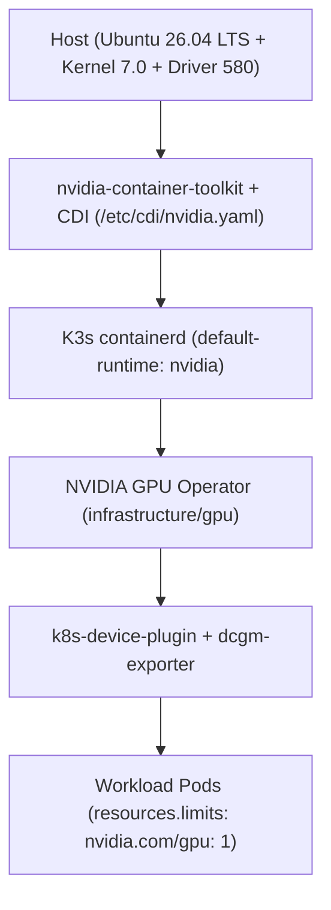

# NVIDIA GPU Acceleration

The homelab node `legion` has an NVIDIA GeForce GTX 1050 Ti Mobile GPU (Pascal architecture, 4GB VRAM). Three components expose the GPU to Kubernetes pods: the NVIDIA Container Toolkit, the Container Device Interface (CDI), and the NVIDIA GPU Operator.



## Host Configuration

The Ansible playbook (`ansible/roles/nvidia/`) installs and configures the host dependencies:

- NVIDIA driver: Version 580+ is already installed on the host.
- NVIDIA Container Toolkit: The playbook installs it from the official apt repository.
- CDI generation: `nvidia-ctk cdi generate --output=/etc/cdi/nvidia.yaml`.
- Low-level runtime: The playbook installs `runc` and makes a symlink at `/usr/bin/runc`.
- K3s server: The playbook sets `default-runtime: "nvidia"` in `/etc/rancher/k3s/config.yaml`.

## Step 1: Deploy the GPU Operator with GitOps

The file `infrastructure/gpu/gpu-operator.yaml` declares the NVIDIA GPU Operator (Helm chart `v26.7.0`) as an ArgoCD Application. Its configuration uses the drivers on the host:

- `driver.enabled: false` (uses the 580 series kernel module that is already on the host).
- `toolkit.enabled: false` (uses the containerd runtime that is already configured on the host).
- `cdi.enabled: true` (enables the Container Device Interface for OCI device injection).
- `validator.plugin.env`: `DISABLE_CUDA_VALIDATION=true` (skips the synthetic checks for Ampere, because the GPU uses the Pascal architecture).

## Step 2: Examine the GPU Allocation

Make sure that Kubelet registers the GPU on the node:

```bash
kubectl get node legion -o jsonpath='{.status.allocatable.nvidia\.com/gpu}'
```

Expected output:

```text
1
```

Make sure that the node labels show the GPU model and capabilities:

```bash
kubectl get node legion -o jsonpath='{.metadata.labels.nvidia\.com/gpu\.product}'
```

Expected output:

```text
NVIDIA-GeForce-GTX-1050-Ti
```

## Step 3: Run a Test Workload

Run a short `nvidia-smi` test pod. This test makes sure that a container can use the GPU from end to end:

```bash
kubectl run gpu-test --rm -i --restart=Never \
  --image=nvidia/cuda:12.4.1-base-ubuntu22.04 \
  --overrides='{"spec":{"containers":[{"name":"gpu-test","image":"nvidia/cuda:12.4.1-base-ubuntu22.04","command":["nvidia-smi"],"resources":{"limits":{"nvidia.com/gpu":"1"}}}]}}'
```

## Step 4: Request GPUs in Workloads

In application manifests (for example, Jellyfin or AI inference workloads), use standard resource limits to request GPU access:

```yaml
resources:
  limits:
    nvidia.com/gpu: "1"
```
