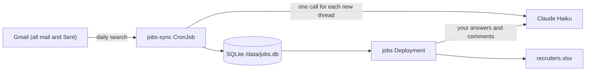

Jobs (`apps/jobs/`) reads your Gmail each day. It finds the recruiters and companies that contacted you, the jobs that you applied to, your interviews, and the threads where nobody replied. Open the web app at `https://jobs.sudhanva.me`. The app is available only on the tailnet.

## How Jobs Works



- Search: The sync runs a set of Gmail searches. The searches find recruiting words, interview words, emails from hiring tools (Greenhouse, Lever, Ashby, Workday, and others), LinkedIn InMail, calendar invites, outcome words, and job emails in Sent. The search includes archived mail. It does not include Spam or Trash.
- Threads: The sync reads each thread that matches. A thread that gets a new message is read again.
- AI: Claude Haiku reads each new or changed thread once. A change to the prompt (`PROMPT_VERSION` in `apps/jobs/src/jobs/extract.py`) makes the next sync read all threads again. It returns the kind of thread, the hiring company, the agency, the roles, the people on the company side, the stage, and a confidence value. The AI uses only the Anthropic API (`AI_FALLBACK_MODELS=none`), so email text does not go to other model providers.
- Grouping: The app puts threads into companies. Different spellings of a company name (for example "Stripe" and "Stripe, Inc.") become one company. Recruiters of the same company are listed together. An agency recruiter is listed under each client company, or under the agency when the client is not named.
- Web app: The `jobs` Deployment serves a single-page app (React, TanStack Router, Query, and Table, shadcn/ui) and a JSON API under `/api`.

## What the App Counts

| Kind | Example |
| --- | --- |
| Recruiter outreach | A recruiter, sourcer, founder, or hiring manager writes about a job, by email, InMail, or a hiring platform |
| Application | You apply, or the company confirms your application |
| Interview scheduling, interview, assessment | Invites, interview loops, coding tests, take-home tasks |
| Offer, rejection | Outcome messages |
| Follow-up, referral | Follow-ups from either side, and referrals for a specific job |

The app does not count job alert emails, newsletters, threads where you are the interviewer or hire for your own team, or other email.

## Statuses

Each company shows the furthest stage of all its threads: outreach, applied, screening, interview, or offer. A rejection or a withdrawal shows after the stage, for example `interview → rejected`.

A thread is "no reply" when your message is the last message and nobody answered in 14 days. A company is "no reply" when all its threads are "no reply". Set `JOBS_NO_REPLY_DAYS` to change the number of days.

## Answer the Open Questions

The AI asks a question when it cannot decide an important fact, for example whether a thread is a real job contact or which company it is about. Threads with a confidence below 0.7 also show on the Questions page. The app does not count team names such as "Acme Recruiting Team" as recruiters.

Step 1: Open the Questions page.

Step 2: Select an option, or write a comment, or both. "Not a job contact" is always an option.

Step 3: Select "Save". The app sends your answer to the AI with the thread, and the AI updates the thread. The AI always follows your answer. If the AI is not available, the app keeps your answer and the next sync applies it.

To correct a thread that has no question, open the company and select "Correct this" on the thread.

## Rename or Merge a Company

Open the company and enter a new name. Two companies with the same new name become one company. Clear the name to remove the rename.

## Export to Excel

Select "Download Excel" on the Companies page, or open `https://jobs.sudhanva.me/api/export.xlsx`. The workbook has four sheets:

| Sheet | Contents |
| --- | --- |
| Companies | One row for each company, with its recruiters, emails, roles, status, and dates |
| Recruiters | One row for each recruiter, with email, title, company, agency, roles, and dates |
| Conversations | One row for each thread, with a link that opens it in Gmail |
| Open questions | The threads that need your answer |

To write the workbook from the command line:

```bash
uv run jobs export recruiters.xlsx
```

## Sync Schedule and History

The `jobs-sync` CronJob runs each day at 05:00 America/Los_Angeles. It searches from three days before the last successful sync. The first sync searches the last 12 years (`JOBS_LOOKBACK_YEARS`).

To run a sync now, start a Job from the CronJob:

```bash
kubectl create job -n jobs --from=cronjob/jobs-sync jobs-sync-manual
```

## Settings

| Variable | Default | Description |
| --- | --- | --- |
| `JOBS_DB_PATH` | `jobs.db` | SQLite file |
| `JOBS_LOOKBACK_YEARS` | `12` | Years that the sync searches back. A larger value makes the next sync search the older years one time |
| `JOBS_OVERLAP_DAYS` | `3` | Days before the last sync that each sync searches again |
| `JOBS_NO_REPLY_DAYS` | `14` | Days without an answer before a thread is "no reply" |
| `JOBS_WORKERS` | `8` | Parallel Gmail reads and AI calls |
| `JOBS_AI_MAX_CALLS` | empty | Limit on AI calls for each sync |
| `GMAIL_CLIENT_ID`, `GMAIL_CLIENT_SECRET`, `GMAIL_REFRESH_TOKEN` | none | Gmail OAuth client from `kv/gmail/credentials` |

## Privacy

The repository is public. It has only code. The threads, the AI results, your answers, and the names of recruiters are only in `/data/jobs.db` on the `jobs-data` volume. The HTTPRoute uses the Tailscale gateway, so only devices on the tailnet can open the app. The app sends `noindex` headers and a `robots.txt` that blocks all crawlers.

## Troubleshooting

| Symptom | Cause | Fix |
| --- | --- | --- |
| Log shows `rateLimitExceeded` | Gmail allows a fixed number of requests each minute for each user | The sync waits and tries again. Set `JOBS_WORKERS` lower if the sync fails |
| A company shows two times | The AI used two names that do not match after the app removes suffixes | Rename one company to the name of the other |
| A recruiter has no email | The contact came through LinkedIn or a no-reply hiring tool | Open the thread in Gmail to find other contact details |
| An answer shows "applied at next sync" | The AI call failed when you saved | Wait for the next sync, or start a Job from the CronJob |
