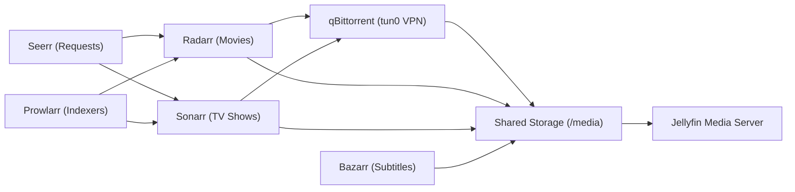

# Media Automation and WireGuard VPN Stack

This guide shows how to configure the media automation stack in the `media` namespace.



The stack contains these services:

| Service | Function |
| --- | --- |
| qBittorrent | BitTorrent client. It sends all traffic through the Gluetun container. |
| Gluetun | WireGuard client with an iptables killswitch. |
| Prowlarr | Indexer manager. It sends the torrent indexers to Radarr and Sonarr. |
| Radarr | Movie collection manager. |
| Sonarr | Television series manager. |
| Bazarr | Subtitle manager for movies and television series. |
| Seerr | Web interface for media requests. |
| Jellyfin | Media server that streams audio and video. |

---

## Step 1: Write WireGuard Parameters to Vault

Store the WireGuard credentials in Vault at the path `kv/qbittorrent/vpn`. Take every value from your WireGuard profile, for example a Cloudflare WARP profile.

Run this command to write the credentials to Vault:

```bash
kubectl -n vault exec -it vault-0 -- vault kv put kv/qbittorrent/vpn \
  private_key="REPLACE_ME" \
  public_key="REPLACE_ME" \
  endpoint_ip="REPLACE_ME" \
  endpoint_port="REPLACE_ME" \
  addresses="REPLACE_ME/32"
```

The `qbittorrent-vpn` ExternalSecret (`apps/qbittorrent/external-secret-vpn.yaml`) copies the five properties into the `qbittorrent-vpn` Secret. The Gluetun container reads them as `WIREGUARD_PRIVATE_KEY`, `WIREGUARD_PUBLIC_KEY`, `WIREGUARD_ENDPOINT_IP`, `WIREGUARD_ENDPOINT_PORT`, and `WIREGUARD_ADDRESSES`.

Make sure that the ExternalSecret syncs the Kubernetes Secret:

```bash
kubectl -n media get externalsecret qbittorrent-vpn
kubectl -n media get secret qbittorrent-vpn
```

---

## Step 2: Back Up Credentials to Bitwarden

Back up all service credentials to the Bitwarden `Homelab` folder. Use the item title format `Homelab - <Component> <Role>`.

The `qbittorrent-vpn` ExternalSecret reads `kv/qbittorrent/vpn`. No manifest in this repository reads the other paths in this table. They keep admin credentials and API keys for operators. The apps keep their settings on their config PVCs.

| Service | Vault Path | Bitwarden Item Title |
| --- | --- | --- |
| qBittorrent WebUI | `kv/qbittorrent/auth` | `Homelab - qBittorrent Admin` |
| qBittorrent VPN | `kv/qbittorrent/vpn` | `Homelab - qBittorrent WireGuard VPN` |
| Prowlarr | `kv/prowlarr/auth` | `Homelab - Prowlarr Admin` |
| Sonarr | `kv/sonarr/auth` | `Homelab - Sonarr Admin` |
| Radarr | `kv/radarr/auth` | `Homelab - Radarr Admin` |
| Bazarr | `kv/bazarr/auth` | `Homelab - Bazarr Admin` |
| Seerr | `kv/seerr/auth` | `Homelab - Seerr Admin` |
| Jellyfin | `kv/jellyfin/auth` | `Homelab - Jellyfin Admin` |

---

## Step 3: Prepare the Media Storage Directories

All media workloads mount the `jellyfin-media` volume at `/media`.

Create these directories on the shared storage:

```bash
kubectl -n media exec deploy/qbittorrent -c qbittorrent -- mkdir -p \
  /media/torrents/movies \
  /media/torrents/tv \
  /media/torrents/incomplete \
  /media/movies \
  /media/tv
```

All directories are on one volume, so Radarr and Sonarr can import files as hardlinks from `/media/torrents`. A hardlink uses no additional disk space.

---

## Step 4: Configure the VPN Interface Lock

Gluetun creates the network interface `tun0` in the shared pod network namespace. Bind qBittorrent to `tun0`, so that no packets go out on other interfaces.

Run this script to set the interface binding through the qBittorrent API. Replace `REPLACE_ME` with the tunnel address from the `addresses` property in Vault. Do not include the `/32` suffix.

```bash
kubectl -n media exec deploy/qbittorrent -c qbittorrent -- python3 -c '
import urllib.request, urllib.parse, json
prefs = {
    "current_network_interface": "tun0",
    "current_interface_address": "REPLACE_ME",
    "upnp": False,
    "lsd": False
}
data = urllib.parse.urlencode({"json": json.dumps(prefs)}).encode()
urllib.request.urlopen(urllib.request.Request("http://127.0.0.1:8080/api/v2/app/setPreferences", data=data))
print("Interface locked to tun0.")
'
```

qBittorrent keeps this setting on the `qbittorrent-config` PVC. Git does not contain it. Make sure that `/config/qBittorrent/qBittorrent.conf` contains the setting:

```bash
kubectl -n media exec deploy/qbittorrent -c qbittorrent -- grep -E "Interface=" /config/qBittorrent/qBittorrent.conf
```

The output must show `Session\Interface=tun0`.

---

## Step 5: Configure the Zero-Seeding Policy

qBittorrent must stop seeding when a download completes. The script sets the ratio limit to `0` and the seeding time limit to `0` minutes.

Run this script to apply the zero-seeding rules:

```bash
kubectl -n media exec deploy/qbittorrent -c qbittorrent -- python3 -c '
import urllib.request, urllib.parse, json
prefs = {
    "max_ratio_enabled": True,
    "max_ratio": 0.0,
    "max_seeding_time_enabled": True,
    "max_seeding_time": 0,
    "max_ratio_act": 0
}
data = urllib.parse.urlencode({"json": json.dumps(prefs)}).encode()
urllib.request.urlopen(urllib.request.Request("http://127.0.0.1:8080/api/v2/app/setPreferences", data=data))
print("Zero-seeding policy active.")
'
```

qBittorrent pauses each torrent when the download completes.

---

## Step 6: Connect Prowlarr to Download Managers

Connect Prowlarr to Radarr and Sonarr through the cluster Service URLs.

Step 1: Open Prowlarr at `https://prowlarr.sudhanva.me`.

Step 2: Add your public or private torrent indexers in **Indexers**.

Step 3: Go to **Settings -> Apps** and click the add button.

Step 4: Select **Radarr**:

- **Radarr Server**: `http://radarr.media.svc:80`
- **API Key**: Enter the key from the Vault path `kv/radarr/auth` or from the Radarr settings.
- **Sync Level**: Full Sync

Step 5: Select **Sonarr**:

- **Sonarr Server**: `http://sonarr.media.svc:80`
- **API Key**: Enter the key from the Vault path `kv/sonarr/auth` or from the Sonarr settings.
- **Sync Level**: Full Sync

Prowlarr sends all configured indexers to Radarr and Sonarr.

---

## Step 7: Configure Radarr and Sonarr Download Clients

Configure qBittorrent as the download client in Radarr and Sonarr.

Step 1: Open Radarr at `https://radarr.sudhanva.me`.

Step 2: Go to **Settings -> Download Clients** and add **qBittorrent**:

- **Host**: `qbittorrent.media.svc`
- **Port**: `80`
- **Category**: `movies`
- **Post-Import Category**: Leave blank

Step 3: In **Settings -> Media Management**, set Root Folder to `/media/movies`.

Step 4: Open Sonarr at `https://sonarr.sudhanva.me`.

Step 5: Go to **Settings -> Download Clients** and add **qBittorrent**:

- **Host**: `qbittorrent.media.svc`
- **Port**: `80`
- **Category**: `tv`
- **Post-Import Category**: Leave blank

Step 6: In **Settings -> Media Management**, set Root Folder to `/media/tv`.

---

## Step 8: Configure Jellyfin Library Scan Notifications

Radarr and Sonarr tell Jellyfin when an import completes.

Step 1: Create an API key in Jellyfin under **Administration -> Dashboard -> API Keys**.

Step 2: In Radarr, go to **Settings -> Connect** and add **Emby / Jellyfin**:

- **Host**: `jellyfin.media.svc`
- **Port**: `80`
- **Use SSL**: Disabled
- **API Key**: Enter the Jellyfin API token
- **Update Library**: Enabled

Step 3: Click **Test** and click **Save**.

Step 4: In Sonarr, go to **Settings -> Connect** and add **Emby / Jellyfin**:

- **Host**: `jellyfin.media.svc`
- **Port**: `80`
- **Use SSL**: Disabled
- **API Key**: Enter the Jellyfin API token
- **Update Library**: Enabled

Step 5: Click **Test** and click **Save**.

When an import completes, Radarr and Sonarr tell Jellyfin to refresh the media library.

---

## Step 9: Configure Subtitle Automation in Bazarr

Step 1: Open Bazarr at `https://bazarr.sudhanva.me`.

Step 2: Go to **Settings -> Sonarr**:

- **Address**: `http://sonarr.media.svc:80`
- **API Key**: Enter the Sonarr API token

Step 3: Go to **Settings -> Radarr**:

- **Address**: `http://radarr.media.svc:80`
- **API Key**: Enter the Radarr API token

Step 4: Go to **Settings -> Providers** and add your subtitle accounts.

Step 5: Go to **Settings -> Languages** and set the default subtitle profiles to English.

---

## Step 10: Configure Media Discovery in Seerr

Step 1: Open Seerr at `https://seerr.sudhanva.me`.

Step 2: Sign in with the Jellyfin server address `http://jellyfin.media.svc:80` and the Jellyfin admin account.

Step 3: Go to **Settings -> Services** and connect Radarr:

- **Server Name**: `Radarr`
- **Hostname**: `radarr.media.svc`
- **Port**: `80`
- **API Key**: Enter the Radarr API token
- **Root Folder**: `/media/movies`

Step 4: Connect Sonarr:

- **Server Name**: `Sonarr`
- **Hostname**: `sonarr.media.svc`
- **Port**: `80`
- **API Key**: Enter the Sonarr API token
- **Root Folder**: `/media/tv`

Users can then request movies and television series in the Seerr web interface.

---

## Step 11: Validate the VPN Killswitch

Make sure that qBittorrent cannot send network packets outside the WireGuard tunnel.

Step 1: Examine the public IP address from the qBittorrent container:

```bash
kubectl -n media exec deploy/qbittorrent -c qbittorrent -- python3 -c '
import urllib.request
trace = urllib.request.urlopen("https://cloudflare.com/cdn-cgi/trace").read().decode()
for line in trace.splitlines():
    if line.startswith(("ip=", "warp=", "colo=")):
        print(line)
'
```

The output must show `warp=on` with a VPN exit IP address.

Step 2: Test an outbound TCP connection on the interface `eth0`. The script binds to the pod IP, which changes each time the pod restarts:

```bash
kubectl -n media exec deploy/qbittorrent -c qbittorrent -- python3 -c '
import socket
pod_ip = socket.gethostbyname(socket.gethostname())
s = socket.socket(socket.AF_INET, socket.SOCK_STREAM)
s.settimeout(3)
s.bind((pod_ip, 0))
try:
    s.connect(("1.1.1.1", 443))
    print("LEAK DETECTED!")
except Exception as e:
    print("BLOCKED:", type(e).__name__)
finally:
    s.close()
'
```

The test must report `BLOCKED: TimeoutError`.

Step 3: Examine the active kernel sockets:

```bash
kubectl -n media exec deploy/qbittorrent -c qbittorrent -- python3 -c '
with open("/proc/net/tcp") as f:
    for line in f.readlines()[1:]:
        print(line.split()[1], "->", line.split()[2])
'
```

All sockets to remote peers must use the tunnel address from `WIREGUARD_ADDRESSES` as the source.
