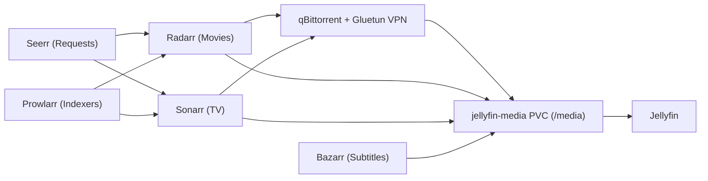

# Media Automation and WireGuard VPN Stack

This guide covers the media automation stack in the `media` namespace: **qBittorrent** (routed through a **Gluetun** WireGuard VPN container), **Prowlarr**, **Sonarr**, **Radarr**, **Bazarr**, and **Seerr**, all sharing the `jellyfin-media` PersistentVolumeClaim.



## Architecture Overview

- **VPN Killswitch in Pod**: `apps/qbittorrent/deployment.yaml` runs `gluetun` and `qbittorrent` in the same Kubernetes Pod. Both containers share the network namespace (`localhost`), so all BitTorrent traffic from `qbittorrent` passes through `gluetun`'s `NET_ADMIN` firewall and WireGuard tunnel (`wg0`).
- **Shared Media Storage**: `qbittorrent`, `sonarr`, `radarr`, `bazarr`, `filebrowser`, and `jellyfin` mount the `jellyfin-media` PVC at `/media` with `fsGroup: 1000`. Using a unified `/media` mount point enables atomic hardlinks between `/media/torrents` and `/media/movies` or `/media/tv` without duplicating disk usage.

## Step 1: Store WireGuard Credentials in Vault

Write the WireGuard parameters to Vault at `kv/qbittorrent/vpn`. You can use a free Cloudflare WARP WireGuard keypair or any custom WireGuard endpoint (such as an India VPS or commercial WireGuard provider):

```bash
kubectl -n vault exec -it vault-0 -- vault kv put kv/qbittorrent/vpn \
  private_key="REPLACE_ME" \
  public_key="bmXOC+F1FxEMF9dyiK2H5/1SUtzH0JuVo51h2wPfgyo=" \
  endpoint_ip="162.159.192.9" \
  endpoint_port="2408" \
  addresses="172.16.0.2/32"
```

Verify that the `ExternalSecret` in `apps/qbittorrent/external-secret-vpn.yaml` synced the `qbittorrent-vpn` Secret:

```bash
kubectl -n media get externalsecret qbittorrent-vpn
kubectl -n media get secret qbittorrent-vpn
```

## Step 2: Configure Shared Directories on the Media PVC

Create the directory structure under `/media` so hardlinks work across all containers:

- `/media/torrents/movies`
- `/media/torrents/tv`
- `/media/movies`
- `/media/tv`

You can create these folders through Filebrowser (`https://filebrowser.sudhanva.me`) or a pod shell in the `media` namespace.

## Step 3: Configure qBittorrent

- Open `https://qbittorrent.sudhanva.me`.
- Retrieve the initial temporary admin password from the container logs:

```bash
kubectl -n media logs deploy/qbittorrent -c qbittorrent | grep -i "temporary password"
```

- In **Tools -> Options -> Web UI**, set your permanent username and password, and enable **Bypass authentication for clients on localhost** and **Bypass authentication for clients in whitelisted IP subnets** (`10.42.0.0/16`) if you want internal cluster access without re-authentication.
- In **Tools -> Options -> Downloads**, set **Default Save Path** to `/media/torrents`.

## Step 4: Connect Prowlarr, Sonarr, Radarr, Bazarr, and Seerr

Use the internal Kubernetes cluster DNS URLs when connecting the services together:

| Service | Internal Cluster URL | External Tailscale URL |
| --- | --- | --- |
| qBittorrent | `http://qbittorrent.media.svc:80` | `https://qbittorrent.sudhanva.me` |
| Prowlarr | `http://prowlarr.media.svc:80` | `https://prowlarr.sudhanva.me` |
| Sonarr | `http://sonarr.media.svc:80` | `https://sonarr.sudhanva.me` |
| Radarr | `http://radarr.media.svc:80` | `https://radarr.sudhanva.me` |
| Bazarr | `http://bazarr.media.svc:80` | `https://bazarr.sudhanva.me` |
| Seerr | `http://seerr.media.svc:80` | `https://seerr.sudhanva.me` |
| Jellyfin | `http://jellyfin.media.svc:80` | `https://jellyfin.sudhanva.me` |

- **Prowlarr (`https://prowlarr.sudhanva.me`)**: Add your public or private torrent indexers, then under **Settings -> Apps**, add **Sonarr** (`http://sonarr.media.svc:80`) and **Radarr** (`http://radarr.media.svc:80`) using their API keys.
- **Sonarr (`https://sonarr.sudhanva.me`)**: Set root folder to `/media/tv` and add **qBittorrent** (`host: qbittorrent.media.svc`, `port: 80`) as the download client.
- **Radarr (`https://radarr.sudhanva.me`)**: Set root folder to `/media/movies` and add **qBittorrent** (`host: qbittorrent.media.svc`, `port: 80`) as the download client.
- **Bazarr (`https://bazarr.sudhanva.me`)**: Connect to Sonarr and Radarr under **Settings -> Sonarr** and **Settings -> Radarr** and configure your subtitle providers.
- **Seerr (`https://seerr.sudhanva.me`)**: Sign in with your Jellyfin account (`http://jellyfin.media.svc:80`), sync libraries, and connect Radarr and Sonarr.

## Step 5: Verify the VPN Tunnel

Confirm that `qbittorrent` egress traffic is routed through the WireGuard tunnel:

```bash
kubectl -n media logs deploy/qbittorrent -c gluetun
```
