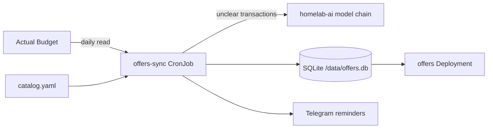
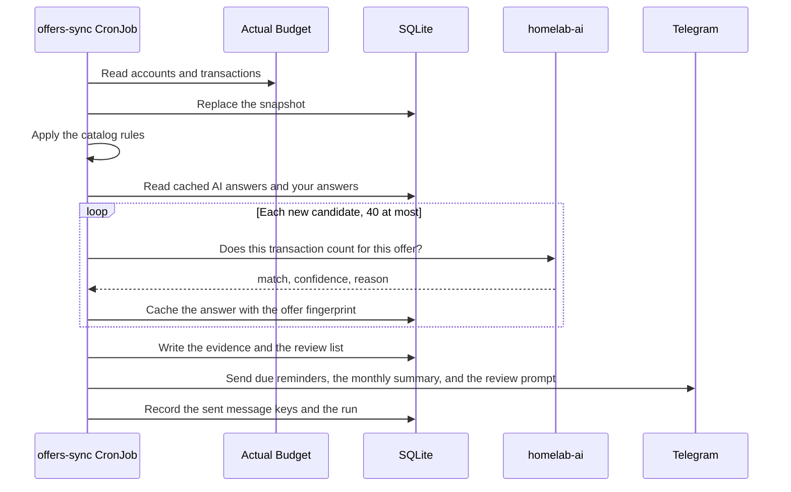
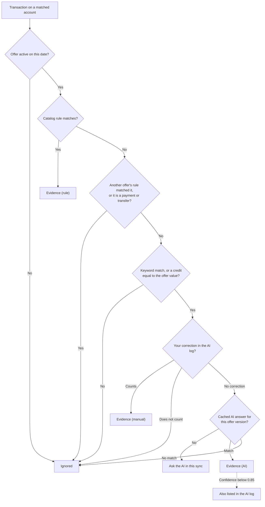
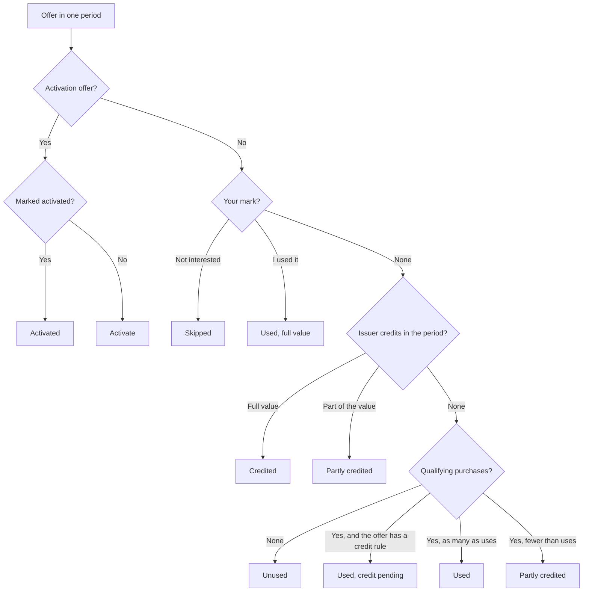
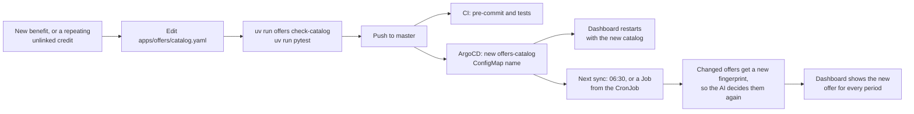

Offers (`apps/offers/`) reads the transactions in Actual Budget each day. It shows which card credits are used and which are unused in the current period. It also sends Telegram reminders before unused credits expire. Open the dashboard at `https://offers.sudhanva.me`.

## How Offers Works



- Catalog: `apps/offers/catalog.yaml` lists the cards and their offers. Kustomize puts the file in the ConfigMap `offers-catalog`. A change to the file restarts the dashboard, and the next sync uses it.
- Sync: The `offers-sync` CronJob runs each day at 06:30 America/Los_Angeles. It reads the on-budget accounts and all their transactions from Actual Budget. To read fewer days, set `OFFERS_LOOKBACK_DAYS`. It does not change Actual Budget.
- Dashboard: The `offers` Deployment serves a single-page app (React, TanStack Router and Query, shadcn/ui) and a JSON API under `/api` from the SQLite file. It writes only your corrections. The app source is in `apps/offers/web/`, and the container build compiles it.
- No manual work: The sync decides every offer state. The dashboard shows the result. You correct a state only when it is wrong.
- Card accounts: The `account` pattern of a card matches the names of Actual accounts. Each matched account gets its own copy of each offer.

## Daily Sync



## Decision Order

Offers decides each transaction in this order:

- Step 1: A rule in the catalog decides a clear match. A rule match is final.
- Step 2: Your correction in the AI log decides a transaction that the rules cannot decide.
- Step 3: The AI decides the remaining transactions that contain a keyword of an offer. Offers applies every AI answer.
- Step 4: The AI log lists the answers with a confidence below `0.85`, so that you can check them. You do not have to.



Offers in the same `group` share one pool of orders. After the decisions, each purchase in a group stays with one offer only.

The AI never overrules a rule. It sees a transaction only when no rule matched it. Offers keeps each AI answer in SQLite with the offer fingerprint. The AI sees each transaction once for each version of an offer. When you change an offer in the catalog, the AI decides its transactions again. Each sync asks the AI a maximum of 40 times (`OFFERS_AI_MAX_CALLS`). If the AI is not available, the transactions wait for the next sync.

The AI prompt contains the card name, the offer, and the date, amount, payee, and bank description of the transaction. It does not contain the account name.

## Offer States

| State | Meaning |
| --- | --- |
| Credited | The issuer posted the full credit |
| Partly credited | The issuer posted part of the credit, or you used some of the promos of a multi-use offer |
| Used, credit pending | A qualifying purchase exists, and the credit is not posted yet |
| Used | A qualifying purchase exists for an offer that the issuer applies in an app, for example Uber Cash or a Lyft credit. Or you marked the offer as used |
| Unused | No evidence in this period |
| Skipped | You skipped the offer for this period |
| Activate | An activation offer, for example quarterly 5% categories. Transactions cannot show an activation, so the dashboard shows it as a reminder, not as an open offer |

Offers computes the state of each offer in each period from the evidence and your mark:



The history of each offer starts at the first transaction of its account in Actual Budget. A period before that date does not count as missed. The card totals on the dashboard count the current calendar year. The offer pages show the full history.

## Step 1: Read the Dashboard

- Open `https://offers.sudhanva.me`. The month name and the arrows at the top select the month. Each past month keeps its result.
- **Unused** lists the offers with no evidence in the period, ordered by deadline. A circle marks each one.
- **Awaiting credit** lists the purchases that wait for an issuer credit.
- **Used** lists the used and credited offers. A green check mark marks each one.
- The holder buttons show one person's cards. **By card** groups the offers by card.
- The **Cards** page compares the captured credits of the year with each annual fee, and lists the credits that no offer explains.
- Select an offer name to see its history and the transactions that count for it.

The quarterly activations show as reminders above the list.

## Step 2: Correct a State

You do not have to do anything. Correct a state only when it is wrong:

- In the **…** menu of an offer, select **I used it** for a use that Actual Budget cannot show. For example, Uber Cash that paid a full trip has no card transaction.
- Select **Not interested this period** to remove an offer from the unused list.
- Select **Undo** to remove a correction.
- The **AI log** lists the AI answers with a low confidence. Select **Wrong? Flip it** to reverse one. Offers keeps each correction in the `user_decisions` table as a test case.

## Step 3: Get Telegram Reminders

The sync sends these messages to the Telegram chat in `TELEGRAM_CHAT_ID`. The bot token comes from `kv/telegram/bot` (property `token`).

| Message | When |
| --- | --- |
| Offers that end soon | An offer is unused or partly credited, and its period ends in 5 days or less (`OFFERS_REMINDER_DAYS`). For an activation offer, in the first 5 days of its period |
| Monthly summary | On the first sync of days 1 to 3 of a month, for the periods that ended in the previous month |

The `notifications` table keeps a key for each message, so a message goes out one time only.

## Step 4: Change the Catalog

Add an offer when a card gets a new benefit, when you add an Amex Offer or a Chase Offer to a card, or when **Credits not linked to an offer** shows a credit that repeats. A merchant offer, for example `amex-offer-paramount-plus`, is an offer with `valid_from` and `valid_to` set to the dates of the offer. Change an offer when its value, period, merchants, or end date changes. To retire an offer, set `valid_to`. Do not delete it, because the history of past periods uses it.



Each card has these fields:

| Field | Meaning |
| --- | --- |
| `id` | Lowercase identifier |
| `name`, `issuer` | Display names |
| `annual_fee` | The fee in dollars. The dashboard compares the captured credits with it |
| `account` | A case-insensitive regular expression for the Actual account names of this card. Use the product name only. Do not put account numbers in the catalog |
| `fee_payee` | Optional. A regular expression for the annual fee transaction. The month of the latest fee sets the card-member year |
| `anniversary_month` | Optional. The first month of the card-member year, used when Actual Budget has no annual fee transaction |

Each offer has these fields:

| Field | Meaning |
| --- | --- |
| `id`, `card`, `name` | The offer identifier, the card `id`, and the display name |
| `value` | The value in dollars for each period |
| `period` | `monthly`, `quarterly`, `semiannual`, `annual`, or `cardmember_year` |
| `kind` | `credit` (default) or `activation` |
| `valid_from`, `valid_to` | Optional dates. Past periods keep the offer as it was |
| `enrollment` | `true` if the offer needs enrollment or activation |
| `uses` | The number of uses in a period, for an offer made of more than one promo. For example, two promos of $10 have `value: 20` and `uses: 2`. One qualifying purchase then shows the offer as partly used |
| `group` | Optional. Offers in the same group are separate promos that one order cannot share. Each purchase counts for the first offer in catalog order that matches it and has a use left |
| `how_to_use` | A short instruction for the dashboard and the AI |
| `detect.credit` | A rule for the credit that the issuer posts on the card |
| `detect.usage` | A rule for a qualifying purchase. Set `scope: any` if a purchase on any account counts |
| `detect.keywords` | Whole words that send a transaction to the AI when no rule matches |
| `detect.ai_hint` | The eligibility text that the AI uses |

A rule has a `payee` regular expression, which Offers tests against the payee name and against the bank description. It can also have `min_amount` and `max_amount`.

Validate the catalog before you push:

```bash
cd apps/offers
uv run offers check-catalog
uv run pytest
```

## Step 5: Run a Sync Now

Start a Job from the CronJob:

```bash
kubectl -n offers create job --from=cronjob/offers-sync offers-sync-manual
kubectl -n offers logs -f job/offers-sync-manual
```

## Bank Sync

Offers reads the transactions that are in Actual Budget. Run the bank sync in Actual Budget to import new transactions. To let Offers run the Actual bank sync before each read, set `OFFERS_BANK_SYNC` to `"true"` in `apps/offers/cronjob.yaml`. The bank sync is the only write from Offers to Actual Budget.
