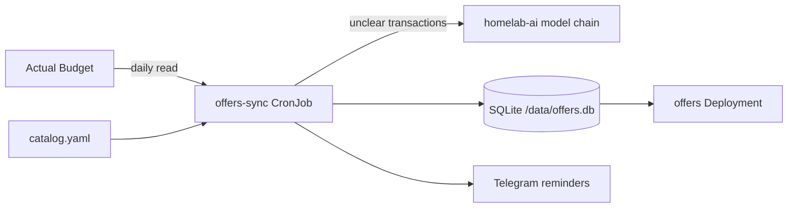
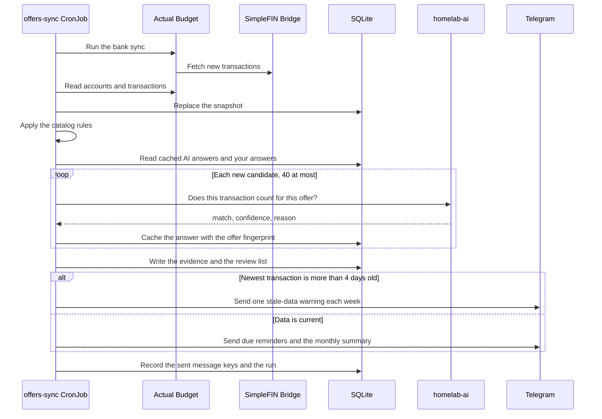
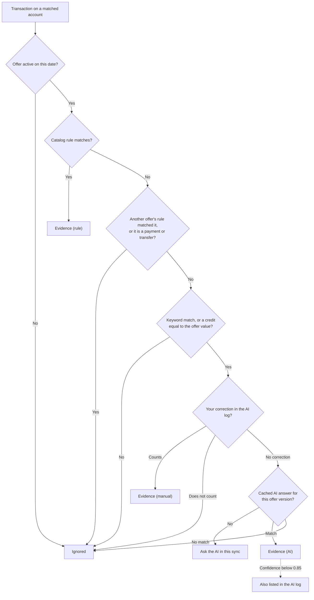
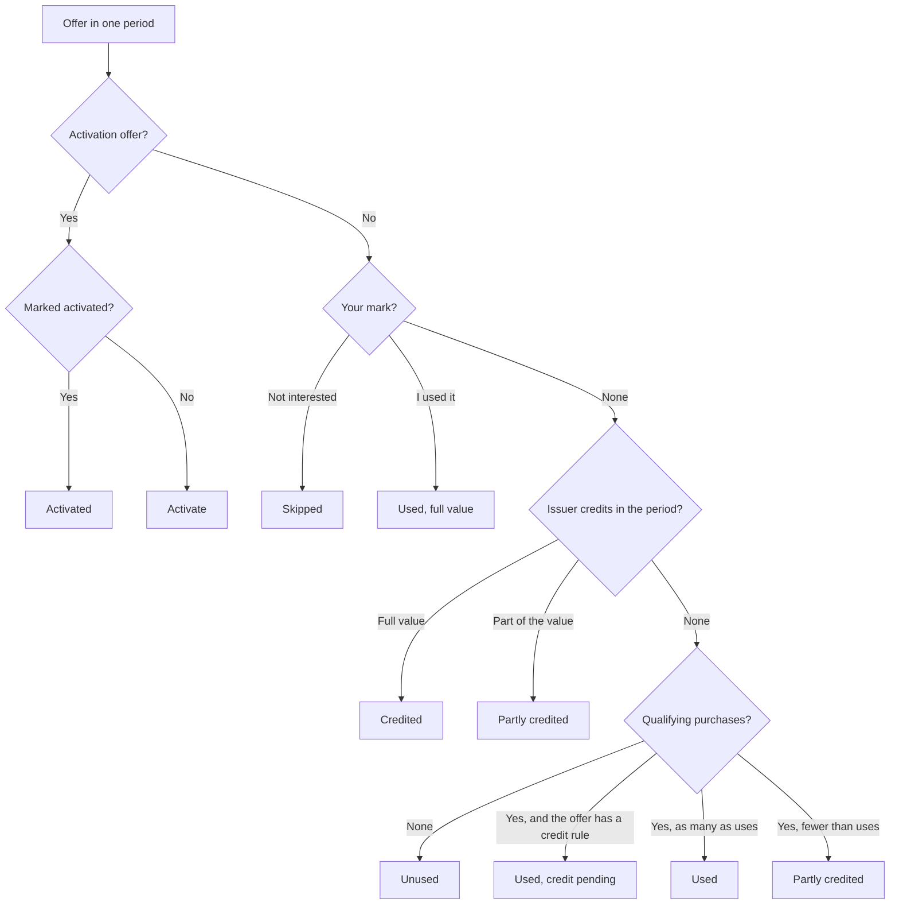
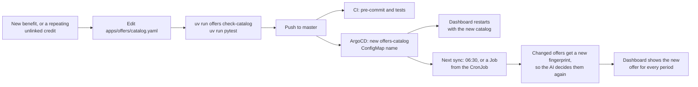

Offers (`apps/offers/`) reads the transactions in Actual Budget each day. It shows which card credits are used and which are unused in the current period. It also sends Telegram reminders before unused credits expire. Open the dashboard at `https://offers.sudhanva.me`.

## How Offers Works



- Catalog: `apps/offers/catalog.yaml` lists the cards and their offers. Kustomize puts the file in the ConfigMap `offers-catalog`. A change to the file restarts the dashboard, and the next sync uses it.
- Sync: The `offers-sync` CronJob runs each day at 06:30 America/Los_Angeles. It runs the Actual Budget bank sync, then reads the on-budget accounts and all their transactions. The bank sync is the only change that Offers makes to Actual Budget. Keep `OFFERS_LOOKBACK_DAYS` empty: each sync replaces the stored transactions, so a shorter lookback removes the history of long periods.
- Dashboard: The `offers` Deployment serves a single-page app (React, TanStack Router and Query, shadcn/ui) and a JSON API under `/api` from the SQLite file. It writes only your corrections. The app source is in `apps/offers/web/`, and the container build compiles it.
- No manual work: The sync decides every offer state that transactions can show. You correct a state only when the transactions cannot show it, for example an in-app credit that paid an order in full, or an activation.
- Two kinds of offer: An in-app credit sits in an app account, for example Uber Cash or the DoorDash promos, and applies to an order. An order on the platform, paid with the card, uses it. A statement credit posts back to the card, for example the dining credit or an Amex Offer. The posted credit shows it.
- Card accounts: The `account` pattern of a card matches the names of Actual accounts. Each matched account gets its own copy of each offer.

## Daily Sync



## Decision Order

Offers decides each transaction in this order:

- Step 1: A rule in the catalog decides a clear match. A rule match is final.
- Step 2: Your correction in the AI log decides a transaction that the rules cannot decide.
- Step 3: The AI decides the remaining transactions that contain a keyword of an offer. Offers applies every AI answer.
- Step 4: The AI log lists the answers with a confidence below `0.85`, so that you can check them. You do not have to.



After the decisions, Offers applies these steps:

- A credit counts for one offer only, the first offer in catalog order whose rule matches it.
- A credit moves to the period of the purchase that it pays back: the latest earlier purchase for the same offer, within 45 days. A credit that posts in the next month counts for the month of the purchase.
- A credit that posts up to 60 days after the end date of an offer still counts.
- In an offer with `promos`, each purchase in date order takes the first free promo whose `payee` matches it. A promo without `payee` takes a purchase only when no specific promo matches.
- Offers in the same `group` share one pool of orders. Each purchase in a group stays with one offer only.

The AI never overrules a rule. It sees a transaction only when no rule matched it. Offers keeps each AI answer in SQLite with the offer fingerprint. The AI sees each transaction once for each version of an offer. When you change an offer in the catalog, the AI decides its transactions again. Each sync asks the AI a maximum of 40 times (`OFFERS_AI_MAX_CALLS`). If the AI is not available, the transactions wait for the next sync.

The AI prompt contains the card name, the offer, and the date, amount, payee, and bank description of the transaction. It does not contain the account name.

## Offer States

| State | Meaning |
| --- | --- |
| Credited | The issuer posted the full credit |
| Partly credited | The issuer posted part of the credit, or you used some of the promos of a multi-use offer |
| Used, credit pending | A qualifying purchase exists, and the credit is not posted yet |
| Used | A qualifying purchase exists for an offer that the issuer applies in an app, for example Uber Cash or a Lyft credit. Or you marked the offer as used |
| Unused | No evidence in this period |
| Skipped | You skipped the offer for this period |
| Activate | An activation offer, for example quarterly 5% categories. Transactions cannot show an activation, so the dashboard shows it as a reminder, not as an open offer |

Offers computes the state of each offer in each period from the evidence and your mark:



A period ends at the end date of its offer. A period that starts before the first transaction of its account shows "Before your data" instead of "Missed".

The history of each offer starts at the first transaction of its account in Actual Budget. A period before that date does not count as missed. The card totals on the dashboard count the current calendar year. The offer pages show the full history.

## Step 1: Read the Tracker

Open `https://offers.sudhanva.me`. The tracker shows each card with its offers as rows and the last six months as columns. The current month has a shaded column.

| Mark | Meaning |
| --- | --- |
| Green check | Used or credited |
| Half circle | Partly used. The caption shows the uses or the amount |
| Dashed ring | Open in the current period. The caption shows the amount left, or the days left in the last 7 days |
| Red cross | Missed. The period ended unused |
| Question mark | The period starts before your data, so earlier use is not visible |
| Clock | A purchase waits for its credit |
| Dash | You marked it not interested |

- An offer with a longer period, for example a half-year credit, shows one wide cell across its months.
- An amber dot on a cell means that matching orders were paid with another card. Pay with this card to use the credit.
- The summary at the top shows the credits used this month, the amount still open, and the amount missed last month.
- A banner shows when Actual Budget has no transactions in the last 4 days.
- Select a cell or an offer name to see each period with the transactions that count for it.
- The **Cards** page compares the captured credits of the year with each annual fee, and lists the credits that no offer explains.

## Step 2: Correct a State

You do not have to do anything. Correct a period only when the transactions cannot show it:

- On the offer page, select **I used it** for a period that an in-app credit paid in full. Select **I activated it** for an activation.
- Select **Not interested** to stop an open period from counting.
- Select **Undo** to remove a correction.
- The **AI log** lists the AI answers with a low confidence. Select **Wrong? Flip it** to reverse one. Offers keeps each correction in the `user_decisions` table as a test case.

## Step 3: Get Telegram Reminders

The sync sends these messages to the Telegram chat in `TELEGRAM_CHAT_ID`. The bot token comes from `kv/telegram/bot` (property `token`).

| Message | When |
| --- | --- |
| Offers that end soon | An offer is unused or partly credited, and its period ends in 5 days or less (`OFFERS_REMINDER_DAYS`). For an activation offer, in the first 5 days of its period |
| Monthly summary | When the data covers the previous month, for the periods that ended in that month. One message for each month |
| Stale data | Once each week while the newest transaction is more than 4 days old. Reminders about unused credits and the monthly summary wait until the data is current. Activation reminders do not wait |

The `notifications` table keeps a key for each message, so a message goes out one time only.

## Step 4: Change the Catalog

Add an offer when a card gets a new benefit, when you add an Amex Offer or a Chase Offer to a card, or when **Credits not linked to an offer** shows a credit that repeats. A merchant offer, for example `amex-offer-paramount-plus`, is an offer with `valid_from` and `valid_to` set to the dates of the offer. Change an offer when its value, period, merchants, or end date changes. To retire an offer, set `valid_to`. Do not delete it, because the history of past periods uses it.



Each card has these fields:

| Field | Meaning |
| --- | --- |
| `id` | Lowercase identifier |
| `name`, `issuer` | Display names |
| `annual_fee` | The fee in dollars. The dashboard compares the captured credits with it |
| `account` | A case-insensitive regular expression for the Actual account names of this card. Use the product name only. Do not put account numbers in the catalog |
| `fee_payee` | Optional. A regular expression for the annual fee transaction. The month of the latest fee sets the card-member year |
| `anniversary_month` | Optional. The first month of the card-member year, used when Actual Budget has no annual fee transaction |

Each offer has these fields:

| Field | Meaning |
| --- | --- |
| `id`, `card`, `name` | The offer identifier, the card `id`, and the display name |
| `value` | The value in dollars for each period |
| `period` | `monthly`, `quarterly`, `semiannual`, `annual`, `cardmember_year`, or `once`. A `once` offer has one period from `valid_from` to `valid_to`, for example an activation that you do one time |
| `kind` | `credit` (default) or `activation` |
| `valid_from`, `valid_to` | Optional dates. Past periods keep the offer as it was |
| `enrollment` | `true` if the offer needs enrollment or activation |
| `uses` | The number of uses in a period, for an offer of equal uses. One qualifying purchase of a two-use offer shows it as partly used |
| `promos` | Optional. A list of promos with a `name`, a `value`, and an optional `payee` regular expression. Offers sets `value` to their sum and `uses` to their number. Use it when the promos have different values or different merchants, for example the DoorDash promos |
| `group` | Optional. Offers in the same group are separate promos that one order cannot share. Each purchase counts for the first offer in catalog order that matches it and has a use left |
| `how_to_use` | A short instruction for the dashboard and the AI |
| `detect.credit` | A rule for the credit that the issuer posts on the card |
| `detect.usage` | A rule for a qualifying purchase. Set `scope: any` if a purchase on any account counts |
| `detect.keywords` | Whole words that send a transaction to the AI when no rule matches |
| `detect.ai_hint` | The eligibility text that the AI uses |

A rule has a `payee` regular expression, which Offers tests against the payee name and against the bank description. It can also have `min_amount` and `max_amount`.

Validate the catalog before you push:

```bash
cd apps/offers
uv run offers check-catalog
uv run pytest
```

## Step 5: Run a Sync Now

Start a Job from the CronJob:

```bash
kubectl -n offers create job --from=cronjob/offers-sync offers-sync-manual
kubectl -n offers logs -f job/offers-sync-manual
```

## Bank Sync

The sync runs the Actual Budget bank sync before it reads the transactions (`OFFERS_BANK_SYNC: "true"` in `apps/offers/cronjob.yaml`). The bank sync imports new transactions from SimpleFIN Bridge, in the same way as the **Sync** button in Actual Budget. If the bank sync fails, the sync logs a warning and continues. The stale-data warning then tells you on Telegram. To stop the bank sync, set `OFFERS_BANK_SYNC` to `"false"`.
