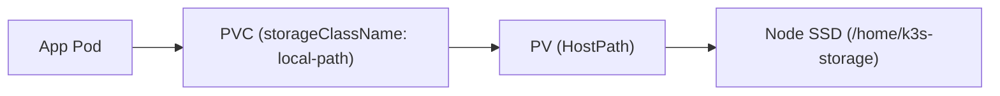

# Persistent Storage (Local-Path Provisioner)

The cluster uses the built-in K3s `local-path-provisioner` to make persistent storage dynamically. The storage is on the NVMe/SSD drive at `/home/k3s-storage`.



## Storage Architecture

The local-path provisioner creates hostPath persistent volumes when a claim needs one. Each PVC gets its own directory on the host in `/home/k3s-storage/`. The directory name contains the PVC name and its UUID:

```bash
/home/k3s-storage/pvc-<uuid>_<namespace>_<pvc-name>/
```

### Storage Configuration in K3s

Ansible sets the storage root path in `/etc/rancher/k3s/config.yaml` when it provisions the host:

```yaml
default-local-storage-path: "/home/k3s-storage"
```

## Step 1: Verify the StorageClass

The `local-path` StorageClass is the default storage class on the cluster. To see it, run:

```bash
kubectl get storageclass
```

Expected output:

```text
NAME                   PROVISIONER             RECLAIMPOLICY   VOLUMEBINDINGMODE      ALLOWVOLUMEEXPANSION   AGE
local-path (default)   rancher.io/local-path   Delete          WaitForFirstConsumer   false                  1h
```

The volume binding mode is `WaitForFirstConsumer`. Thus, the provisioner creates the persistent volume only after the scheduler puts the pod that uses the claim on a node.

## Step 2: Requesting Storage in Applications

To get storage for an application, declare a standard `PersistentVolumeClaim` manifest that refers to `local-path`:

```yaml
apiVersion: v1
kind: PersistentVolumeClaim
metadata:
  name: app-data
  namespace: default
spec:
  accessModes:
    - ReadWriteOnce
  storageClassName: local-path
  resources:
    requests:
      storage: 10Gi
```

Attach the volume in the pod specification:

```yaml
spec:
  containers:
    - name: app
      image: alpine:latest
      volumeMounts:
        - name: data
          mountPath: /data
  volumes:
    - name: data
      persistentVolumeClaim:
        claimName: app-data
```

## Step 3: Inspecting Volumes on the Host

To examine the storage directly on the host machine, run:

```bash
ssh sudhanva@100.66.139.118 "sudo ls -la /home/k3s-storage"
```

The owner of each persistent volume directory is `root:root`. The directories have standard container permissions (`0777` or a user-defined UID).

## Step 4: Backup and Disaster Recovery

All volumes are in `/home/k3s-storage`. Thus, backups are easy and do not stop the workloads:

- Restic or Borg: Point your backup client directly to `/home/k3s-storage` to make deduplicated, encrypted snapshots.
- Rsync: Copy the directory to remote network-attached storage or to an external drive.
