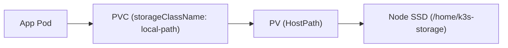

# Persistent Storage (Local-Path Provisioner)

The cluster uses the K3s `local-path-provisioner` to create persistent volumes when a claim needs one. The volumes are on the NVMe SSD at `/home/k3s-storage`.



## Storage Architecture

The local-path provisioner creates a hostPath persistent volume for each PVC. Each PVC gets its own directory in `/home/k3s-storage/`. The directory name contains the PVC UUID, the namespace, and the PVC name:

```bash
/home/k3s-storage/pvc-<uuid>_<namespace>_<pvc-name>/
```

### Storage Configuration in K3s

The `k3s_server` Ansible role writes the storage path to `/etc/rancher/k3s/config.yaml`. The value comes from `local_storage_path` in `ansible/group_vars/all.yaml`.

```yaml
default-local-storage-path: "/home/k3s-storage"
```

## Step 1: Verify the StorageClass

The `local-path` StorageClass is the default storage class on the cluster. To see it, run:

```bash
kubectl get storageclass
```

Expected output:

```text
NAME                   PROVISIONER             RECLAIMPOLICY   VOLUMEBINDINGMODE      ALLOWVOLUMEEXPANSION   AGE
local-path (default)   rancher.io/local-path   Delete          WaitForFirstConsumer   false                  1h
```

The volume binding mode is `WaitForFirstConsumer`. The provisioner creates the persistent volume only after the scheduler puts the pod that uses the claim on a node.

## Step 2: Request Storage for an Application

To get storage for an application, declare a `PersistentVolumeClaim` that refers to `local-path`:

```yaml
apiVersion: v1
kind: PersistentVolumeClaim
metadata:
  name: app-data
  namespace: default
spec:
  accessModes:
    - ReadWriteOnce
  storageClassName: local-path
  resources:
    requests:
      storage: 10Gi
```

Attach the volume in the pod specification:

```yaml
spec:
  containers:
    - name: app
      image: alpine:latest
      volumeMounts:
        - name: data
          mountPath: /data
  volumes:
    - name: data
      persistentVolumeClaim:
        claimName: app-data
```

## Step 3: Examine Volumes on the Host

To examine the storage on the host machine, run:

```bash
ssh sudhanva@100.66.139.118 "sudo ls -la /home/k3s-storage"
```

The owner of each persistent volume directory is `root:root`. The directory permissions are `0777`, or the permissions that the container sets for its user ID.

## Step 4: Back Up the Volumes

All volumes are in `/home/k3s-storage`. You can back up this directory while the workloads run:

- Restic or Borg: Set the backup source to `/home/k3s-storage` to make deduplicated, encrypted snapshots.
- Rsync: Copy the directory to network-attached storage or to an external drive.
