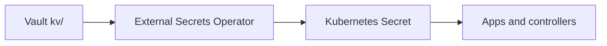
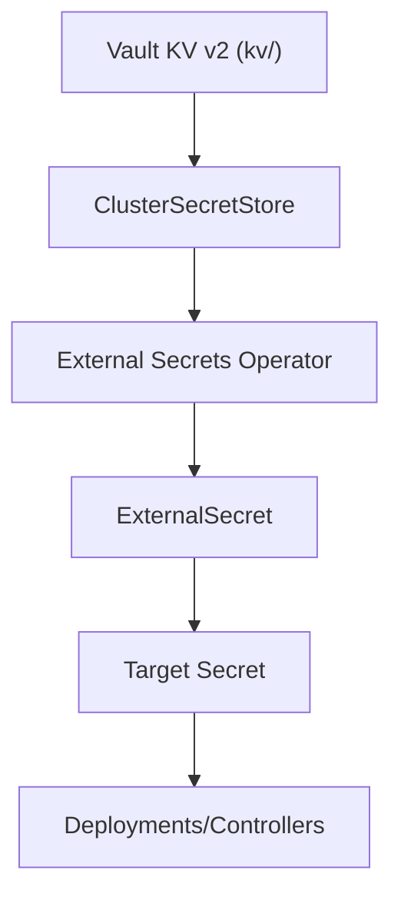

# Vault Secrets

Move the cluster secrets into Vault. Then use External Secrets Operator to sync them into Kubernetes.



## Detailed Secret Sync Path



## Step 1: Deploy Vault and External Secrets Operator

Push the repository changes. ArgoCD syncs `infrastructure/vault/` and `infrastructure/external-secrets/`.

Verify that the pods are ready:

```bash
kubectl -n vault get pods
kubectl -n external-secrets get pods
```

If Vault is Pending, verify that the PVC binds to local-path storage:

```bash
kubectl -n vault get pvc
```

## Step 2: Initialize and unseal Vault

Keep the unseal keys and the root token offline, for example in a password manager. If you lose them, the only recovery is to wipe the Vault PVC and initialize Vault again. This deletes all stored secrets.

Initialize Vault. The `vault operator init` command prints five unseal keys with a threshold of three. Save the unseal keys and the root token in a safe location.

```bash
kubectl -n vault exec -it vault-0 -- vault operator init
```

Unseal Vault with the necessary number of keys:

```bash
kubectl -n vault exec -it vault-0 -- vault operator unseal
```

Log in with the root token:

```bash
kubectl -n vault exec -it vault-0 -- vault login
```

## Step 3: Enable the KV v2 secrets engine

Enable KV v2 at `kv/`. This path agrees with the ExternalSecret store configuration:

```bash
kubectl -n vault exec -it vault-0 -- vault secrets enable -path=kv kv-v2
```

## Step 4: Create secrets in Vault

Write the secrets that Kubernetes uses now:

```bash
kubectl -n vault exec -it vault-0 -- vault kv put kv/external-dns/cloudflare api-token="REPLACE_ME"
kubectl -n vault exec -it vault-0 -- vault kv put kv/cert-manager/cloudflare api-token="REPLACE_ME"
kubectl -n vault exec -it vault-0 -- vault kv put kv/tailscale/operator-oauth client_id="REPLACE_ME" client_secret="REPLACE_ME"
```

### Step 4a: Filebrowser credentials

Generate a bcrypt hash of the password:

```bash
htpasswd -bnBC 12 filebrowser "REPLACE_ME" | cut -d ':' -f2
```

Store the username, plaintext password, and bcrypt hash:

```bash
kubectl -n vault exec -it vault-0 -- vault kv put kv/filebrowser/auth \
  username="filebrowser" \
  password="REPLACE_ME" \
  password_hash="REPLACE_ME"
```

### Step 4b: ArgoCD Image Updater credentials

Store registry and Git credentials for ArgoCD Image Updater:

```bash
kubectl -n vault exec -it vault-0 -- vault kv put kv/argocd-image-updater/ghcr \
  username="REPLACE_ME" token="REPLACE_ME"

kubectl -n vault exec -it vault-0 -- vault kv put kv/argocd-image-updater/dockerhub \
  username="REPLACE_ME" token="REPLACE_ME"

kubectl -n vault exec -it vault-0 -- vault kv put kv/argocd/repo-creds \
  username="REPLACE_ME" token="REPLACE_ME"
```

## Step 5: Configure Kubernetes auth for External Secrets Operator

External Secrets Operator logs in to Vault with its own ServiceAccount. Vault issues a short-lived token for each login, so no static token expires.

Write a read-only policy for `kv/`:

```bash
kubectl -n vault exec -it vault-0 -- /bin/sh -c 'cat > /tmp/eso-policy.hcl <<EOF
path "kv/data/*" {
  capabilities = ["read"]
}
path "kv/metadata/*" {
  capabilities = ["read", "list"]
}
EOF'
kubectl -n vault exec -it vault-0 -- vault policy write eso-policy /tmp/eso-policy.hcl
```

Enable the Kubernetes auth method. Vault runs in the cluster, so it uses its own ServiceAccount and CA to review tokens:

```bash
kubectl -n vault exec -it vault-0 -- vault auth enable kubernetes
kubectl -n vault exec -it vault-0 -- vault write auth/kubernetes/config \
  kubernetes_host="https://kubernetes.default.svc:443"
```

Bind the `external-secrets` ServiceAccount to the policy. The role accepts only tokens with the `vault` audience:

```bash
kubectl -n vault exec -it vault-0 -- vault write auth/kubernetes/role/external-secrets \
  bound_service_account_names=external-secrets \
  bound_service_account_namespaces=external-secrets \
  policies=eso-policy \
  audience=vault \
  ttl=1h
```

The ClusterSecretStore in `infrastructure/external-secrets/clustersecretstore.yaml` refers to this role. ArgoCD syncs it.

## Step 6: Add new secrets and ExternalSecret resources

To add a new secret, write it to Vault first. Then create an ExternalSecret manifest in the same folder as the workload that uses the secret.

Example Vault write:

```bash
kubectl -n vault exec -it vault-0 -- vault kv put kv/my-app/api token="REPLACE_ME"
```

Example ExternalSecret manifest. Save it as a separate YAML file, such as `apps/my-app/externalsecret.yaml` or `infrastructure/<component>/external-secret.yaml`:

```yaml
apiVersion: external-secrets.io/v1
kind: ExternalSecret
metadata:
  name: my-app-api
  namespace: my-app
spec:
  refreshInterval: 1h
  secretStoreRef:
    name: vault
    kind: ClusterSecretStore
  target:
    name: my-app-api
    creationPolicy: Owner
  data:
  - secretKey: token
    remoteRef:
      key: my-app/api
      property: token
```

Commit the new manifest. ArgoCD syncs it.

## Step 7: Validate ExternalSecret sync

Verify that External Secrets Operator created or updated the target secrets:

```bash
kubectl -n external-dns get secret cloudflare-api-token
kubectl -n cert-manager get secret cloudflare-api-token
kubectl -n tailscale get secret operator-oauth
```

Every Secret that comes from Vault has `creationPolicy: Owner`, so External Secrets Operator owns it. Do not create or edit these Secrets with `kubectl`.

## Vault paths and the ExternalSecrets that read them

This table lists every ExternalSecret in the repo. All paths are under the KV v2 mount `kv/`. The `homelab-ai-credentials` ExternalSecret comes from the kustomize Component `packages/homelab-ai/kustomize/`, so each app that includes the Component gets its own copy in its namespace.

| Vault path | Properties read | ExternalSecret (namespace/name) | Manifest |
| --- | --- | --- | --- |
| `kv/argocd-image-updater/ghcr` | `username`, `token` | `argocd/argocd-image-updater-registries` | `infrastructure/external-secrets/external-secret-argocd-image-updater-registries.yaml` |
| `kv/argocd-image-updater/dockerhub` | `username`, `token` | `argocd/argocd-image-updater-registries` (synced, not used by Image Updater) | `infrastructure/external-secrets/external-secret-argocd-image-updater-registries.yaml` |
| `kv/argocd/repo-creds` | `username`, `token` | `argocd/repo-homelab` | `infrastructure/external-secrets/external-secret-argocd-repo-creds.yaml` |
| `kv/cert-manager/cloudflare` | `api-token` | `cert-manager/cloudflare-api-token` | `infrastructure/external-secrets/external-secret-cloudflare-cert-manager.yaml` |
| `kv/cert-manager/cloudflare` | `api-token` | `tailscale/cloudflare-api-token` | `infrastructure/external-secrets/external-secret-cloudflare-cert-manager-tailscale.yaml` |
| `kv/external-dns/cloudflare` | `api-token` | `external-dns/cloudflare-api-token` | `infrastructure/external-secrets/external-secret-cloudflare-external-dns.yaml` |
| `kv/tailscale/operator-oauth` | `client_id`, `client_secret` | `tailscale/operator-oauth` | `infrastructure/external-secrets/external-secret-tailscale-operator.yaml` |
| `kv/monitoring/grafana-admin` | `admin-user`, `admin-password` | `monitoring/grafana-admin` | `infrastructure/prometheus/external-secret-grafana.yaml` |
| `kv/telegram/bot` | `token`, `chat_id` | `monitoring/alertmanager-telegram` | `infrastructure/prometheus/external-secret-telegram.yaml` |
| `kv/telegram/bot` | `token` | `gmail-classifier/gmail-credentials-personal`, `gmail-classifier/gmail-credentials-family` | `apps/gmail-classifier/secret-personal.yaml`, `apps/gmail-classifier/secret-family.yaml` |
| `kv/telegram/bot` | `token` | `drive-organizer/drive-credentials-personal`, `drive-organizer/drive-credentials-family` | `apps/drive-organizer/secret-personal.yaml`, `apps/drive-organizer/secret-family.yaml` |
| `kv/gmail/credentials` | `client_id`, `client_secret`, `refresh_token` | `gmail-classifier/gmail-credentials-personal` | `apps/gmail-classifier/secret-personal.yaml` |
| `kv/gmail/credentials` | `client_id`, `client_secret`, `refresh_token` | `drive-organizer/drive-credentials-personal` | `apps/drive-organizer/secret-personal.yaml` |
| `kv/google/accounts/family` | `client_id`, `client_secret`, `refresh_token` | `gmail-classifier/gmail-credentials-family` | `apps/gmail-classifier/secret-family.yaml` |
| `kv/google/accounts/family` | `client_id`, `client_secret`, `refresh_token` | `drive-organizer/drive-credentials-family` | `apps/drive-organizer/secret-family.yaml` |
| `kv/actual` | `password` | `actual-classifier/actual-classifier-secrets` | `apps/actual-classifier/secret.yaml` |
| `kv/filebrowser/auth` | `username`, `password_hash` | `media/filebrowser-auth` | `apps/filebrowser/external-secret-auth.yaml` |
| `kv/qbittorrent/vpn` | `private_key`, `public_key`, `endpoint_ip`, `endpoint_port`, `addresses` | `media/qbittorrent-vpn` | `apps/qbittorrent/external-secret-vpn.yaml` |
| `kv/technitium/admin` | `admin-user`, `admin-password` | `technitium/technitium-admin` | `apps/technitium/external-secret.yaml` |
| `kv/openrouter` | `api_key` | `<namespace>/homelab-ai-credentials` in `actual-classifier`, `monitoring`, `drive-organizer`, and `gmail-classifier` | `packages/homelab-ai/kustomize/externalsecret.yaml` |
| `kv/anthropic` | `api_key`, `workspace_id` | `<namespace>/homelab-ai-credentials` in `actual-classifier`, `monitoring`, `drive-organizer`, and `gmail-classifier` | `packages/homelab-ai/kustomize/externalsecret.yaml` |

Vault can also hold paths that no manifest reads, for example the plaintext `password` property in `kv/filebrowser/auth`, or logins for the media apps that you keep for yourself. The cluster does not use these values. To find the readers of a path, search the repo:

```bash
git grep -n "key: <path>" -- apps infrastructure packages
```

## Step 8: Access the Vault UI

Vault is available at `https://vault.sudhanva.me` through the Tailscale Gateway.

## Step 9: Back Up Secrets to Bitwarden

Back up all cluster secrets and Vault keys to Bitwarden for disaster recovery.

Store all entries in the dedicated Bitwarden `Homelab` folder (`b4bcc38c-4296-41a4-b9b3-b4c50047ce37`).

Use the consistent naming format `Homelab - <Component> <Role>`.

Add custom field `tag: homelab` to every entry.

### Required Bitwarden Backup Items

- **`Homelab - HashiCorp Vault Master Keys`**: Stores the five unseal keys, unseal threshold (3), and root token.
- **`Homelab - HashiCorp Vault Keys Raw JSON Backup`**: Stores the raw JSON initialization response.
- **`Homelab - ArgoCD Admin`**: Stores the ArgoCD admin password.
- **`Homelab - ArgoCD GitHub & GHCR Token`**: Stores the GitHub personal access token for git repository and container registry access.
- **`Homelab - Cloudflare API Token`**: Stores the DNS-01 API token for cert-manager and external-dns.
- **`Homelab - Tailscale Operator OAuth`**: Stores the Tailscale operator OAuth client ID and secret.
- **`Homelab - qBittorrent WireGuard VPN`**: Stores the WireGuard private key, public key, and endpoint parameters.

Run this command with the Bitwarden CLI to verify the synchronized items:

```bash
bw list items --folderid b4bcc38c-4296-41a4-b9b3-b4c50047ce37
```

## Troubleshooting

### Vault UI blank page

Large UI bundles can time out through the Gateway. If the Vault UI shows a blank page in the browser but `curl` works, examine the Envoy Gateway logs. Look for `response_timeout` entries on `/ui/assets/...`.

Update the Vault HTTPRoute to increase the request timeout:

```yaml
apiVersion: gateway.networking.k8s.io/v1
kind: HTTPRoute
metadata:
  name: vault
  namespace: vault
spec:
  rules:
  - timeouts:
      request: 60s
      backendRequest: 60s
```

Commit the change. ArgoCD syncs `infrastructure/gateway/vault-httproute.yaml`.

### ClusterSecretStore not ready

If `infra-external-secrets` is Degraded or ExternalSecrets show `SecretSyncedError`, examine the ClusterSecretStore and the Kubernetes auth role:

```bash
kubectl -n external-secrets get clustersecretstore vault -o yaml
kubectl -n vault exec -it vault-0 -- vault read auth/kubernetes/role/external-secrets
kubectl -n external-secrets logs deploy/external-secrets | grep -i vault
```

The ClusterSecretStore becomes Ready only when Vault is unsealed and the `external-secrets` role exists.

### ExternalSecrets still failing after Vault recovery

If you initialized Vault again, or added secrets after External Secrets failed, force a resync.

Step 1: Request a reconcile for all ExternalSecrets.

```bash
kubectl get externalsecrets -A -o jsonpath='{range .items[*]}{.metadata.namespace}{" "}{.metadata.name}{"\n"}{end}' | while read -r ns name; do
  kubectl -n "$ns" annotate externalsecret "$name" reconcile.external-secrets.io/requested-at="$(date -u +%Y-%m-%dT%H:%M:%SZ)" --overwrite
done
```

Step 2: Examine the sync status.

```bash
kubectl get externalsecrets -A
```
