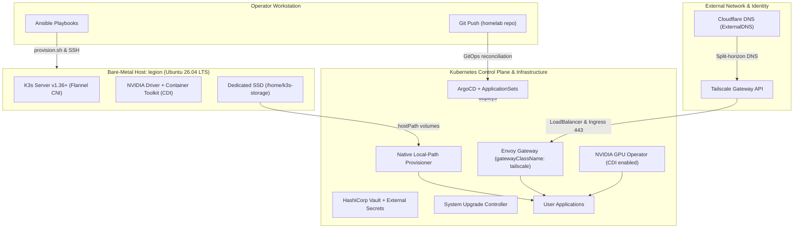

import { Aside, Card, CardGrid, LinkCard, Tabs, TabItem } from '@astrojs/starlight/components';

## What You'll Build

You build a self-hosted bare-metal Kubernetes cluster on node `legion`. Clients connect to its services over Tailscale through Envoy Gateway:

| Service | Hostname | Port | Purpose |
|---------|----------|------|---------|
| ArgoCD | `argocd.sudhanva.me` | 443 | GitOps control plane UI |
| Vault | `vault.sudhanva.me` | 443 | Central secret management |
| Grafana | `grafana.sudhanva.me` | 443 | Metrics and dashboards |
| Prometheus | `prometheus.sudhanva.me` | 443 | Metrics collection |
| Alertmanager | `alertmanager.sudhanva.me` | 443 | Alert routing |
| Headlamp | `headlamp.sudhanva.me` | 443 | Kubernetes cluster management UI |
| Home | `home.sudhanva.me` | 443 | Dashboard with links to the services |
| Jellyfin | `jellyfin.sudhanva.me` | 443 | Media streaming with NVIDIA GTX 1050 Ti transcoding |
| Filebrowser | `filebrowser.sudhanva.me` | 443 | File manager for persistent media volumes |
| Technitium DNS | `dns.sudhanva.me` | 443 | Authoritative and recursive DNS server |
| Home Assistant | `homeassistant.sudhanva.me` | 443 | Smart home automation platform |
| Gemma 4 AI | `ai.sudhanva.me` | 443 | Local LLM inference (Google Gemma 4 E2B on GPU) |
| Docs | `homelab.sudhanva.me` | 443 | Cluster documentation site |

## Architecture

## Prerequisites

<Tabs>
  <TabItem label="Hardware">
    - Bare-metal machine (node `legion`) with Ubuntu 26.04 LTS installed
    - Minimum 4 CPU cores, 16GB RAM
    - Dedicated SSD/NVMe mounted at `/home/k3s-storage`
    - NVIDIA GeForce GTX 1050 Ti GPU for hardware acceleration
    - A stable LAN connection and a static IP
  </TabItem>
  <TabItem label="Accounts">
    - A Tailscale account with a Tailnet OAuth client for the Kubernetes operator
    - A Cloudflare account with a managed domain (`sudhanva.me`) and an API token for ExternalDNS and cert-manager
    - A personal GitHub repository with an access token for ArgoCD Image Updater
  </TabItem>
  <TabItem label="Workstation">
    - macOS or Linux workstation
    - Ansible, OpenSSH, and `kubectl` installed
    - SSH key access to the target node (`sudhanva@legion`) with passwordless sudo
  </TabItem>
</Tabs>

## What's Included

<CardGrid stagger>
  <Card title="GitOps with ArgoCD" icon="github">
    ApplicationSets reconcile the cluster from declarative manifests. When you push a change to Git, it deploys automatically.
  </Card>
  <Card title="Ubuntu 26.04 & K3s v1.36+" icon="rocket">
    Lightweight Kubernetes for production use, with Flannel CNI. Ansible provisions the node with no manual steps.
  </Card>
  <Card title="Envoy Gateway & Tailscale" icon="setting">
    Kubernetes Gateway API with the Tailscale operator, split-horizon DNS, and automatic Let's Encrypt TLS.
  </Card>
  <Card title="Vault & External Secrets" icon="approve-check">
    HashiCorp Vault keeps the secrets in one location. External Secrets Operator writes them as native Kubernetes secrets.
  </Card>
  <Card title="Local-Path SSD Storage" icon="document">
    Dynamic hostPath storage on a dedicated SSD at `/home/k3s-storage`, with no distributed storage overhead.
  </Card>
  <Card title="NVIDIA GPU Acceleration" icon="laptop">
    Hardware acceleration for the GTX 1050 Ti with the NVIDIA GPU Operator and the Container Device Interface (CDI).
  </Card>
  <Card title="Automated Upgrades" icon="seti:pipeline">
    Rancher System Upgrade Controller does declarative K3s upgrades with no downtime.
  </Card>
</CardGrid>

## Component Stack

| Layer | Components | Configuration Location |
|-------|------------|------------------------|
| Host & OS | Ubuntu 26.04 LTS (node `legion`) | `ansible/inventory/hosts.yaml` |
| Kubernetes | K3s `v1.36+` (`v1.36.4+k3s1`), Flannel CNI | `ansible/group_vars/all.yaml` |
| Storage | Native Local-Path Provisioner (`/home/k3s-storage`) | `ansible/roles/k3s_server/` |
| Ingress & Networking | Envoy Gateway `v1.9.1`, Tailscale Operator, ExternalDNS, CoreDNS | `infrastructure/gateway/`, `infrastructure/envoy-gateway/` |
| GitOps | ArgoCD `v3.5.2`, ApplicationSets, Image Updater | `bootstrap/`, `infrastructure/argocd-image-updater/` |
| Secrets | HashiCorp Vault `0.34.1`, External Secrets Operator `2.10.0` | `infrastructure/vault/`, `infrastructure/external-secrets/` |
| Hardware / GPU | NVIDIA GPU Operator `v26.7.0` (CDI enabled) | `infrastructure/gpu/` |
| Lifecycle | System Upgrade Controller (Plan `k3s-server`) | `infrastructure/system-upgrade-controller/` |
| Monitoring | kube-prometheus-stack, Grafana, Alertmanager | `infrastructure/prometheus/` |
| Alerting | Telegram bot (@ManassuHomelabBot) through Alertmanager | `infrastructure/prometheus/` |
| Security | Kubescape Operator | `infrastructure/kubescape/` |

## Quick Links

<CardGrid>
  <LinkCard title="From Scratch" href="/how-to/from-scratch/" description="The full procedure to start a bare-metal cluster" />
  <LinkCard title="Gateway & Ingress" href="/explanation/gateway-networking/" description="Envoy Gateway and Tailscale integration" />
  <LinkCard title="Persistent Storage" href="/how-to/storage/" description="Local-Path storage architecture on /home/k3s-storage" />
  <LinkCard title="Version Matrix" href="/reference/versions/" description="Pinned versions for all cluster components" />
</CardGrid>
