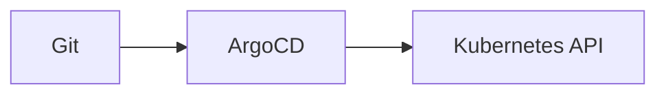

The documentation uses [Astro Starlight](https://starlight.astro.build/) and the [Divio documentation system](https://docs.divio.com/documentation-system/).

## Content Organization

| Section | Purpose | Example |
|---------|---------|---------|
| **Tutorials** | Learning-oriented walkthroughs | Setting up the cluster |
| **How-To Guides** | Problem-oriented procedures | Adding a worker node |
| **Explanation** | Understanding-oriented concepts | GitOps automation model |
| **Reference** | Information-oriented lookup | Version matrix |

## File Locations

```text
docs/src/content/docs/
├── tutorials/      # Step-by-step learning paths
│   └── index.md    # Tutorial overview (slug: tutorials)
├── how-to/         # Task-specific procedures
├── explanation/    # Architecture and concepts
├── reference/      # Component catalogs and matrices
└── index.mdx       # Landing page
```

## Frontmatter Requirements

Each document must have frontmatter with a title, a description, and keywords:

```yaml
---
title: Descriptive Title with Keywords
description: Clear description for search results (150-160 chars)
keywords:
  - primary keyword
  - secondary keyword
  - related terms
sidebar:
  order: 1
---
```

Starlight shows the `title` as the page heading. Do not add a `#` heading at the top of the page, because the page then shows two titles. Start the body with text or a `##` heading.

The sidebar in `docs/astro.config.mjs` is a manual list of slugs. Starlight uses `sidebar.order` only for autogenerated sidebar groups, so the value has no effect here. When you add a page, add its slug to the sidebar in `docs/astro.config.mjs`. Otherwise the page builds but has no sidebar entry.

## Links

Link to other pages with root slugs, for example `/tutorials/system-prep/` or `/how-to/vault/#step-5-configure-kubernetes-auth-for-external-secrets-operator`. Do not use relative `.md` links. Starlight does not rewrite them, so they break on the built site.

## Naming Conventions

- Use lowercase kebab-case: `add-worker-node.md`
- Use task-based names: `deploy-apps.md` not `apps.md`
- Do not use numeric prefixes in filenames

## Mermaid Diagrams

The astro-mermaid plugin renders the diagrams:



## Writing Standard

Write all documentation in ASD-STE100 Simplified Technical English. The rules in this section apply to every page and README.

### Sentences and words

- Write procedural sentences with a maximum of 20 words. Write descriptive sentences with a maximum of 25 words.
- Write one instruction in each sentence. Use the imperative: "Run the plan." "Store the token in Vault."
- Use the active voice. Write the subject that does the action: "ArgoCD applies the manifest," not "The manifest is applied."
- Use the present tense for the current state. Use the future tense only for a result of a step.
- Use one word for one meaning. Use the same technical name each time, for example `homelab-ai`, ArgoCD, and Vault.
- Write a maximum of six sentences in a paragraph. Write one topic in each paragraph.
- Use articles ("the", "a"). Do not use "etc." Give the full list.

### Content

- Describe the system as it is now. Do not write history, such as what changed, what was removed, what an older version did, or what did not work. Git history and commit messages keep that record.
- State a requirement as a rule, and give the reason after it if the reader needs the reason: "Use a nameserver that blocks ads. Tailscale queries all global nameservers at the same time." Do not describe options that the system does not use, and do not write "not recommended, do this instead."
- Write facts that the repository or the cluster confirms. Give the file path, the command, or the value.
- For a feature that the repository does not have, write one sentence about the current scope, for example "The cluster has one server node." Do not write a procedure for it.

### Words and patterns to remove

- Do not use marketing words, for example robust, seamless, powerful, leverage, utilize, streamline, or cutting-edge.
- Do not use filler, for example "it is important to note," "simply," "just," "basically," or "in order to."
- Do not tell the reader what to think, for example "this is the key point" or "as you can see."
- Do not use emoji, decorative bold in sentences, or em dashes.
- Do not end a section with a summary of the same section.

### Format

- Do not use numbered lists. Write steps as headings or bullets that start with "Step 1", "Step 2", and so on.
- Use tables for lookup data. Use bullets for items that are parallel. Use prose for explanation.
- Put commands, paths, and values in code format.
- Do not use inline YAML comments.
