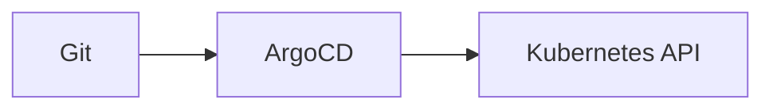

# Documentation Structure

The documentation uses [Astro Starlight](https://starlight.astro.build/) and the [Divio documentation system](https://docs.divio.com/documentation-system/).

## Content Organization

| Section | Purpose | Example |
|---------|---------|---------|
| **Tutorials** | Learning-oriented walkthroughs | Setting up the cluster |
| **How-To Guides** | Problem-oriented procedures | Adding a worker node |
| **Explanation** | Understanding-oriented concepts | GitOps automation model |
| **Reference** | Information-oriented lookup | Version matrix |

## File Locations

```text
docs/src/content/docs/
├── tutorials/      # Step-by-step learning paths
│   └── index.md    # Tutorial overview (slug: tutorials)
├── how-to/         # Task-specific procedures
├── explanation/    # Architecture and concepts
├── reference/      # Component catalogs and matrices
└── index.mdx       # Landing page
```

## Frontmatter Requirements

Each document must have frontmatter with a title, a description, and keywords:

```yaml
---
title: Descriptive Title with Keywords
description: Clear description for search results (150-160 chars)
keywords:
  - primary keyword
  - secondary keyword
  - related terms
sidebar:
  order: 1
---
```

The sidebar in `docs/astro.config.mjs` is a manual list of slugs. Starlight uses `sidebar.order` only for autogenerated sidebar groups, so the value has no effect here. When you add a page, add its slug to the sidebar in `docs/astro.config.mjs`. Otherwise the page builds but has no sidebar entry.

## Links

Link to other pages with root slugs, for example `/tutorials/system-prep/` or `/how-to/vault/#step-5-configure-kubernetes-auth-for-external-secrets-operator`. Do not use relative `.md` links. Starlight does not rewrite them, so they break on the built site.

## Naming Conventions

- Use lowercase kebab-case: `add-worker-node.md`
- Use task-based names: `deploy-apps.md` not `apps.md`
- Do not use numeric prefixes in filenames

## Mermaid Diagrams

The astro-mermaid plugin renders the diagrams:



## Writing Guidelines

- Follow the [AGENTS.md](https://github.com/nsudhanva/homelab/blob/master/AGENTS.md) conventions
- Do not use numbered lists. Write steps as headings or bullets that start with "Step 1", "Step 2", and so on
- Do not use inline YAML comments
- Write professional prose with no marketing language
