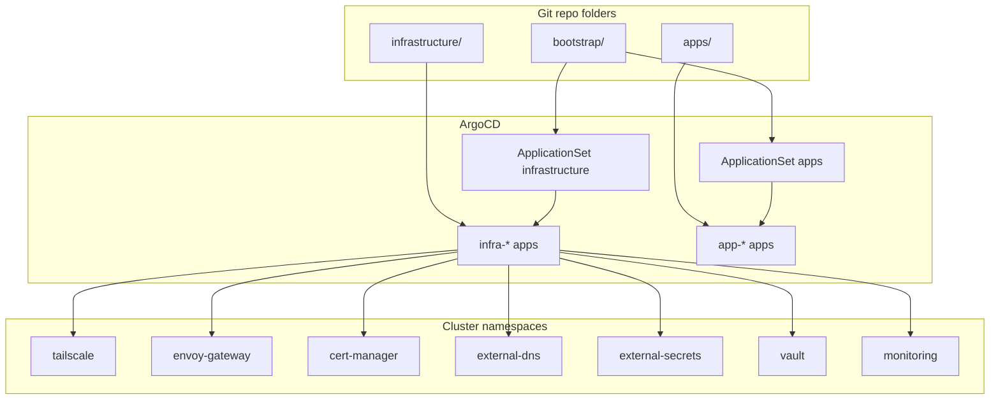

# Infrastructure Components

This page lists each infrastructure component, its path, and its function.

## ArgoCD ApplicationSets

Two ApplicationSets watch `apps/` and `infrastructure/` and create the ArgoCD Applications. These files define the ApplicationSets:

- `bootstrap/templates/infra-appset.yaml`
- `bootstrap/templates/apps-appset.yaml`

## Core infrastructure

K3s provides the Local-Path Provisioner itself (StorageClass `local-path`). It is not an `infrastructure/` component.

| Component | Path | Purpose | Notes |
| --- | --- | --- | --- |
| ArgoCD | `bootstrap/argocd/` | GitOps controller install (`v3.5.6`) | The `argocd` Ansible role applies it. No ApplicationSet manages it |
| ArgoCD Image Updater | `infrastructure/argocd-image-updater/` | Image updates for ArgoCD Applications | Uses the ImageUpdater CRD and the `argocd-image-updater-registries` Secret from Vault |
| Gateway API CRDs | `infrastructure/gateway-api-crds/gateway-api-crds.yaml` | Installs Gateway API CRDs and the safe-upgrades ValidatingAdmissionPolicy | ArgoCD pulls upstream `config/crd` at `v1.6.3` |
| Envoy Gateway CRDs | `infrastructure/envoy-gateway-crds/` | Installs Envoy Gateway CRDs | Kustomize pulls the upstream `v1.9.2` CRD bundle |
| Envoy Gateway | `infrastructure/envoy-gateway/envoy-gateway.yaml` | Ingress controller for Gateway API | Helm chart `v1.9.2` with image `v1.9.2`. Bundled CRDs are off (`crds.enabled: false`) |
| Tailscale Operator | `infrastructure/tailscale/tailscale-operator.yaml` | Tailnet integration and LoadBalancer proxy pods | Needs the `operator-oauth` Secret, which an ExternalSecret creates from Vault |
| cert-manager | `infrastructure/cert-manager/cert-manager.yaml` | TLS certificate management | Uses the DNS-01 challenge |
| ClusterIssuer | `infrastructure/cert-manager-issuer/cluster-issuer.yaml` | ACME issuer for wildcard certificates | Cloudflare API token solver |
| ExternalDNS | `infrastructure/external-dns/external-dns.yaml` | Creates DNS records for HTTPRoutes | Watches `external-dns.alpha.kubernetes.io/expose=true` |
| CoreDNS override | `infrastructure/coredns/configmap.yaml` | Rewrites `*.sudhanva.me` to `gateway-internal` | Split-horizon DNS for clients in the cluster |
| Tailscale DNS | `infrastructure/tailscale-dns/` | Split-horizon DNS for tailnet clients. HTTPRoute hosts resolve to the Gateway. Other names go to public DNS | CoreDNS exposed through a Tailscale LoadBalancer |
| External Secrets CRDs | `infrastructure/external-secrets-crds/` | Installs External Secrets CRDs | Kustomize pulls the upstream `v2.14.0` CRD bundle |
| External Secrets Operator | `infrastructure/external-secrets/external-secrets.yaml` | Syncs secrets from Vault | ClusterSecretStore and ExternalSecret manifests |
| Gateway | `infrastructure/gateway/` | GatewayClass, Gateway, EnvoyProxy, cert, internal-service | Uses the GatewayClass `tailscale` |
| Vault | `infrastructure/vault/vault.yaml` | Central secrets storage | PVC on `local-path` |
| Prometheus Operator CRDs | `infrastructure/prometheus-operator-crds/` | Prometheus CRDs | Sync wave `-2` |
| Prometheus stack | `infrastructure/prometheus/` | Metrics, alerting, dashboards | Grafana, Prometheus, Alertmanager, and HTTPRoutes |
| Kubescape | `infrastructure/kubescape/` | Cluster security scans | The operator runs in offline mode |
| Metrics Server | `infrastructure/metrics-server/` | CPU and memory metrics API | Headlamp uses it for the usage graphs |
| GPU Operator | `infrastructure/gpu/` | NVIDIA GPU Operator | Helm chart `v26.7.2` with Container Device Interface (CDI) as the default |
| System Upgrade Controller | `infrastructure/system-upgrade-controller/` | K3s upgrades | Kustomize pulls the upstream `v0.20.2` manifests and adds the `k3s-server` Plan |

## Gateway and route definitions

Each gateway and route resource has its own file:

- `infrastructure/gateway/gatewayclass.yaml`
- `infrastructure/gateway/gateway.yaml`
- `infrastructure/gateway/envoyproxy.yaml`
- `infrastructure/gateway/certificate.yaml`
- `infrastructure/gateway/internal-service.yaml`
- `infrastructure/gateway/argocd-httproute.yaml`
- `infrastructure/gateway/vault-httproute.yaml`
- `infrastructure/prometheus/httproute-grafana.yaml`
- `infrastructure/prometheus/httproute-prometheus.yaml`
- `infrastructure/prometheus/httproute-alertmanager.yaml`
