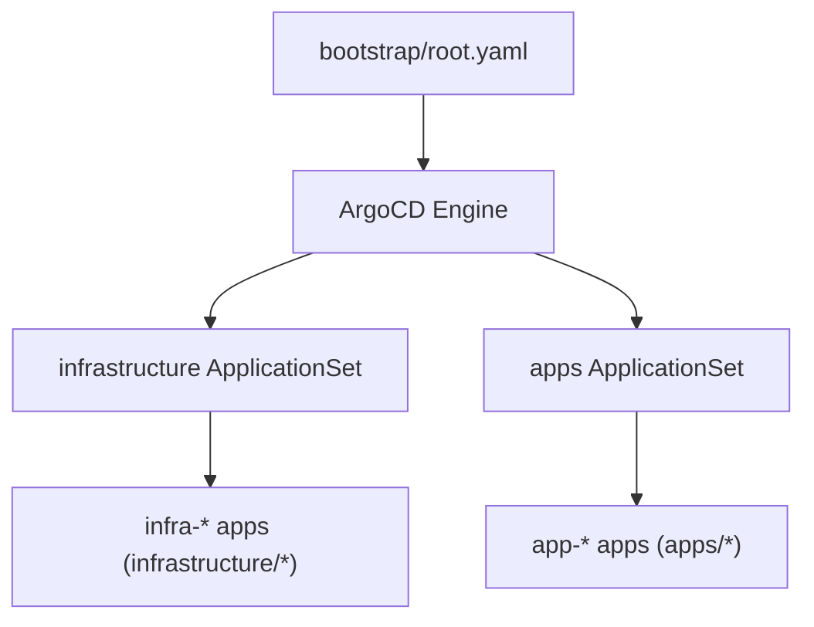

# ArgoCD and GitOps

ArgoCD applies the manifests in this repository to the cluster. It syncs the Kubernetes resources with `HEAD` of the repository (the `master` branch). The installed version is ArgoCD `v3.5.6`, pinned in `bootstrap/argocd/kustomization.yaml`.

## Step 1: Install ArgoCD

When you run `./scripts/provision.sh`, the Ansible role `ansible/roles/argocd` installs ArgoCD. The role also applies the root application.

To install or recover ArgoCD manually, run these commands:

```bash
kubectl apply --server-side --force-conflicts -k bootstrap/argocd
kubectl wait --for=condition=available --timeout=600s deployment/argocd-server -n argocd
```

Get the initial admin password:

```bash
kubectl -n argocd get secret argocd-initial-admin-secret -o jsonpath='{.data.password}' | base64 -d; echo
```

:::note

ArgoCD is available through the Gateway API at `argocd.sudhanva.me`.

TLS terminates at Envoy Gateway. Thus, `bootstrap/argocd/kustomization.yaml` applies `bootstrap/argocd/cmd-params-patch.yaml`. This patch sets `server.insecure: "true"` in the `argocd-cmd-params-cm` ConfigMap.

:::

## Step 2: Learn the ApplicationSet structure

The root Application `bootstrap` syncs `bootstrap/templates/`. This directory holds two ApplicationSets:



- `bootstrap/templates/infra-appset.yaml` (ApplicationSet `infrastructure`): Finds each subdirectory in `infrastructure/`. It creates one Application named `infra-<directory>` for each subdirectory.
- `bootstrap/templates/apps-appset.yaml` (ApplicationSet `apps`): Finds workloads through `apps/*/app.yaml`. It creates one Application named `app-<name>` for each workload, in the namespace from `app.yaml`.

Both ApplicationSets use automated sync with prune and self-heal.

## Step 3: Apply the root bootstrap application

To start the reconciliation of all infrastructure components and applications, run this command:

```bash
kubectl apply -f bootstrap/root.yaml
```

ArgoCD reconciles `root.yaml`, which creates the ApplicationSets. The ApplicationSets then generate and sync all applications in the cluster.

## Step 4: Verify application sync status

Make sure that all applications show `Synced` and `Healthy`:

```bash
kubectl get applications -n argocd
```

To add a workload or an infrastructure component, push the manifests to Git. ArgoCD deploys them automatically.
