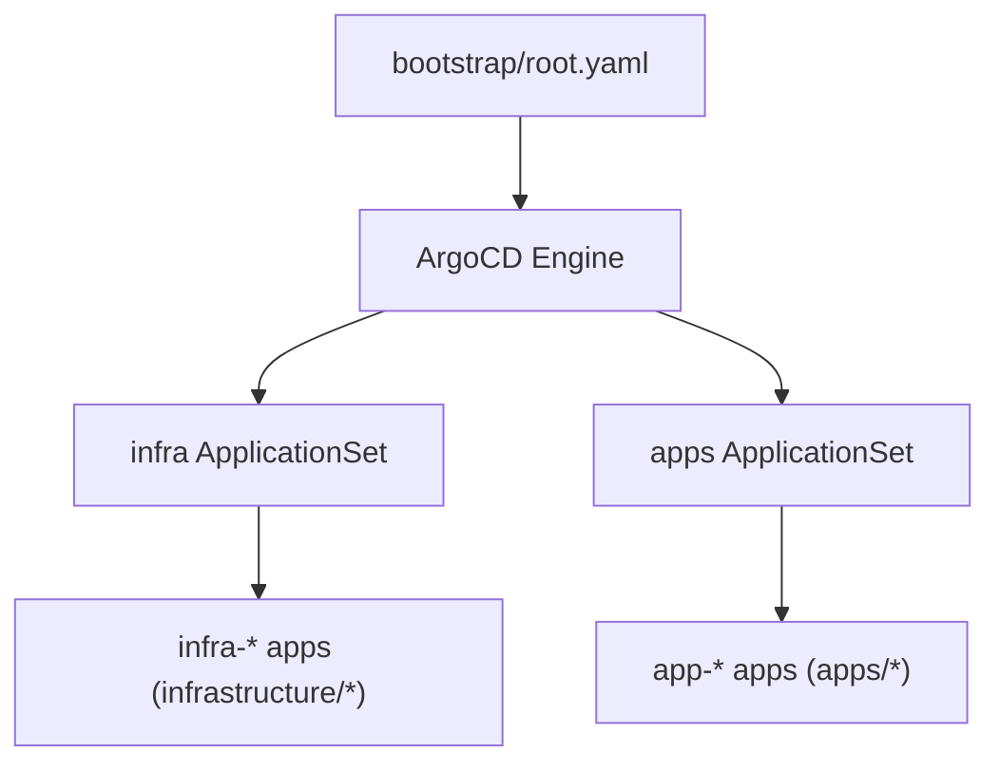

# ArgoCD and GitOps

ArgoCD is the main declarative engine for the cluster. It continuously syncs the Kubernetes resources with the master branch of this repository.

## Step 1: Automated vs Manual Installation

When you run `./scripts/provision.sh`, the Ansible role `ansible/roles/argocd` installs ArgoCD. It also applies the root application automatically.

If you must deploy or recover ArgoCD manually, run these commands:

```bash
kubectl apply --server-side --force-conflicts -k bootstrap/argocd
kubectl wait --for=condition=available --timeout=600s deployment/argocd-server -n argocd
```

Get the initial admin password:

```bash
kubectl -n argocd get secret argocd-initial-admin-secret -o jsonpath='{.data.password}' | base64 -d; echo
```

:::note

ArgoCD is available through the Gateway API at `argocd.sudhanva.me`.

TLS terminates at Envoy Gateway. Thus, the deployment includes `argocd-cmd-params-patch.yaml`, which sets `server.insecure: "true"`.

:::

## Step 2: The ApplicationSet pattern

The repository uses two ApplicationSets in `bootstrap/templates/`:



- **`bootstrap/templates/infra-appset.yaml`**: Finds each subdirectory in `infrastructure/` and deploys its manifests or Helm charts into the cluster.
- **`bootstrap/templates/apps-appset.yaml`**: Finds workloads through `apps/*/app.yaml`. It deploys the applications into their target namespaces with auto-prune and self-healing.

## Step 3: Apply the root bootstrap application

To start the reconciliation of all infrastructure components and applications, run this command:

```bash
kubectl apply -f bootstrap/root.yaml
```

ArgoCD reconciles `root.yaml`, which creates the ApplicationSets. The ApplicationSets then generate and sync all applications in the cluster.

## Step 4: Verify application sync status

Make sure that all applications show `Synced` and `Healthy`:

```bash
kubectl get applications -n argocd
```

To add a new workload or infrastructure component, push your manifests directly to Git. ArgoCD deploys them automatically.
