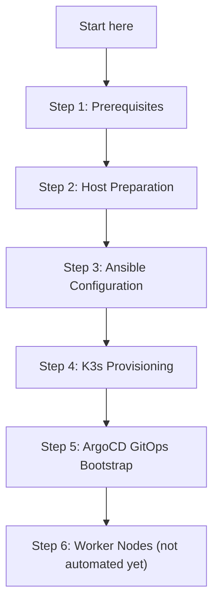

# Cluster Setup Tutorials

These tutorials show you, step by step, how to build a bare-metal K3s Kubernetes cluster from scratch. The cluster runs on node `legion` (Ubuntu 26.04 LTS).

## Tutorial Roadmap

Do these tutorials in sequence. The result is a single-node cluster that you can rebuild from this repository:

| Stage | Tutorial | Deliverable |
|---|---|---|
| Step 1 | [Prerequisites](/tutorials/prerequisites/) | Workstation dependencies and access credentials |
| Step 2 | [Host Preparation](/tutorials/system-prep/) | Ubuntu 26.04 installation, networking, and storage mount |
| Step 3 | [Ansible Configuration](/tutorials/containerd/) | Inventory variables and host role definitions |
| Step 4 | [K3s Bootstrap](/tutorials/kubernetes/) | Live K3s cluster with Flannel CNI and NVIDIA CDI |
| Step 5 | [ArgoCD and GitOps](/tutorials/argocd/) | Declarative infrastructure and app synchronization |
| Step 6 | [Add Workers](/tutorials/join-workers/) | What a second node needs. The repo does not automate worker joins yet |
