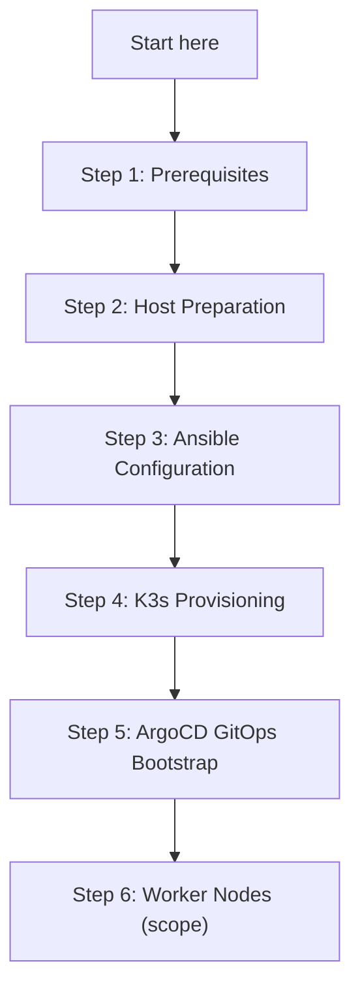

# Cluster Setup Tutorials

These tutorials build a bare-metal K3s cluster from an empty machine. The cluster runs on node `legion` (Ubuntu 26.04 LTS).

## Tutorial Roadmap

Do the tutorials in sequence. The result is a single-node cluster that you can rebuild from this repository.

| Stage | Tutorial | Result |
|---|---|---|
| Step 1 | [Prerequisites](/tutorials/prerequisites/) | Workstation tools and access credentials |
| Step 2 | [Host Preparation](/tutorials/system-prep/) | Ubuntu 26.04 installation, networking, and the storage mount |
| Step 3 | [Ansible Configuration](/tutorials/containerd/) | Inventory variables and host role settings |
| Step 4 | [K3s Bootstrap](/tutorials/kubernetes/) | A running K3s cluster with Flannel and NVIDIA CDI |
| Step 5 | [ArgoCD and GitOps](/tutorials/argocd/) | Infrastructure and applications that ArgoCD syncs from Git |
| Step 6 | [Add Workers](/tutorials/join-workers/) | The node scope of the cluster: one server node |
